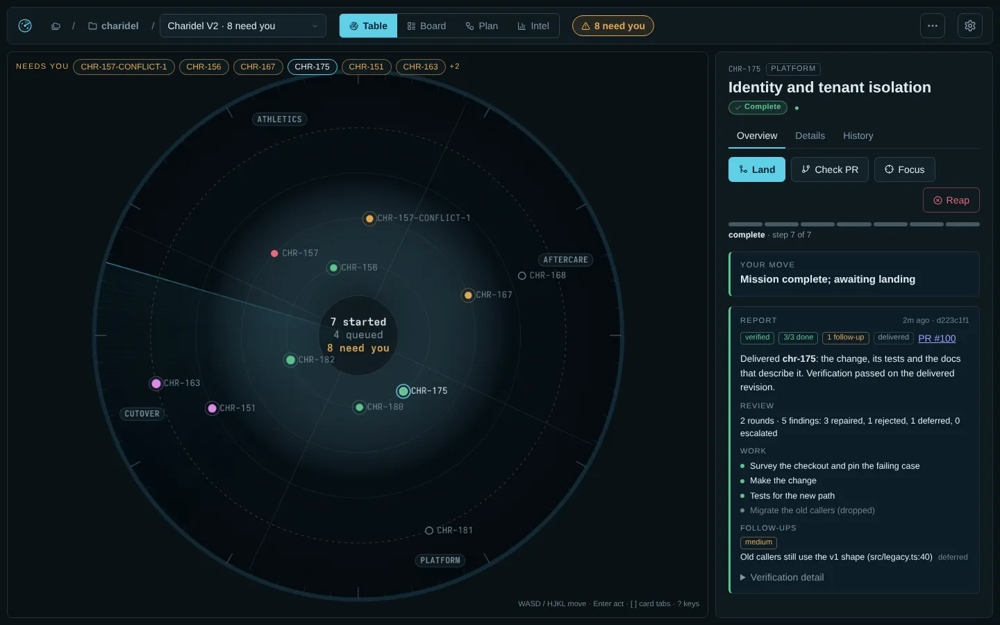
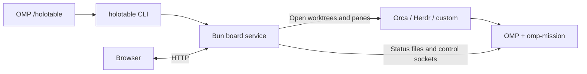
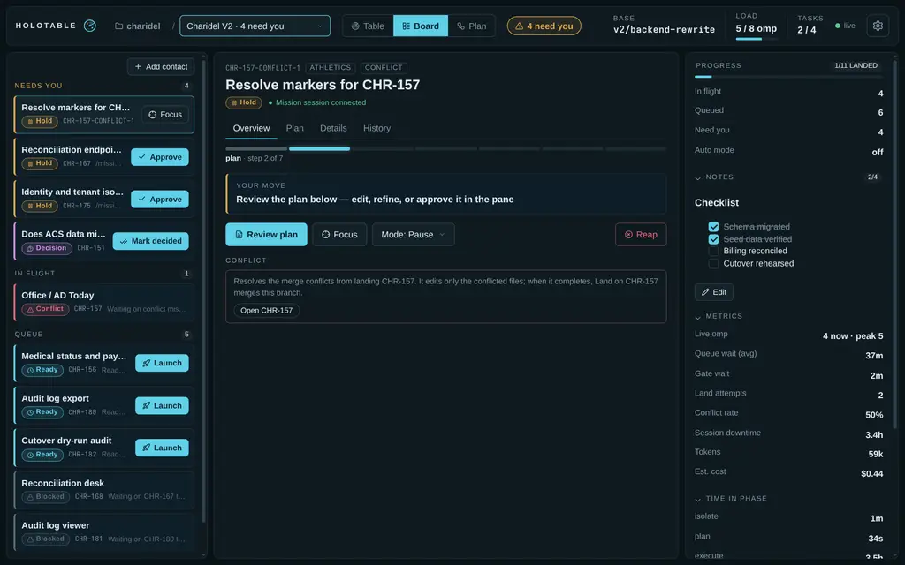
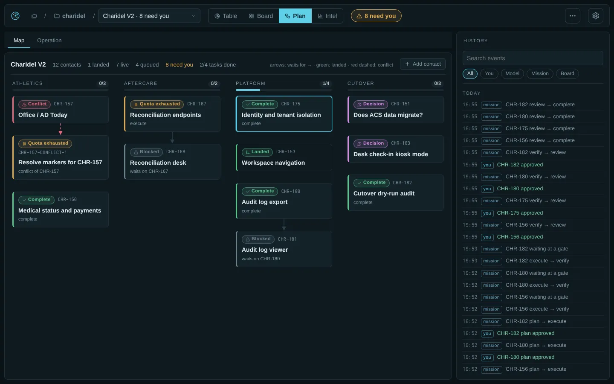
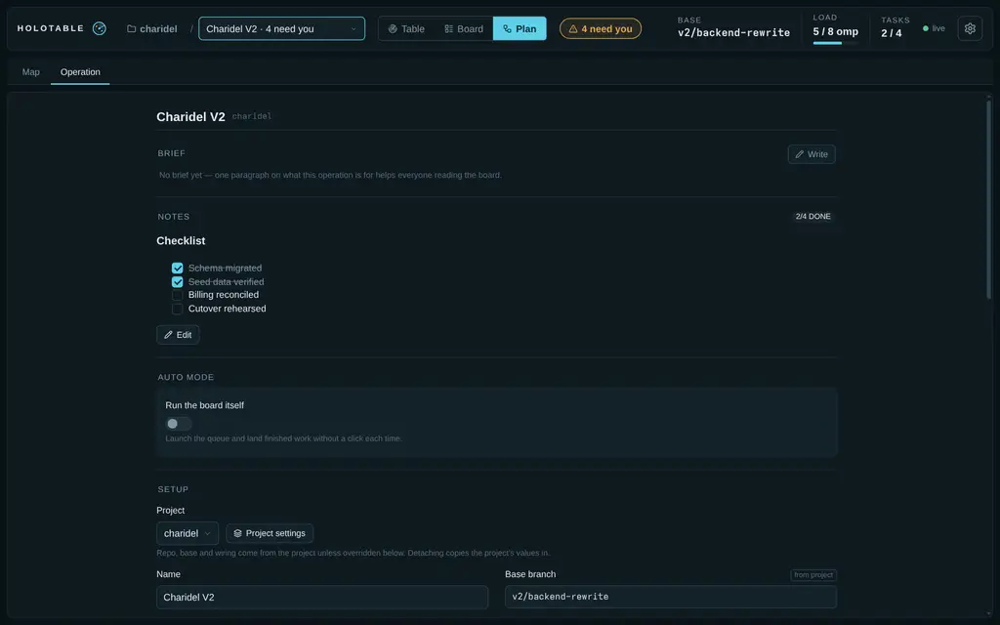
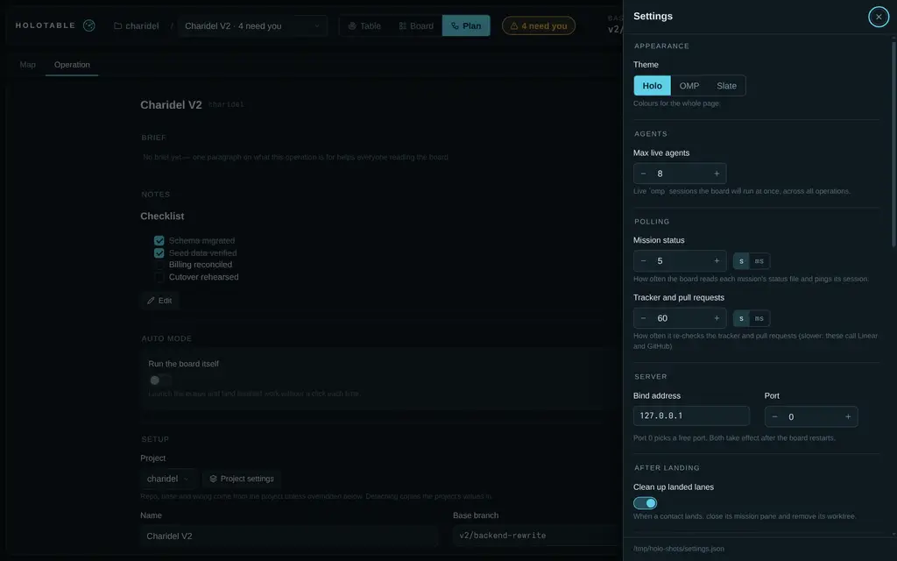

<div align="center">


<h1>Holotable</h1>

**Mission control for OMP.**

[](https://github.com/can1357/oh-my-pi)
[](https://bun.sh)
[](LICENSE)

[Summary](#summary) • [Install](#install) • [Quick start](#quick-start) • [OMP integration](#omp-integration)
<br>
[Documentation](#documentation) • [Roadmap](#roadmap) • [Credits](#credits)

</div>

## Summary

A local-first campaign board for [OMP](https://github.com/can1357/oh-my-pi). Organize repositories into **projects**, campaigns into **operations**, and tickets into **contacts**. See dependencies, live missions, approvals, verification, delivery, notes and history in one place.

Holotable opens and watches [omp-mission](https://github.com/Shadorain/omp-mission) sessions. It does not run a model or replace the mission controller. Plan approval stays in the mission pane; Pause gates, resume holds and ownership locks still apply. Launch and land are operator actions unless you explicitly enable an operation's auto mode or recovery.



## Install

Requires **OMP 18.4.4 or later**, [Bun](https://bun.sh/docs/installation) on `PATH`, and a browser. In OMP:

```text
/plugin install github:Shadorain/omp-mission
/plugin install github:Shadorain/holotable
```

OMP's Git installer installs runtime dependencies automatically.

**Restart OMP after installation.** Then run `/holotable` from a session in your own repository. It starts or reuses the production board and prints its URLs. No demo, container, database, separate server command or Holotable-specific model key is needed.

<details>
<summary>Install from a checkout instead</summary>

```bash
git clone https://github.com/Shadorain/holotable.git
cd holotable
bun install --frozen-lockfile
omp plugin link .
```

Install `omp-mission` too, restart OMP, then open a session in the repo you want to manage—not this tool's checkout—and run `/holotable`.

</details>

## Quick start

1. **Open the board.** In OMP, run `/holotable` and open one of its URLs. The Getting started card checks OMP, the mission extension and the integrations you use, with fixes for anything missing.
2. **Add your project.** Projects → New project. Pick the session's repo; review the detected base branch, tracker, frontend and delivery. To launch missions, choose Orca, Herdr or a custom terminal frontend.
3. **Create an operation.** Choose the project, name the campaign and add contacts. Or paste a Linear document/project URL, issue links, a markdown plan or a rough goal into **What**, then press **Draft it**. An OMP pane reads the sources and repository and writes the seed; review it before **Create**.
4. **Run the work.** Launch a ready contact. Approve its native plan from the card's Plan tab, then approve Pause gates and land completed work from the board. Dependencies keep blocked contacts queued and visible.

A question a mission asks appears under **Needs you** as **Question**. When the pane can take answers from the board, the card shows the full question and its options with the recommended one picked (checkboxes for multi-select), plus an **Other…** field for your own words. **Send answer** goes over the mission's control socket: omp-mission settles the pane's ask dialog exactly as if you had answered there, and the pane's copy closes. The board first re-reads the status and refuses (`stale`) if that question is gone or a different one is open. Panes started before this support show the question with **Answer in mission**, which brings the pane forward. Only an operator answers; auto mode and Recovery never do, and the board never resumes past a question. Plan approval is labeled **Plan**; verification holds are labeled **Verify**. All three stay in Needs you. Planning provider failures show their blocker instead of a misleading plan-approval prompt. Mission extensions load once per OMP process: panes started before question reporting was installed must be restarted to publish Ask dialogs; restarting only the board cannot update them.

A tool approval works the same way. When a mission pane stops on OMP's Approve/Deny prompt before running a tool (approval mode or a `tools.approval` policy asks), the contact shows **Question** under **Needs you**, and the card shows the tool, the command or summary, the full prompt, and one button for each of the pane's choices: **Approve**, any remembered grants or the for-this-session choice the prompt offers, and **Deny**. A click goes over the control socket, and omp-mission answers the pane's prompt exactly as that choice would. The board first re-reads the status and refuses (`stale`) if that approval is gone or a different one is open. Panes without this support (older omp-mission, or OMP before 18.11.3) show **Answer in mission**. Only an operator answers an approval. Auto mode and Recovery never do. Pause gates and plan approval are unchanged.

Submitting a mission action grays out that mission's controls across the list, card, Plan tab,
and mode picker until the response and a fresh board read arrive. Other missions remain usable.
Recovery dialogs show **Requesting…** and lock their model and targets while submitting.
Settings fields, project/operation creation, brief saves, and zone adds also disable their
submitting controls while waiting; rejected requests restore them. Request completion means
the command was acknowledged, not that the mission's background work has finished.

Start with **Settings → Agents → 2** on a small or heat-constrained machine. Auto mode and recovery are off by default; enable them per operation only when you want their documented behavior.

### Draft a plan or an idea

**Existing execution plan:** select the matching project, paste the document URL into **What**
and click **Draft it**. Linear documents are read with `lin docs get`; referenced issues and
relations supply live status and blockers. The agent is instructed to preserve parallel lanes,
explicit prerequisites, decisions, ownership boundaries and acceptance gates, not turn every
suggested ordering into a dependency. Review zones, contacts, `blockedBy` and the brief before
**Create**. Pasting a link without drafting does not import it.

**No tickets yet:** use a project with **Tracker → none** (for a new repo, open **Adjust**).
You can make a separate local project for the same repository rather than change a tracked
project's existing operations. Describe the goal, constraints and what success looks like in
**What**, then **Draft it**. The agent inspects the repo and proposes local mission ids, workstreams,
dependencies, acceptance checks and decision contacts for unresolved choices. No external tickets
are needed or created. Contacts have short titles and self-contained descriptions that carry
scope and acceptance checks; the brief records the campaign plan for review.

Drafting does not execute work or approve mission plans. After **Create**, each launched mission
develops its own detailed plan; approve it on the card's Plan tab or in its OMP pane.
tracking, drafts use real fetched tickets only. New unticketed work needs a local project or
tickets you create first. Check the draft: agent-generated dependencies and scope still need
operator review.


### Integration setup

Install only what your projects use. The board can display and organize work with `none` adapters; launching missions requires a terminal frontend and `omp-mission` loaded in the child OMP sessions.

|Integration|Setup|
|---|---|
|Orca terminals and worktrees|Install Orca and its `orca` CLI. Set the repo's worktree folder in Orca's project settings.|
|Herdr terminals|Install and configure Herdr and its `herdr` CLI.|
|Custom terminals|Set the command templates in Settings → Custom frontend.|
|GitHub tickets or PR delivery|Install `gh` and run `gh auth login`.|
|Linear tickets|Install and authenticate `lin`; `lin me` should succeed.|
|Local-merge delivery|Git and a clean integration worktree; no hosting-service credentials needed.|
|Bead graph (server-mode beads)|The project page shows the repo's Dolt graph server and can put it under a supervised `beads-dolt-<project>` systemd user unit (pinned port, `Restart=always`, `dolt.auto-start: false` so no mission pane starts a copy the Orca reaper would kill).|

### Open it from another machine

Default access is **Tailscale**, on port **4848** (or the next available port). Local URLs work without Tailscale. Settings → Server can restrict access to **This machine** or allow the **Network**. The full URL contains the API token: keep it private. HTTP is unencrypted; use a trusted network, Tailscale or an SSH tunnel.

## OMP integration

`/holotable` runs the bundled `holotable` CLI to start or reuse one board per `OMP_HOLOTABLE_HOME`, records the current repo for the project picker, prints the URLs and enables the model tools. Bun must be on `PATH`; linking the shell command is optional for OMP. The board stays up independently of the session.



The optional status row follows OMP's theme and omits zero counts. `holotable_state` reads the board; `holotable_queue` proposes or edits queued contacts. Neither tool launches, lands or approves work. Holotable can request a model for a new agent pane; model execution, provider routing, verification and review remain in OMP and the mission.

After updating the checkout, run `holotable restart` and start fresh OMP sessions before using
queue tools. Existing sessions can retain the old contact schema; refreshing the browser alone
does not reload those tools. Existing operations do not need to be closed or recreated.

The CLI is the cross-platform management interface. On Linux, the default home uses a resource-bounded **systemd user service** when available. Custom homes and other platforms use a detached Bun process. Your campaigns live outside the plugin checkout, under `~/.omp/agent/holotable` by default; updates do not replace them. See [Resource budgets](#resource-budgets).

<details>
<summary>Standalone CLI and service management</summary>

The OMP plugin installer does not put `holotable` on your shell's `PATH`. From a checkout with dependencies installed, expose the existing executable:

```bash
bun link
export PATH="${BUN_INSTALL:-$HOME/.bun}/bin:$PATH"
holotable --help
```

Keep the checkout in place: the command links to it. Keep Bun's bin directory on your shell's `PATH` for future terminals. Without linking, `bun bin/holotable.ts` runs the same CLI from the checkout.

All OMP sessions and shell commands using the same `OMP_HOLOTABLE_HOME` share **one board process**. Closing OMP does not stop it. The localhost, Tailscale IP and Tailscale DNS URLs are different addresses for that same board, not separate instances. A different home deliberately creates a separate board.

|Command|Effect|
|---|---|
|`holotable` / `holotable start`|start or reuse the board and print its URLs|
|`holotable status`|check the board and show its PID and URLs; exit code 3 means offline|
|`holotable url`|print the running board's URLs|
|`holotable list`|list operations; all `/holotable` store commands also work here|
|`holotable serve --access local`|run in the foreground; Ctrl+C stops this foreground board|
|`holotable stop`|gracefully stop this home's board, keeping campaign data|
|`holotable restart`|stop, then start this home's board; the URL token is kept|
|`holotable install --now`|install and enable the Linux default-home user service for login startup|
|`holotable uninstall`|stop and remove that Linux service; campaign data is kept|

Stopping the board stops watching and automatic board actions, not mission panes already owned by Orca or Herdr. In-flight actions finish before ownership is released. Stopping from OMP also clears that session's row and disables its tools. After a stop, `holotable start` or `/holotable` starts it again.

Global options go **before** the command: `holotable --home /path/to/campaigns status` controls a separate home; `holotable --json status` returns structured output. Shell selection is stored per home. Host integrations use `--current <id>` (or `--current ""` for none) to keep selection session-local.

Discovery is bound to its home: a copied `board.json`/`token` cannot let one home manage another home's board, and two homes always get separate processes.

`systemctl --user` remains useful for Linux logs and unit diagnostics, not required for normal lifecycle commands. After upgrading a board from a release without the shutdown API, restart it once with its original process manager before using CLI stop/restart.

</details>

## Use

```
/holotable project new lab --repo ~/projects/lab --base main
/holotable new lab-q3 --project lab
/holotable zone Ops
/holotable add notes --zone ops --kind decision
/holotable add api --zone ops --blocked-by notes
/holotable list
```

The page has three views over one projection. Each shows only what it is for; detail sits one tab or key away instead of on screen.

- **Table** (`1`): the radar and the selected contact's card. Zones are sectors; rings are lifecycle stages from the outside in (queued, planning, active, complete), so distance from the centre is progress. Contacts that need you pulse and are listed as chips across the top; selecting one draws its dependency chain. Move between orbs with **WASD**, **HJKL** or the arrow keys: each press goes to the nearest contact in that direction. One canvas: static when idle, about 30 fps with live missions or attention. Animation stops on other views, in a hidden tab, or with reduced motion.
- **Board** (`2`): the contact list, the card, and the operation panel (progress, notes and wiring). The list is ordered by what needs you: **Needs you**, **In flight**, **Queue**, and a collapsed **Landed**; each row is one line of title and one line of state, with the same next action the card leads with (Review plan, Approve, Switch model, Land, Launch, Mark decided, or Focus). An operation with no frontend or fleet shows its queue as **Blocked**, with the setting to change.
- **Plan** (`3`): compact dependency cards with state, ticket, a short title and a blocker cue, arranged by zone. Arrows show what waits on what (green once landed, red dashed for conflicts). Click to trace a chain and filter its history; double-click to open the full card. Its description is shown directly below the title, with no expand/collapse control.

**Holotable Intel** is separate: click **Intel** in the header to open the on-demand dashboard for the selected operation or archive. No Intel scripts, styles or evaluation payloads load in the base board. Evidence continues to be collected whether Intel is open or not; the execution views stay focused on running work.

The card has three tabs (`[` and `]` switch): **Overview** (progress, what happens next, actions, what it waits for and unblocks, conflict links), **Details** (origin, kind, tracker, delivery, workers, branch, worktree, terminal) and **History** (every event for this contact, with who caused it).

On the Operation page, zone pills filter the contacts table; click again or **All** to clear.
Filters survive polls per operation, and contact kinds use themed colored pills.
Ticket clicks there (or Cmd/Ctrl+click elsewhere) open the tracker issue, never a delivery PR.
PR links remain under the card's Delivery details; local contacts have no tracker link.

Destructive actions (Reap) need a second click. Disabled actions explain other refusals under the buttons; blocked contacts list prerequisites once, as navigable chips. Mission connectivity is a colored dot, with its status available on hover. Load shows measurements without instructional text. Results and failures appear as toasts; failures stay about 8 s and also go to the error inbox, a bell left of the settings gear (hidden while empty) whose badge counts unread errors. Opening it marks them read and lists them newest first with their time; Clear empties it, Esc closes it. The inbox lives only as long as the page. Keys are listed under [Views and keys](#views-and-keys). Below about 1440 px, base, load, tasks, the connection, Auto, the integration warning and the Intel link fold behind a More button, which shows a warning dot while the connection is down or the integration checkout is dirty, so the header stays one row on laptops. Below about 760 px the header fits in two rows and the view toggle shows icons only. The Board then shows one panel at a time under List, Card and Progress tabs that stay at the top while the page scrolls: it opens on the List, tapping a contact opens its Card, and the List tab goes back to where the list was scrolled.

The gear at the right of the header opens a settings drawer for board-wide settings; settings for one operation live on its Operation page. Every control saves on change or blur and shows a brief "Saved" mark beside its title (the same on the project and Operation pages); a rejected value shows the server's message inline. Selects, switches and checkboxes use the page's controls; decision choices use native radio buttons. Dropdowns support arrows, Home/End and type-ahead, and a poll never closes an open one.

`/holotable` with no arguments makes sure the board service is running (starting it if needed), records the session's repo for the project picker, prints the URLs and enables the model tools. One board runs per `OMP_HOLOTABLE_HOME`: a second session is told where the first one lives.

Activation is session-local. Until you use `/holotable` (with or without arguments), OMP does not load the board core or CLI adapter, register its model tools, read campaign data, poll the service or show a board row. A new, switched or branched session returns to this inactive state, as does `/holotable stop`; the session's selected operation is kept.

Once activated, the row shows the selected operation and nonzero live, queued and need-you counts, using OMP's themed symbols and colors. With one operation it shows that operation automatically; with several and no selection it shows board totals. An empty board adds no row. An unreachable board shows a compact offline hint.

### Commands

|Command|Effect|
|---|---|
|(none)|start the board if needed and print its URLs; also records the session's repo for the project picker|
|`start` / `stop` / `restart` / `status` / `url`|manage or inspect the same home-selected board through the CLI|
|`new <id> (--project <id> \| --repo <path> --base <branch>) [--name] [--tracker] [--fleet] [--frontend] [--delivery] [--auto] [--pause \| --no-pause] [--recover] [--from file.json] [--brief file.md]`|create and select an operation; unset fields follow the project, then global defaults; `--auto` enables board launch/land, independently of mission Pause gates|
|`project new <id> --repo <path> --base <branch> [--name] [--integration] [--tracker] [--fleet] [--frontend] [--delivery] [--pause \| --no-pause] [--worktree-root]`|create a project; mission mode follows the global default unless explicitly overridden|
|`project list`|projects and their operations|
|`project set [<id>:]<field> <value>`|change a project field (default: the selected operation's project); every operation that has not overridden it follows|
|`project attach <id> [op]` / `project detach [op]` / `project delete <id>`|attach (the operation takes every project value), detach (the values are copied in), delete (refused while an open operation uses it)|
|`list [--all]`|open operations (`--all` adds archived)|
|`use <id>`|select an operation|
|`zone <label>`|add a zone (its id is derived from the label)|
|`set <field> <value>`|change `name`, `base`, `integration`, `pause`, `ignoreChecks` (`true`/`false`, see [Landing](#landing-and-conflicts)), `tracker`, `fleet`, `frontend`, `delivery`, `worktreeRoot` (`default` clears it), `recover` (`on`/`off`, see [Recovery](#recovery)) or the auto-mode fields `auto` (`on`/`off`), `auto.launch`, `auto.land`, `auto.decide`, `auto.maxLive`; in a project, `inherit` drops the override (not for `auto*` or `recover`: those belong to the operation)|
|`add <ticket> --zone <id> [--kind] [--blocked-by A,B] [--title] [--description <text>] [--worktree <path>] [--option X…] [--recommended X]`|add a contact with a short title and separate full instructions; `--worktree` adopts an existing checkout; `--option`/`--recommended` build a decision contact (see [Decisions](#decisions))|
|`close <id> <landed\|abandoned\|decision\|failed>`|end the operation through the same path as the page: wind-down, `closed` event, report, archive|
|`config [key value]`|show or set board settings|

`--from file.json` seeds an operation:

```json
{
  "zones": [{ "id": "api", "label": "API" }],
  "contacts": [
    { "ticket": "CHR-1", "zone": "api", "title": "Build database schema", "description": "Implement the schema migration with tenant-scoped constraints and persistence tests." },
    { "ticket": "CHR-2", "zone": "api", "title": "Build typed HTTP client", "description": "Generate the typed client for the new schema and verify its error handling.", "blockedBy": ["CHR-1"] }
  ],
  "notes": "## Ship\n- [ ] Staging\n- [ ] Announce"
}
```

Keep `title` to a short label, typically 3–8 words. Put scope, restrictions and acceptance criteria
in `description`; the card shows it in full. Local missions use the description as their task.
Tracked missions keep their ticket identity and receive the description as additional instructions.
Title-only local seeds still use their title as the task.

A `"brief"` string seeds the operation's brief (same as `--brief`); `--brief <file>` overrides a `brief` key in the seed. `"notes"` seeds the scratch pad.

Start an automatic campaign from OMP with `/holotable new release --repo /path/to/repo --base main --auto`, or use the same `new` arguments in the shell CLI. The flag enables launch and land with `auto.maxLive = 4`, bounded by the board cap. It does **not** disable Pause, approve plans, decide contacts or enable recovery. Explicit auto settings in a seed are preserved, with `enabled` switched on by `--auto`; without the flag, the seed's auto configuration is unchanged.

### Settings

`$OMP_HOLOTABLE_HOME/settings.json` (default `~/.omp/agent/holotable`, mode `0600`). The page's settings drawer is global only (operation fields live on the Operation page under Plan). Every control saves on change; `access`/`port` rebind the running board — no restart — and the drawer lists the URLs it now answers on.

|Key|Default|Meaning|
|---|---|---|
|`access`|`tailscale`|who may open the board: `local` binds loopback only, `tailscale` binds everywhere but accepts only loopback and Tailscale peers (`100.64.0.0/10`, `fd7a:115c:a1e0::/48`), `network` accepts any address on your LAN. The token is required in every mode|
|`port`|`4848`|bind port; `0` picks a free one. A taken port falls back to one of the next ten|
|`cap`|`8`|live `omp` ceiling, 1-64; above 8, or when the sessions would need most of this machine's memory, the page warns (each idle omp holds about 600 MB)|
|`ai.model`|`null`|default model selector for new agent panes; unset leaves selection to OMP|
|`ai.thinking`|`null`|reasoning effort for new panes: `off`, `minimal`, `low`, `medium`, `high`, `xhigh`, `max`, `auto`; unset leaves it to OMP|
|`ai.draft` / `ai.decision` / `ai.mission`|`null`|per-use model defaults; unset inherits `ai.model`, then OMP|
|`pollMs`|`5000`|status read and owner ping floor — status-file writes wake a pass sooner via fs.watch|
|`sampleMs`|`60000`|tracker and delivery sampling interval|
|`theme`|`holo`|page theme: `holo`, `omp` (omp-grill's palette), `slate`|
|`worktrees.root`|`{repo}-holotable-{name}`|where herdr and custom lanes are created: `{repo}` (repo path), `{repoName}`, `{name}` (required), may start with `~/`. An operation's `worktreeRoot` overrides it|
|`defaults.tracker`|`none`|`linear`, `github`, `none`|
|`defaults.fleet`|`omp-mission`|`omp-mission`, `none`|
|`defaults.frontend`|`none`|`orca`, `herdr`, `custom`, `none`|
|`defaults.delivery`|`none`|`github-pr`, `local-merge`, `none`|
|`defaults.pause`|`false`|Settings → Defaults → **Pause gates**: whether missions in new projects and standalone operations stop at each Pause gate (unrelated to an operation's Auto mode); saved projects and operations keep theirs|
|`cleanup`|`true`|after a contact lands or is marked done, close its terminal and remove its worktree when clean (a dirty worktree is kept and noted)|

### AI models and token usage

**Settings → AI & Models** controls new panes, not sessions already running. Searchable model
pickers also sit beside **Draft it**, **Launch** and **Decide with an agent**. A pick there overrides
the per-use default for that action; **OMP default** bypasses Holotable's model defaults. Explicit
mission picks survive replacement panes. **Refine** uses the model already running in the mission:
the control socket cannot change it.

Open **Settings → AI & Models → Load subscription quotas** to see remaining quota, binding
windows, reset times and report freshness from OMP. Model pickers rank reported capacity first,
warn at 10% remaining (or a provider warning), and disable exhausted subscriptions while preserving
their current selection visibly. Unknown or stale quota is never presented as available.
Antigravity's Gemini and shared Claude/GPT pools stay separate; the same model through another
provider is a different subscription. Some accounts do not expose usage, so a partial report
cannot prove that all accounts are exhausted.

The catalog and quotas load only when a picker opens or you request them: there is no quota
polling. Model choices appear as soon as the catalog arrives; subscription checks update them
separately, so a slow or failed quota report does not hold the picker open on a loading state.
**Refresh subscription quotas** reloads OMP's current report and updates the pickers; recent
exhaustion remains visible while that refresh is pending. The report timestamp shows its upstream
age. Browser and server caches expire after 30 seconds.
Choices apply to new panes, not running coordinators, bead workers or reviewers. No fallback,
account selection, subscription reset credits or global OMP settings are changed automatically.
Prices are catalog input/output dollars per million tokens, not spend limits or a promise of
provider/model access. Authenticate the selected provider in OMP. OMP still owns fallback and
subagent-role routing. Lower reasoning effort and the Agents cap to control token use and load.

```bash
holotable config cap 2
holotable config ai.thinking low
holotable config ai.draft openrouter/google/gemini-3.8-flash
holotable config ai.draft ""   # inherit the global/OMP default again
```


### Views and keys

The header has the project breadcrumb (opens the project page), the operation picker (grouped by project; below the list, New operation and a link to the Archive), the three view buttons, the needs-you and auto-mode pills (the auto pill opens the Operation page), base branch, load, note tasks done (hidden when the notes have no task lines), the connection dot and, rightmost, the settings gear. Hovering or focusing any control shows a tooltip saying what it does, and for a disabled one why it is off. On touch screens, tapping a pill, dot, chip or label toggles its tooltip and a long press on a button shows its tooltip without pressing it; tapping elsewhere or scrolling hides it. Hovering or focusing the Load stat instead shows live CPU and memory for the operation and the machine (plus all open operations when more than one is open) ; clicking Load pins a small CPU · MEM chip for the selected operation next to it, and clicking again hides it (`GET /api/usage`: /proc sampling, processes attributed by lane worktree; over 80% is tinted, over 95% marked bad). Simulated missions in the playground have no real processes, so attributed usage there reads zero while the machine line stays real.

Toggle views with the header buttons or `1 2 3` / `t b p`. The Plan view has two sub-views (Map | Operation); `Shift+P` flips between them.

- **Table**: radar with live pins inside the well and queued pins on the outer ring. Click a pin or use WASD/HJKL to select; Enter focuses its primary action.
- **Board**: what needs you, in flight and queued on the left (Add contact, at the foot of the Queue, queues a new ticket mid-flight; when the operation has a tracker, the Ticket field searches it, fills the title and marks tickets already on the board; Waits for picks from the operation's contacts); the selected contact's card in the middle; on the right the operation's progress, notes and wiring. When every contact has landed, Board and Table show a Close prompt.
- **Plan**: the dependency map with history beside it. Selecting a node focuses its chain and dims the rest; clicking it again or Esc undoes that.

Keys (`?` or Settings → Help shows them): WASD/HJKL/arrows move, Enter acts, `[` `]` cycle card tabs (Overview, Plan when one waits, Details, History), `1 2 3 t b p` switch views, `Shift+P` toggles the Plan sub-view, `,` opens settings, Esc clears notices and focus. Cmd/Ctrl+click on any ticket opens it at its tracker (or its pull request) in a new tab.

### Operation page (Plan → Operation)

The operation as a document: brief (edit in place), notes, the auto-mode card (launch, land, max live, and the opt-in decide and approve-plans switches), setup (project and name; for a project's operation the rest folds behind a summary of overrides, each inherited field tagged "from project" and each override offering "use project value"; a standalone operation shows them all), zones (just a name; the id is derived) and contacts (Add contact, here or on the Board and the Plan map), the seed it was created from (formatted, downloadable), and at the bottom **End the operation**: Close (once everything has landed) or Abort. Abort opens a dialog listing the panes it will close, the worktrees it will delete (dirty ones called out with their paths), then asks you to type the operation id.

### Getting started and the tour

A board with no operations opens on Projects with a **Getting started** card: checks of this machine (`GET /api/setup`: omp, the omp-mission extension, and the CLIs for the frontends and trackers in use, each with a fix to copy) and the first campaign as four steps (project, operation, contacts, launch) ticked off from real counts. **Hide** puts it away; Settings → Help → Getting started brings it back. The first visit also runs a short tour of the header (Esc skips, arrows step); Settings → Help → Take the tour replays it.

### Notes

A markdown scratch pad per operation (`notes.md`), on the Operation page and in the Board sidebar. Task lines (`- [ ]` / `- [x]`) can be ticked in place and are counted in the header; nothing else reads them, so they never start or block missions. Saves carry the revision you loaded; if someone else saved first, the save is refused and your text stays in the editor to copy. Operations created before notes existed have their old checklist converted once.

### Projects

**Projects** (the first breadcrumb in the header) is the top of the board: every project with its repo, base and operations (with what needs you), the standalone operations, and **New project**. The picker offers your existing projects' repos, every repo Orca knows, and repos where `/holotable` recently ran (`GET /api/repos`, deduplicated); pick or paste a repo and detection fills every field — name, base, integration, tracker, frontend, delivery, worktree folder — each with a one-line reason, all adjustable (`POST /api/projects/detect`; `POST /api/projects` with just `{repo}` does the same at create time). The second breadcrumb opens one project: its operations, its settings (changing one changes it for every operation that has not overridden it), the bead-graph server status when the repo is server-mode beads (Install puts it under the systemd unit; Restart bounces it), and Remove (only once no open operation uses it; the repo is never touched). An operation's own page only picks its project; the per-operation overrides are folded behind a one-line summary ("all from the project", or which fields differ). Boards from before projects existed are migrated once: operations are grouped by repo into one project each, seeded from the oldest operation, and keep only the fields that differ.

### New operation

Picker → New operation. Choose the project, paste a source or rough goal into **What**, then **Draft it**. The drafting toolbar has a per-run model picker and a separate progress message. Review the generated name, brief, zones, contacts and notes before **Create**; drafting needs a terminal frontend and creates no operation by itself.

The brief has a full-width editor, markdown **Preview**, and **Review in focus** for a wide review
window with edit/preview and Save/Cancel. Draft completion fills both review views and preserves
brief text you have edited yourself.

Dependencies control eligibility, not map columns or prose numbering. Auto launch takes the first
ready contact in the saved queue; independent missions may run together, while hard prerequisites
and undecided decisions keep dependent contacts blocked.

### Archive

Picker → Archive. Closed and aborted operations, kept out of the picker: a list with outcome, close date and landed count, and a read-only report per operation (summary counts, brief, every contact's result with issue and PR links, and the full history).

### Plan review (in the contact card)

A contact with a pending plan shows a "Plan" tab (primary action "Review plan"). Edit and Save update the plan file with revision checks; Refine sends feedback through OMP's native plan review. **Approve plan** resolves that review with compacted context through the mission socket when advertised. Otherwise **Approve in pane** opens the mission; use `/plan-review`, or update and relaunch older OMP sessions. Native approval requires OMP 18.10.4 or newer.

### Settings drawer

Board-wide only: Appearance (theme), Agents (cap), AI & Models (default model, reasoning effort and per-use defaults), Polling (seconds or milliseconds; stored in ms), Server (access, port and current URLs; changes rebind the board), After landing (cleanup), Defaults for new operations, Custom frontend templates (when used), and Help.

### Model tools

Enabled by an explicit `/holotable` command for the current session; a new, switched or branched session disables them again. They propose; the operator clicks.

- `holotable_state`: one line per contact (state, blockers), at most 4000 characters. Read-only.
- `holotable_queue`: `add` a contact or `update` a queued one. A contact that already has a lane is refused with `contact-launched`. It cannot launch, land, approve or set a lane.

## Resource budgets

The installed Linux user service limits the board **and its CLI subprocesses** to a quarter of one CPU core (`CPUQuota=25%`), 256 MiB memory pressure threshold, 512 MiB memory ceiling and 64 tasks. It runs at lower CPU priority and stops restarting after three starts in five minutes. A memory ceiling breach stops the board; operation data remains on disk. Existing installations: run `holotable install`, then `holotable restart` (use the original process manager once when upgrading from a release without the shutdown API).

These limits do **not** cover mission panes hosted by Orca/herdr, other services, or a board started directly with `serve`/a detached fallback. The Agents cap limits mission concurrency across operations, not each mission's CPU. On a small or heat-constrained machine, start with **2** live agents and raise it only after measuring the workload. No board setting can guarantee safe temperatures for the entire host.

On Linux, each mission launch/relaunch also checks `MemAvailable` before creating or closing
a pane: it needs a 600 MiB pane budget plus a 512 MiB machine reserve, with another
600 MiB reserved for each concurrently opening mission. Low headroom refuses the action
without changing the saved lane. Recovery waits for headroom and does not count memory
refusals against its crash-loop budget. This is admission control, not a memory limit on
running missions; other tools can still exhaust the host. If `/proc` is unavailable,
this check is unavailable and the Agents cap remains the limit.

Queued-only operations do not run terminal-list commands; operations with live recorded terminals or decision panes share one Orca/herdr listing per watcher pass. Custom frontends remain operation-scoped. Usage viewers share one machine snapshot instead of independently scanning `/proc`. The page refreshes on push events from `GET /api/stream`; a 30 s poll (3 s while the stream is down) is only a safety net and never stacks requests behind slow responses. Hidden pages stop refreshing and drawing; usage polling runs only while its tooltip is visible. Unchanged header and formatted statistics leave their DOM intact.

Watcher passes never overlap. OMP's passive 10-second refresh reads the service in-process; it does not spawn CLI polling processes. Explicit CLI starts close the parent's log descriptor after spawn. Stop authenticates a live PID and instance nonce, never signals a PID from a discovery file, and drains HTTP actions, watcher, auto and recovery work before releasing the ownership lock.

## Watching missions

While the service runs, an `fs.watch` over the mission status directories wakes the watcher within about a second of any status write; the `pollMs` pass is the floor underneath it. Each pass reads each launched contact's mission status file, pings the owning session's control socket, and records changes as events (`phase`, `gate-armed`, `socket-up`, `socket-down`). Every `sampleMs` it samples the tracker and the delivery PR and appends a `sample` only when a field changed. It is read-only. Port failures are warned once per distinct message and never stop the loop.

Wakeups coalesce into one pending pass and never multiply fallback timers. Continuous writes cannot postpone updates indefinitely. Unrelated agent files do not wake the board; directory watches are reconciled after topology changes and periodically rearmed after replacement. The stream uses the same header token as the rest of the API, not a URL query. Hidden tabs close it; reconnect and updates received during a slow refresh trigger a catch-up refresh. Slow stream readers receive coalesced notifications rather than an unbounded write queue.

Adapters: tracker `linear` (`lin`) and `github` (`gh`); fleet `omp-mission` (status files and control socket, see [docs/contract.md](docs/contract.md)); delivery `github-pr` (`gh pr view`) and `local-merge` (`git merge-base --is-ancestor`).

## Launching missions

Launch is a click on a ready contact. The board refuses first (decision tickets, blockers, `cap`, no frontend, no fleet), then runs: ensure the repo with the frontend, create a worktree on the operation's base, open a terminal running `omp` with `OMP_MISSION_AUTOSTART=/mission …` and a plan-mode overlay, then wait up to 90 s for the child's control socket. The child opens a pending plan and waits: its native plan review can be approved from the card's Plan tab or in the pane. Every step is written to the lane as it happens, so a failed launch resumes at the failed step instead of recreating anything. A contact whose socket never answered shows `offline`, with Focus and Reap.

Frontends (per operation, `--frontend` or `/holotable set frontend`):

|Frontend|Worktrees|Terminal|
|---|---|---|
|`orca`|`orca worktree create … --no-parent --command …`|Mission runs in the first terminal; `orca terminal create` only for existing lanes and relaunches|
|`herdr`|`git worktree add -b holotable/<name>` in the `worktrees.root` folder (default beside the repo)|`herdr tab create` + `herdr agent start`|
|`custom`|same as herdr|shell templates `custom.terminal`, `custom.focus`, `custom.close` (`{cwd} {title} {command} {handle}`)|
|`none`|never|never|

Requirements: the launched `omp` must load `omp-mission` (install it as an OMP extension). Orca puts worktrees in its own project's worktree folder (Orca project settings) and ignores `worktrees.root`; it creates worktrees only for repos where that folder is set, and the settings drawer shows the folder or says it is missing. `cap` (default 8, maximum 64) counts live `omp` sessions across every open operation; an idle `omp` is about 600 MB. **Reap** closes the contact's terminal after checking its handle, incarnation and worktree against what the frontend lists; it never uses `--all` and never types into a terminal.

New Orca workspaces start the mission in the workspace's first terminal instead of leaving an unused shell beside it. This requires an Orca CLI exposing `worktree create --command` (the host CLI extension forwards Orca's existing `startupCommand` RPC field). Setup is not skipped: Orca's repository setup/startup policy still applies. The separate Setup tab remains available for logs; this change does not auto-close it or touch existing tabs. Long mission commands use a private temporary startup script that removes itself when started; an unstarted script remains in the host's temporary directory for diagnosis.

## Operator actions

The contact card shows the fleet buttons the mission itself offers (`Approve`, `Continue`, `Review`, `Dispatch`, `Resend`, `Release`, and a `Mode` select: auto, pause, force) and `Focus`. `Continue` appears only when the mission is actually stuck: a resume hold, quota park, or failed verification; with Recovery on, a plain resume hold is left to the board. Each button is one request to the owning session's control socket, sent as an operator action; the board never computes whether a transition is legal, so resume hold, plan mode and Pause gates apply exactly as when typing the slash command in the pane. `Approve` carries the id of the gate it was rendered for, and a gate that moved on fails as `stale`. A gone owner fails as `owner-offline` and changes nothing. Every action except `Focus` is recorded as an `operator` event, success or failure. A model turn in the board's own session can only read and queue: it has no tool that approves, continues or launches.

`Relaunch` appears on a contact whose session is `offline` while its lane still has a terminal (a pane that closed, a session that exited or died, or one that hung inside its pane). It closes the old pane if the frontend still lists it, opens a new one in the same worktree with the same launch command, and waits for the control socket. A mission that is already past its plan reopens **outside plan mode** (a resumed mission cannot continue while the session is in plan mode); one still waiting on a plan reopens in it and plans again. The new session re-attaches the saved mission under resume hold, so the card then shows `Continue`; nothing resumes until you press it (or [recovery](#recovery) does). A dead session holds no slot against the cap, so Relaunch replaces its own pane; it is disabled with the reason `cap <open>/<cap> omp` only when other live sessions fill the cap, and is not offered for a finished mission, a lane with no terminal, an `external` lane, or a `none` frontend. After **Reap**, Relaunch is the only way back.

Quota exhaustion is explicit: live panes show **Quota exhausted**, dead panes remain **Offline** with the last failure. On a mission parked on an exhausted quota, **Switch model** is the card's first action, because the producer-advertised retry (**Continue** for a coordinator park, **Review** for a failed review, or **Resend** for a stopped worker) only works once quota is back. When at least one mission can take a new model, a strip above the Board list names the stopped missions and opens the same dialog for all of them. The dialog shows each mission's model and what failed. When the same model is offered on another subscription with reported quota left (`anthropic/claude-sonnet-5-5` → `google-antigravity/claude-sonnet-5-5`), it presets the picker to the one with the most quota and says so. Otherwise it presets nothing: a different model is your call, and unknown capacity is no promise. Picking a model moves focus to **Switch & retry**, so the keyboard flow is Enter, type, Enter, Enter, and the dialog closes once every checked mission accepted the switch. Each checked mission gets the model for its coordinator, future workers and reviews, and only its failed work is retried. Running workers, finished review targets, bead claims and edits are kept; gates, resume holds and failed verification are not cleared, and missions not advertising `retry-model` stay unchecked with the reason. Recovery and auto mode never send it. Reload/relaunch older mission panes to load updated producer code; no mission/status-file edits are needed.

The board loads the model catalog (`omp models`) when it starts and answers pickers from memory afterwards. A refresh runs in the background, and a failed refresh keeps the last good list. Under the service's CPU quota, one `omp models` run takes several seconds.

A live mission advertising `resend` has a stopped worker and shows **Hold**, not
**Running**. Its **Resend** button asks the producer to retry; **Release** appears
only when the producer offers it. Recovery never sends either action automatically.

Active independent reviews show **Review**. Failed reviews requiring an operator show **Failed**, **Rate limited**, or **Quota exhausted** in Needs you; automatic cooldowns show under **Waiting**, not In flight, with their retry time and retained-review counts. The card exposes full provider error details when the producer supplies them. Older running panes' next-step text still identifies failures and scheduled waits, but their full structured evidence requires updated producer code.

Auto mode pauses new launches, plan approvals, automatic PR checks and decision-agent panes while a running pane in this operation reports quota/rate-limit failures. A reaped or dead pane's last error does not count. It leaves the queue visible and can still land completed work or record free recommended decisions. Existing producer retries retain their own pacing; the board changes a model only on the operator's **Switch model** and never adds a competing retry loop.

## Blocked queue

A contact with unmet blockers stays in the queue, visible and unlaunchable (`blocked by <ticket>`), and never disappears. A blocker counts only when it has a `landed` event: a mission reaching `complete` does not unblock its dependents. `landed` is written by Land (or by **Mark done**, for decision contacts and code work the delivery verifies is already merged). When a contact's last blocker lands the watcher records `unblocked` once.

An audit mission delivers no PR. When an audit finishes with commits that are not in the base and no PR exists, **Mark done** (and auto mode) opens one from its branch through the delivery (`gh pr create`) and reports `pr-opened`, instead of refusing forever. From then on, Land handles it like any other PR: checks, the up-to-date gate and the merge.

**Hands off.** The selected contact's status box shows **Hands off · <reason>** when nothing there is yours to do. That covers a mission working on its own, a plan it is still writing, a contact waiting on its own conflict mission, and an automation switched on for the next step: auto mode landing it, waiting for CI before it lands, approving its plan, the mission fixing its PR, a scheduled review retry, or Recovery restarting or continuing it. Such contacts drop out of **Needs you**. The banner never appears for a mission's question, a Pause gate, a decision auto mode does not make, red CI with no fix under way, or a step whose automation is off.

**Idle in its pane.** A mission whose coordinator ended its turn and has sat idle for 3 minutes, with no workers, review, verification or scheduled retry running for it, is not working on its own: it most likely stopped to ask you something in plain text. It moves to **Needs you** with the time it went idle, and **Focus** takes you to its pane. Normal waits (workers running, a review in progress, a retry scheduled) never flag. Needs `omp-mission` with coordinator reporting; older panes never flag.

## Landing and conflicts

**Land** is a click on a completed contact. It merges the delivered branch on the operation's integration checkout (`integration`, default the repo's primary checkout), never inside a mission checkout, and only when that checkout is on the base branch and has no uncommitted changes on paths the merge would write (`integration-wrong-branch`, `integration-dirty` otherwise — the refusal names the overlapping paths; unrelated uncommitted files are kept). `local-merge` runs `git merge --no-ff`; `github-pr` checks the PR targets the base and its checks are not failing, then merges it with `gh pr merge` using the repo's first allowed method (squash, then rebase, then merge; a resolution branch is pushed non-force onto the PR head first). Clean: `land-attempt`, then `landed`, which unblocks dependents.

**Landed means merged.** The board never writes `landed` until the delivery confirms the work is in the base branch: `github-pr` asks `gh` first (a `MERGED` PR counts — squash merges rewrite the commits, so ancestry cannot answer those; an open or closed PR never counts) and falls back to git when `gh` has no answer. The git check is `merge-base --is-ancestor` plus `cherry`, so fast-forward, merge and rebase/cherry-pick landings all count. A merge that leaves the branch outside the base — a `gh` timeout mid-merge, a closed PR — refuses with `not-merged` and names why; nothing is marked done and no cleanup runs. A PR the probe already shows `merged` skips Land entirely: the card offers **Mark merged**, which records it. `none` and `local-merge` deliveries run the git check directly. Auto mode treats `not-merged` as a wait, not a failure: it leaves auto on and retries after ten minutes.

**Complete is not landed.** Finished implementation/audit contacts stay in **Needs you**, including when landing is blocked, with the landing requirement in their detail. PR probes, merges and merge verification use the mission's delivered PR URL when available; a reused branch must not select an older PR.

When the mission advertises `check`, a finished contact also offers **Check PR**: it sends the pane to inspect its delivered PR — update it from the base, work the review threads and conflicts, fix failing CI from its logs, reply to reviewers — and the card's Delivery section shows the result as **Last check**. It is an operator click, or auto mode's bounded CI repair below; Recovery never sends it. If the finished pane has died while its PR is still open (not merged), the card offers **Relaunch**: the session reopens in its worktree, and Check PR comes back once its socket is live. Recovery never relaunches a finished contact.

**Failing CI checks.** While the latest PR probe reports a failed check, Land is disabled with `failing check: <names>` and the card adds **Land anyway** (click twice): it merges that one PR past the red checks and is recorded in history as `landed past failing checks`. Auto mode never presses it. With `auto.land` on, auto mode instead sends **Check PR** to a live, finished mission at most twice per contact for each position of the base. Another contact landing opens a fresh budget, because a base move can be what turned the checks red or what fixes them. The second request waits until the mission reported its first result (or 45 minutes passed without one) and at least 10 minutes went by. If the mission reports it cannot fix the checks, auto mode sends no more requests until the base moves. Once CI passes, auto land lands it; otherwise the contact waits in Needs you. Pending checks wait. For a repo whose CI is often red for unrelated reasons, switch on **Land with failing checks** (`ignoreChecks`) on the project page, or per operation on the Operation page (`/holotable set ignoreChecks true`, or `inherit`): Land and auto land then merge regardless of check results, and auto mode sends no checks. Either way only holotable's own check is skipped; GitHub branch protection and required reviews still apply, and a merge GitHub refuses fails as usual.

**Running CI checks.** While any PR check is still running, for example after a rerun, Land is disabled with `checks still running`. The merge step refuses for the same reason. Auto mode waits for the checks to finish instead of merging before CI has a result. A head with no checks at all counts as waiting while it has an unfinished workflow run, or while it is under 20 minutes old with no run yet. This covers a head that `update-branch` just pushed, before GitHub has registered its CI. The **Land anyway** button is not offered for running checks. The `ignoreChecks` setting skips this wait, like it skips failing checks.

**Up to date with the base.** Before merging, Land fetches the base and checks that the PR head contains it. When it doesn't, another PR has landed since this PR's CI ran, and two green PRs can still combine into a red base. In that case Land merges the base into the PR on GitHub (`update-branch`) instead of merging the PR, and reports `branch-updated`. GitHub reruns the PR's checks, and Land waits for them; auto mode tries again 3 minutes later, once the checks have registered. Each landing that follows a base move therefore costs one extra CI run. `ignoreChecks` skips this gate together with the check gate.

A conflict aborts the merge, so integration stays clean, and opens **one new conflict contact** (`<ticket>-conflict-<n>`): a worktree at the delivered commit with the conflict markers already in place, and a local-graph, local-delivery `/mission` told to edit only those files, conclude the merge with `git commit --no-edit`, and not push or open a PR. The original contact stays; Land is disabled with `conflict mission <ticket> open` until the conflict mission completes. Land then takes the newest completed conflict contact's branch: with `github-pr` it pushes that branch onto the PR head (plain push) and reports `branch-updated`, so CI runs on the resolved code before a later Land merges it; the landing records both contacts. If GitHub already reports the PR mergeable (its own mission merged the base meanwhile), the resolution is superseded: Land does not push it and lands the PR head through the usual gates. Auto mode never marks a completed conflict contact done while its target is unlanded, because that would drop the resolution. The scoping to those files is by prompt only. Reaping an unfinished conflict mission abandons it: the original contact is landable again, and its next Land opens a fresh conflict mission. Once the target lands, an abandoned conflict contact counts as landed, so it never holds the operation open. With `settings.cleanup` on, that Reap also removes the abandoned worktree (`removed` event), uncommitted merge included, since the next Land replays the merge; the branch is kept and the contact no longer offers Relaunch. Reaping a completed conflict mission (its branch is the pending resolution) or any other contact never removes its worktree.

A PR that GitHub reports as conflicting skips the checks gate, because CI on code that cannot merge settles nothing. Land is enabled whatever its checks say, and auto mode presses it, so the conflict mission opens instead of the contact waiting on red or stuck CI. If the merge turns out clean against the fetched base, GitHub's verdict was stale, and the checks gate applies as usual.

After a PR merges, Land cancels that branch's workflow runs that are still queued or running, so the self-hosted runners stop spending time on code that has already landed.

After a clean land (or **Mark done** on a contact with a lane) the board cleans up: it closes the terminal and, when the worktree has no uncommitted changes, removes it — `reaped` then `removed` events, and the terminal stops counting against `cap`. A dirty worktree is left in place and a failed cleanup is recorded as an `operator` event, never a failed land. `settings.cleanup = false` disables this; Reap stays available either way.

## Decisions

A `decision` contact never launches: it sits in the queue until someone chooses. **Mark decided** records a `decided` event (`choice`, optional `rationale`, `by: "operator"`) and lands the contact; on a landed one, **Change decision** (`redecide`) records a new `decided` that replaces the old choice while dependents stay unblocked. Options come from `options` (2–8 short strings) plus an optional `recommended`, set when the contact is added — `/holotable add <ticket> --kind decision --option "Migrate ACS data" --option "Start fresh" --recommended "Migrate ACS data"`, `POST /api/contacts`, `holotable_queue`, or the seed — and shown on the card. With options the choice must be one of them; without, it is free text (blank counts as `decided`).

The card and confirmation dialog show native radio options with keyboard arrow navigation. New decisions have **no implicit selection**. **Pick recommended** is the top-level shortcut: it selects an option but records nothing until **Mark decided** confirms it, with optional reasoning. Card selection survives a poll. **Change decision** keeps the existing choice and reasoning until edited. A dialog stays bound to its original operation even if another operator archives it; a failed save stays open with the server error and enabled controls.

**Ask an agent** (`decide-agent`) opens a lane-less `omp` pane in the operation's integration checkout — read-only, briefed with the question, options, brief, notes and earlier decisions — that writes `decisions/<ticket>.json` under the operation directory and stops. The watcher lands the contact with `by: "agent"` and closes the pane; an unreadable answer is recorded once and left for you to fix or close, and a pane that exits without answering fails as `pane closed before deciding`. The pane counts toward `cap` like a live mission. With `auto.decide` on, auto mode lands each ready decision on its `recommended` option (`by: "recommended"`); without one it opens the agent pane itself, still respecting `auto.maxLive` and `cap`.

## Auto mode
Per operation (`/holotable set auto on`, or the auto card on the Operation page): `auto.launch` launches ready contacts up to `auto.maxLive` and the global `cap`, choosing the ready contact that unblocks the most unlanded work (saved queue order breaks ties); `auto.land` lands completed contacts; `auto.decide` resolves decisions using their recommended answer or an agent pane. Actions are credited to auto mode in history. Overlapping uncommitted paths or the wrong base branch defer landing without switching Auto off; readiness is rechecked every 30 seconds while other automation continues. Your uncommitted changes are never stashed, discarded or committed by the board. A failed automatic launch, land, plan approval or decision pane never switches Auto off: that contact is retried after 5, 15 and 60 minutes, then left for you with the last error in its history, while the rest of the operation keeps moving. The backoff is read from history, so a board restart keeps it. `auto.plans` (off by default) approves advertised native plan reviews with compacted context on OMP 18.10.4 or newer. Older running panes must be updated and relaunched; absence of a pending review is not an unsupported-runtime warning. See [docs/omp-plan-approval.md](docs/omp-plan-approval.md). Pause gates still wait for you.

**Extra repair cycle** (`auto.repairs`, off by default) lets Auto authorize one additional cycle per contact after the mission's native repair budget runs out. It requires a live owner, passed verification, confirmed repair findings, non-Pause mode and an advertised Review action. The authorization goes through the owning pane's socket and is recorded in history; even a failed attempt consumes this board allowance, across restarts. A second exhaustion, a genuine decision escalation, quota, approval gate or failed verification still waits for you. Enable it on the Operation page or with `/holotable set auto.repairs on`; Auto must also be on. Start/relaunch older mission panes to load the new producer capability. Recovery remains a separate switch for crashed panes and resume holds.

**Request reviews** (`auto.reviews`, off by default). A mission in Auto mode stops once its delivery passes and waits for **Review**. It continues only after an independent review is requested, so without this switch every mission needs that click before it can land. With the switch on, Auto switches each live mission from Auto to Force once, through the owning pane's socket, after plan review. Force mode requests that independent review itself, so the mission runs review, repairs and completion without stopping. Auto skips missions that are in Pause, in Force already, finished, or still in plan review. Each contact is switched at most once, so if you set a mission back to Auto it stays in Auto. A failed send backs off like other automatic actions, and quota waits pause it. Every request costs one reviewer run. Turn it on with `/holotable set auto.reviews on`.

**Landing never fights your checkout.** A land is refused only when the merge would write a path that already has uncommitted changes — the same rule `git merge` itself applies — and the refusal names the paths. Unrelated edits, notes and local config stay untouched and never block. The header shows `integration dirty · n` whenever the integration checkout has uncommitted paths, before any land is attempted; clicking it opens the Operation page.

## Recovery

Per operation, off by default and never inherited from a project: `/holotable set recover on` (or `new <id> --recover`, `POST /api/operation-config {op, field: "recover", value: "on"}`, or `recover: true` in `POST /api/operations`). Switching it is recorded in history as yours. With it on, the board keeps missions running through a closed or crashed pane without you watching:

- **Resume.** A board-launched session sitting at resume hold with a live owner gets `Continue`, at most once every 30 s per contact (a crashed session's ownership lock stays stale for about 30 s, so the first try may fail with `ELOCKED`; failures are recorded and retried). The pacing is read from the events, so a board restart keeps it.
- **Relaunch.** An offline contact whose recorded pane vanished can reopen only when a fresh frontend inventory shows no sessions in its worktree. Rows the frontend knows are not agent sessions are ignored: on Orca, the idle default shell (untitled or titled after the shell) and the **Setup** tab. Any other pane counts, including one whose title is not recognised; an OMP pane (Orca title `π …`), manual or ours, blocks it. A changed handle, an expired status/review deadline, or a dead socket never proves an existing pane is safe to replace. If any session remains, or inventory is unavailable, inspect it and use manual Relaunch if needed. Recovery never closes a listed pane. Relaunches run in the background, one at a time, and respect the global `cap`.
- A responding mission socket takes precedence over a missing or changed terminal identity. Recovery does not replace that live session, and it still counts against the cap; Focus stays disabled if its recorded pane is gone. Relaunch rechecks the socket immediately before touching any terminal.
- A manually resumed pane can publish activity without a board control socket. The board shows its reported phase with an observed-activity indicator and counts it against capacity, but sends no mission commands and does not relaunch it while activity is current. Ordinary status is current for 90 seconds; an active independent review remains current until its advertised deadline, since progress can be quiet between reviewer results.
- **Give-up.** At most 3 recovery relaunches per contact in 30 minutes. The next candidate records one `gave up: 3 relaunches in 30 min` event and recovery leaves that contact alone until you press Relaunch yourself, which resets the count.
- **Refusals.** A refused automatic relaunch is not a crash and does not count toward the give-up limit. A relaunch is refused when another pane is open in the worktree or a session still holds the socket. The contact shows **Waiting**, with the reason and the retry time. Recovery tries again 5 minutes later and does not hold a slot for it in the meantime. Orca's leftover "Setup" tab never counts as a pane in the way.

Saved missions deferred by Recovery show **Waiting**, with the actual session-slot
or memory reason, rather than a misleading crash/attention alert. Recovery reserves
capacity for queued restarts and rechecks each one before opening a pane. After a
restart it refreshes ownership and load before admitting the next mission. Auto mode
leaves a crashed mission's slot empty while Recovery waits out the one-minute startup
grace, so new work cannot take it. This also applies to decision panes. Once a
slot or sufficient memory returns, it retries automatically without spending the
crash-loop budget on resource refusals. Idle and held panes still consume memory and
count against the Agents cap. **Started** counts assigned missions; Load counts
connected panes. A closed terminal's **Focus** is disabled.

Everything recovery does is an `operator` event with `by: "recover"`; history credits it to the board. Recovery never:

- continues a session whose `verify` is `failed` (continuing resets verification; that is your call),
- continues or relaunches a quota-held mission automatically; restore funding or change its model before an explicit retry,
- touches a session without a control socket (a human's `omp` in the worktree),
- approves a gate or a plan,
- relaunches a contact you Reaped,
- relaunches a finished (`complete`) or landed contact,
- exceeds `cap`.

## Ending an operation

Two ways, one path. **Close** (the End card on the Operation page, or `/holotable close`) is for a finished operation; outcome `landed` is refused while any contact is unlanded. **Abort** asks for a preview — the terminals it will close and the worktrees it will delete, each flagged dirty when `git status --porcelain` is non-empty — and then requires you to type the operation id. Both run the same wind-down: auto mode is switched off first, then every contact's recorded terminal is closed (a terminal already gone counts as reaped) and every non-external worktree is removed — on abort even with uncommitted changes. A failure is recorded as an `operator` event and never stops the wind-down.

The archive keeps everything the operation had — `operation.json`, `events.jsonl`, `brief.md`, `seed.json` — plus `report.json`: outcome, per-contact final states (`landed`, `aborted`, `not-launched`) with where each landing went (`landedVia`, tracker and PR URLs), counts (contacts, landed, conflicts, launches, land attempts), the full stats, the note task tally and the notes, and the first 2000 characters of the brief. Archives are browsable from the picker's Archive link; an archive written before reports existed still shows one, rebuilt on read.

## Holotable Intel

Open **Intel** in the header. **Fleet overview** and **Selected operation** share the same layout: headline cards, then the **Internal affairs** docket — a ranked list of open findings synthesized from the deterministic rules and rollup classes. Each case names the measured stat, the worst offending contacts (clicking a chip opens that contact on the board), and concrete fixes: copyable `/holotable` commands, board deep links, or manual checks. Severity degrades gracefully — critical actions first, then watches, then coverage caveats. **Fleet overview** aggregates the same classes across evaluated sources; direct operation/archive links open that scope first. Each scope loads independently, so a failed fleet rollup cannot block an operation snapshot. **Refresh snapshot** is explicit; no polling, live stream, chart library, new process or database. The operation picker is the same dropdown as the board header (open operations, then archives with their close date). Counts read as whole numbers, rates with at most one decimal, shares as whole percents and money to the cent; **Delivered work** shows a per-hour rate only once an operation has run for an hour, otherwise the elapsed window.

Operation headlines show delivered work, median delivery time, recorded check failures and known spend. Missing sources recover to an available selection with a notice. Below the docket, **Where recorded time and spend went** is the phase ledger — one row per phase with its share of measured time, attributed spend and tokens — and **Recorded evidence & coverage** folds every other scalar into a single drawer: queue and delivery samples, waits, launch/relaunch attempts, quality instrumentation, usage coverage and fleet connectivity. Fleet rankings, cohorts and diagnostics collapse into on-demand drawers; nothing renders a second copy of data already in the docket.

Fleet event ratios include observed zero-failure operations in their denominators. Time/cost shares use all recorded category totals, not just operations where that category appeared; overlapping waits are not shares of wall-clock time. Operation spend includes decision panes. Board-wide draft spend is separate and excluded from operation cost per delivery; the board-pane subtotal must not be added again to operation spend.
All evaluation uses recorded history with no additional model calls or model-context tokens; nothing changes approvals, execution or scheduling. Landing, self-checks and model reviews are not externally verified correctness. Cost is an associated estimate, not an invoice or subscription bill. Archived reports freeze evaluation at close; legacy reports without it show **Evaluation not recorded**. The optional controlled-comparison fold explains `holotable compare --manifest FILE`, explicit baselines and matched `maxWorkers` trials; it never schedules an experiment.

**Optional small-model interpretation:** **Export review prompt** downloads the current operation/archive or fleet snapshot as a bounded text prompt (maximum 32 KiB). It includes measurements, unknown/partial coverage and bounded recommendation/event references; it excludes raw transcripts and authentication headers. List/string omissions are declared, and oversized exports fail explicitly. Export is disabled while loading, after a failed scope switch, or when an archive has no evaluation; it never silently uses the previous scope.

Inspect the file, then explicitly run your chosen small model from its download directory:

```sh
omp --model YOUR_SMALL_MODEL --no-tools --no-extensions --no-skills --no-rules --no-title --no-session --max-time 2m -p @holotable-intel-review.txt
```

The prompt requests at most five evidence-citing findings, with hypotheses separated from measurements. This is tool-free advisory interpretation, not an agent independently inspecting code or changing missions. The time limit is not a price cap; choose your provider/model deliberately. This separate OMP session's charges are not automatically attributed to the operation. Intel itself makes no model call, changes no policy, and does not store model output as deterministic evidence.

The base header still shows operational `open/cap omp` and note task progress. Detailed analytics belong only in Intel.

## Playground

`bun run demo [--port 4747] [--host 0.0.0.0] [--home /tmp/holotable-playground]` serves the real board over simulated ports. Launch walks through plan (**Approve plan** on the card or opt-in `auto.plans`), execute, a Pause gate, review and complete. Plan edits, refinement and stale-revision approval refusals use the simulated socket contract. Land can open a conflict mission; Reap, Relaunch, Focus, notes, decisions, contacts and abort also work. Nothing touches Orca or any CLI. `--home` runs an isolated copy and prints its URLs.

The simulated frontend lists its panes, so a pane can vanish: the `status` contact in the `mission` operation is seeded with a closed pane (offline, not reaped), and Reap closes any other. **Relaunch** brings a session back at resume hold (card shows Continue; Continue resumes at the stage it left); `autopilot` has `recover` on, and `set recover on` on `mission` makes the board relaunch and continue that closed pane by itself. Settings survive restarts (`<home>/settings.json` is kept and applied); demo data does not.

The `review` contact in the `mission` operation is seeded with a coordinator idle at review since ten minutes before startup, so it shows **Idle in its pane** under **Needs you**.
The `socket` contact in `mission` is seeded mid-execute waiting on a tool approval (`bash`, `bun run migrate --apply`). Its card shows the prompt with **Approve**, **Approve bash for this session** and **Deny**, and any of them lets the mission run on.

Simulated decision panes write their answer about five seconds after opening (the recommended option, else the first, else "proceed with the longest option"), so the watcher decides on its own. `charidel` has two undecided contacts: `CHR-151` with options "Migrate ACS data"/"Start fresh" and the former recommended — switch on `auto.decide` and it lands instantly — and `CHR-163`, a free-text decision for **Ask an agent**.

`charidel` also seeds failure cases. `CHR-156`'s simulated PR has a red `Flaky e2e` check, so once it completes, Land waits and **Land anyway** (or **Land with failing checks**) merges it. `CHR-167` and `CHR-157-CONFLICT-1` are parked on provider quota: the first leads with **Switch model** and fills the strip above the list, while the second stopped while planning, where the switch is not offered.

## Safety model

- The board launches and watches missions; it never runs them. This process never attaches a mission and never calls `control()`. Every mutation is an operator click, forwarded to the owning session's control socket, which runs the same code the slash command runs.
- Resume hold, plan mode, Pause gates and ownership apply inside the mission. Plan approval resolves OMP's native review through the mission socket, only on an operator click or opt-in `auto.plans`. Recovery never approves plans or gates; see [Recovery](#recovery).
- The board page can approve gates. Access follows Settings → Server (Tailscale by default); every API call requires the URL-fragment token, plus Host and Origin checks. Keep the full URL private.
- Land happens on the integration checkout, never in a mission checkout; a conflict becomes a new mission rather than a second copy of the ticket. Linear issues and pull requests are only touched by an operator click (`gh pr merge` on Land) or by auto mode the operator switched on for that operation.
- Queue stays visible: blocked work never launches and never disappears.
- History is append-only events; there is no second copy of mission JSON.

## Data

Per project under `$OMP_HOLOTABLE_HOME/projects/<id>/project.json`: repo, base, integration, pause, the four ports, worktree folder, `ignoreChecks` (land with failing checks).

Per operation under `$OMP_HOLOTABLE_HOME/operations/<id>/`:

- `operation.json`: intent only (project, the fields it overrides, zones, contacts, blockers, lanes). The queue is derived: a contact with no lane is queued.
- `events.jsonl`: append-only history. Everything shown (state, stats) is rebuilt from it.
- `brief.md`: free-text brief, edited on the Operation page; `notes.md`: the scratch pad; `seed.json`: the raw seed the operation was created from.
- `decisions/<ticket>.sessions/`: the decision pane's omp transcripts (`--session-dir`), rescanned each watcher pass into `pane-usage` spend deltas attributed to the ticket's `decision` phase.

`drafts/<id>/` holds agent drafts until the form closes them; `drafts/<id>/sessions/` pins the draft pane's transcripts. Closing persists aggregate spend to `drafts/usage.jsonl` before deletion; a failed ledger write retains the transcripts for retry. Per-draft high-water marks prevent retry double-counting. Truncated or malformed evidence is marked partial.

At the home root, `board.json` (`{pid, url}`) records the running service for clients and `token` keeps the service's auth token across restarts so URLs stay valid.

Ending an operation moves its directory to `archive/<id>-<timestamp>` and adds `report.json` (outcome, per-contact final states, counts, stats, brief). History is kept.

## Documentation

- [Architecture](docs/architecture.md): layers, ports, lifecycle, events and safety invariants.
- [Mission contract](docs/contract.md): status files and control sockets.
- [Testing](docs/testing.md): regression coverage and runtime smokes.
- [Plan approval API](docs/omp-plan-approval.md): released native review APIs, socket revision checks and runtime requirements.

<details>
<summary>More views</summary>









</details>

## Roadmap

[PLAN.md](PLAN.md) tracks work that is not built yet.

## Development

```bash
git clone https://github.com/Shadorain/holotable.git
cd holotable
bun install --frozen-lockfile
bun test
bun run typecheck
```

Tests use temp homes and never touch `~/.omp/agent`.

## Credits

Built for [oh-my-pi](https://github.com/can1357/oh-my-pi), with missions provided by [omp-mission](https://github.com/Shadorain/omp-mission) and the board runtime powered by [Bun](https://bun.sh).

## License

[MIT](LICENSE)
