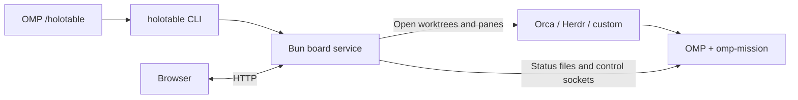

<div align="center">

<h1>Holotable</h1>

**Mission control for OMP.**

[](https://github.com/can1357/oh-my-pi)
[](https://bun.sh)
[](LICENSE)

[Summary](#summary) • [Install](#install) • [Quick start](#quick-start) • [OMP integration](#omp-integration)
<br>
[Documentation](#documentation) • [Roadmap](#roadmap) • [Credits](#credits)

</div>

## Summary

A local-first campaign board for [OMP](https://github.com/can1357/oh-my-pi). Organize repositories into **projects**, campaigns into **operations**, and tickets into **contacts**. See dependencies, live missions, approvals, verification, delivery, notes and history in one place.

Holotable opens and watches [omp-mission](https://github.com/Shadorain/omp-mission) sessions. It does not run a model or replace the mission controller. Plan approval stays in the mission pane; Pause gates, resume holds and ownership locks still apply. Launch and land are operator actions unless you explicitly enable an operation's auto mode or recovery.


## Install

Requires **OMP 18.4.4 or later**, [Bun](https://bun.sh/docs/installation) on `PATH`, and a browser. In OMP:

```text
/plugin install github:Shadorain/omp-mission
/plugin install github:Shadorain/holotable
```

OMP's Git installer installs runtime dependencies automatically.

**Restart OMP after installation.** Then run `/holotable` from a session in your own repository. It starts or reuses the production board and prints its URLs. No demo, container, database, separate server command or Holotable-specific model key is needed.

<details>
<summary>Install from a checkout instead</summary>

```bash
git clone https://github.com/Shadorain/holotable.git
cd holotable
bun install --frozen-lockfile
omp plugin link .
```

Install `omp-mission` too, restart OMP, then open a session in the repo you want to manage—not this tool's checkout—and run `/holotable`.

</details>

## Quick start

1. **Open the board.** In OMP, run `/holotable` and open one of its URLs. The Getting started card checks OMP, the mission extension and the integrations you use, with fixes for anything missing.
2. **Add your project.** Projects → New project. Pick the session's repo; review the detected base branch, tracker, frontend and delivery. To launch missions, choose Orca, Herdr or a custom terminal frontend.
3. **Create an operation.** Choose the project, name the campaign and add contacts. Or use **Draft with an agent**: paste a Linear project URL, issue links or a markdown plan, then press Draft it. An OMP pane writes the seed; review it in the form before Create.
4. **Run the work.** Launch a ready contact. Approve its plan and gates in the mission pane, then land completed work from the board. Dependencies keep blocked contacts queued and visible.

Start with **Settings → Agents → 2** on a small or heat-constrained machine. Auto mode and recovery are off by default; enable them per operation only when you want their documented behavior.

### Integration setup

Install only what your projects use. The board can display and organize work with `none` adapters; launching missions requires a terminal frontend and `omp-mission` loaded in the child OMP sessions.

|Integration|Setup|
|---|---|
|Orca terminals and worktrees|Install Orca and its `orca` CLI. Set the repo's worktree folder in Orca's project settings.|
|Herdr terminals|Install and configure Herdr and its `herdr` CLI.|
|Custom terminals|Set the command templates in Settings → Custom frontend.|
|GitHub tickets or PR delivery|Install `gh` and run `gh auth login`.|
|Linear tickets|Install and authenticate `lin`; `lin me` should succeed.|
|Local-merge delivery|Git and a clean integration worktree; no hosting-service credentials needed.|

### Open it from another machine

Default access is **Tailscale**, on port **4848** (or the next available port). Local URLs work without Tailscale. Settings → Server can restrict access to **This machine** or allow the **Network**. The full URL contains the API token: keep it private. HTTP is unencrypted; use a trusted network, Tailscale or an SSH tunnel.

## OMP integration

`/holotable` runs the bundled `holotable` CLI to start or reuse one board per `OMP_HOLOTABLE_HOME`, records the current repo for the project picker, prints the URLs and enables the model tools. Bun must be on `PATH`; linking the shell command is optional for OMP. The board stays up independently of the session.



The optional status row follows OMP's theme and omits zero counts. `holotable_state` reads the board; `holotable_queue` proposes or edits queued contacts. Neither tool launches, lands or approves work. Model selection, provider routing, verification and review remain in OMP and the mission.

The CLI is the cross-platform management interface. On Linux, the default home uses a resource-bounded **systemd user service** when available. Custom homes and other platforms use a detached Bun process. Your campaigns live outside the plugin checkout, under `~/.omp/agent/holotable` by default; updates do not replace them. See [Resource budgets](#resource-budgets).

<details>
<summary>Standalone CLI and service management</summary>

The OMP plugin installer does not put `holotable` on your shell's `PATH`. From a checkout with dependencies installed, expose the existing executable:

```bash
bun link
export PATH="${BUN_INSTALL:-$HOME/.bun}/bin:$PATH"
holotable --help
```

Keep the checkout in place: the command links to it. Keep Bun's bin directory on your shell's `PATH` for future terminals. Without linking, `bun bin/holotable.ts` runs the same CLI from the checkout.

All OMP sessions and shell commands using the same `OMP_HOLOTABLE_HOME` share **one board process**. Closing OMP does not stop it. The localhost, Tailscale IP and Tailscale DNS URLs are different addresses for that same board, not separate instances. A different home deliberately creates a separate board.

|Command|Effect|
|---|---|
|`holotable` / `holotable start`|start or reuse the board and print its URLs|
|`holotable status`|check the board and show its PID and URLs; exit code 3 means offline|
|`holotable url`|print the running board's URLs|
|`holotable list`|list operations; all `/holotable` store commands also work here|
|`holotable serve --access local`|run in the foreground; Ctrl+C stops this foreground board|
|`holotable stop`|gracefully stop this home's board, keeping campaign data|
|`holotable restart`|stop, then start this home's board; the URL token is kept|
|`holotable install --now`|install and enable the Linux default-home user service for login startup|
|`holotable uninstall`|stop and remove that Linux service; campaign data is kept|

Stopping the board stops watching and automatic board actions, not mission panes already owned by Orca or Herdr. In-flight actions finish before ownership is released. Stopping from OMP also clears that session's row and disables its tools. After a stop, `holotable start` or `/holotable` starts it again.

Global options go **before** the command: `holotable --home /path/to/campaigns status` controls a separate home; `holotable --json status` returns structured output. Shell selection is stored per home. Host integrations use `--current <id>` (or `--current ""` for none) to keep selection session-local.

Discovery is bound to its home: a copied `board.json`/`token` cannot let one home manage another home's board, and two homes always get separate processes.

`systemctl --user` remains useful for Linux logs and unit diagnostics, not required for normal lifecycle commands. After upgrading a board from a release without the shutdown API, restart it once with its original process manager before using CLI stop/restart.

</details>

## Use

```
/holotable project new lab --repo ~/projects/lab --base main
/holotable new lab-q3 --project lab
/holotable zone Ops
/holotable add notes --zone ops --kind decision
/holotable add api --zone ops --blocked-by notes
/holotable list
```

The page has three views over one projection. Each shows only what it is for; detail sits one tab or key away instead of on screen.

- **Table** (`1`): the radar and the selected contact's card. Zones are sectors; rings are lifecycle stages from the outside in (queued, planning, active, complete), so distance from the centre is progress. Contacts that need you pulse and are listed as chips across the top; selecting one draws its dependency chain. Move between orbs with **WASD**, **HJKL** or the arrow keys: each press goes to the nearest contact in that direction. One canvas: static when idle, about 30 fps with live missions or attention. Animation stops on other views, in a hidden tab, or with reduced motion.
- **Board** (`2`): the contact list, the card, and the operation panel (progress, notes, metrics, time in phase and wiring, each foldable). The list is ordered by what needs you: **Needs you**, **In flight**, **Queue**, and a collapsed **Landed**; each row is one line of title and one line of state, with its obvious next action (Approve, Land, Launch, Mark decided, or Focus when plan approval waits in the mission pane).
- **Plan** (`3`): the whole operation. A dependency map with one column per zone, every contact with its state, next step and where it came from, arrows for what waits on what (green once landed, red dashed for conflict missions); and the full, searchable history, filterable by who acted (you, the model, the mission, the board). Selecting a contact focuses its chain and narrows the history to it; the same direction keys move across the map.

The card has three tabs (`[` and `]` switch): **Overview** (progress, what happens next, actions, what it waits for and unblocks, conflict links), **Details** (origin, kind, tracker, delivery, workers, branch, worktree, terminal) and **History** (every event for this contact, with who caused it).

Destructive actions (Reap) need a second click. Disabled actions say why under the buttons. Results and failures appear as toasts; failures stay until dismissed. Keys are listed under [Views and keys](#views-and-keys). The page keeps working on a narrow window; it stacks below about 760 px.

The gear at the right of the header opens a settings drawer for board-wide settings; settings for one operation live on its Operation page. Every control saves on change or blur; a rejected value shows the server's message inline. Selects, switches and checkboxes are the page's own controls, not native ones — dropdowns support arrows, Home/End and type-ahead, and a poll never closes an open one.

`/holotable` with no arguments makes sure the board service is running (starting it if needed), records the session's repo for the project picker, prints the URLs and enables the model tools. One board runs per `OMP_HOLOTABLE_HOME`: a second session is told where the first one lives.

Activation is session-local. Until you use `/holotable` (with or without arguments), OMP does not load the board core or CLI adapter, register its model tools, read campaign data, poll the service or show a board row. A new, switched or branched session returns to this inactive state, as does `/holotable stop`; the session's selected operation is kept.

Once activated, the row shows the selected operation and nonzero live, queued and need-you counts, using OMP's themed symbols and colors. With one operation it shows that operation automatically; with several and no selection it shows board totals. An empty board adds no row. An unreachable board shows a compact offline hint.

### Commands

|Command|Effect|
|---|---|
|(none)|start the board if needed and print its URLs; also records the session's repo for the project picker|
|`start` / `stop` / `restart` / `status` / `url`|manage or inspect the same home-selected board through the CLI|
|`new <id> (--project <id> \| --repo <path> --base <branch>) [--name] [--tracker] [--fleet] [--frontend] [--delivery] [--auto] [--no-pause] [--recover] [--from file.json] [--brief file.md]`|create and select an operation; unset fields come from its project or settings; `--auto` enables [auto mode](#auto-mode) and starts the board; `--recover` opts into [recovery](#recovery)|
|`project new <id> --repo <path> --base <branch> [--name] [--integration] [--tracker] [--fleet] [--frontend] [--delivery] [--no-pause] [--worktree-root]`|create a project (the page's New project and `POST /api/projects` detect any field you leave out)|
|`project list`|projects and their operations|
|`project set [<id>:]<field> <value>`|change a project field (default: the selected operation's project); every operation that has not overridden it follows|
|`project attach <id> [op]` / `project detach [op]` / `project delete <id>`|attach (the operation takes every project value), detach (the values are copied in), delete (refused while an open operation uses it)|
|`list [--all]`|open operations (`--all` adds archived)|
|`use <id>`|select an operation|
|`zone <label>`|add a zone (its id is derived from the label)|
|`set <field> <value>`|change `name`, `base`, `integration`, `pause`, `tracker`, `fleet`, `frontend`, `delivery`, `worktreeRoot` (`default` clears it), `recover` (`on`/`off`, see [Recovery](#recovery)) or the auto-mode fields `auto` (`on`/`off`), `auto.launch`, `auto.land`, `auto.decide`, `auto.maxLive`; in a project, `inherit` drops the override (not for `auto*` or `recover`: those belong to the operation)|
|`add <ticket> --zone <id> [--kind] [--blocked-by A,B] [--title] [--worktree <path>] [--option X…] [--recommended X]`|add a contact; `--worktree` adopts an existing checkout; `--option`/`--recommended` build a decision contact (see [Decisions](#decisions))|
|`close <id> <landed\|abandoned\|decision\|failed>`|end the operation through the same path as the page: wind-down, `closed` event, report, archive|
|`config [key value]`|show or set board settings|

`--from file.json` seeds an operation:

```json
{
  "zones": [{ "id": "api", "label": "API" }],
  "contacts": [{ "ticket": "CHR-1", "zone": "api", "title": "Schema" }, { "ticket": "CHR-2", "zone": "api", "blockedBy": ["CHR-1"] }],
  "notes": "## Ship\n- [ ] Staging\n- [ ] Announce"
}
```

A `"brief"` string seeds the operation's brief (same as `--brief`); `--brief <file>` overrides a `brief` key in the seed. `"notes"` seeds the scratch pad.

Start an automatic campaign from OMP with `/holotable new release --repo /path/to/repo --base main --auto`, or use the same `new` arguments in the shell CLI. The flag enables launch and land with `auto.maxLive = 4`, bounded by the board cap. It does **not** disable Pause, approve plans, decide contacts or enable recovery. Explicit auto settings in a seed are preserved, with `enabled` switched on by `--auto`; without the flag, the seed's auto configuration is unchanged.

### Settings

`$OMP_HOLOTABLE_HOME/settings.json` (default `~/.omp/agent/holotable`, mode `0600`). The page's settings drawer is global only (operation fields live on the Operation page under Plan). Every control saves on change; `access`/`port` rebind the running board — no restart — and the drawer lists the URLs it now answers on.

|Key|Default|Meaning|
|---|---|---|
|`access`|`tailscale`|who may open the board: `local` binds loopback only, `tailscale` binds everywhere but accepts only loopback and Tailscale peers (`100.64.0.0/10`, `fd7a:115c:a1e0::/48`), `network` accepts any address on your LAN. The token is required in every mode|
|`port`|`4848`|bind port; `0` picks a free one. A taken port falls back to one of the next ten|
|`cap`|`8`|live `omp` ceiling, 1-64; above 8, or when the sessions would need most of this machine's memory, the page warns (each idle omp holds about 600 MB)|
|`pollMs`|`5000`|status read and owner ping interval|
|`sampleMs`|`60000`|tracker and delivery sampling interval|
|`theme`|`holo`|page theme: `holo`, `omp` (omp-grill's palette), `slate`|
|`worktrees.root`|`{repo}-holotable-{name}`|where herdr and custom lanes are created: `{repo}` (repo path), `{repoName}`, `{name}` (required), may start with `~/`. An operation's `worktreeRoot` overrides it|
|`defaults.tracker`|`none`|`linear`, `github`, `none`|
|`defaults.fleet`|`omp-mission`|`omp-mission`, `none`|
|`defaults.frontend`|`none`|`orca`, `herdr`, `custom`, `none`|
|`defaults.delivery`|`none`|`github-pr`, `local-merge`, `none`|
|`cleanup`|`true`|after a contact lands or is marked done, close its terminal and remove its worktree when clean (a dirty worktree is kept and noted)|


### Views and keys

The header has the project breadcrumb (opens the project page), the operation picker (grouped by project; below the list, New operation and a link to the Archive), the three view buttons, the needs-you and auto-mode pills (the auto pill opens the Operation page), base branch, load, note tasks done (hidden when the notes have no task lines), the connection dot and, rightmost, the settings gear. Hovering or focusing any control shows a tooltip saying what it does, and for a disabled one why it is off. Hovering or focusing the Load stat instead shows live CPU and memory for the operation, all open operations and the machine (`GET /api/usage`: /proc sampling, processes attributed by lane worktree; over 80% is tinted, over 95% marked bad). Simulated missions in the playground have no real processes, so attributed usage there reads zero while the machine line stays real.

Toggle views with the header buttons or `1 2 3` / `t b p`. The Plan view has two sub-views (Map | Operation); `Shift+P` flips between them.

- **Table**: radar with live pins inside the well and queued pins on the outer ring. Click a pin or use WASD/HJKL to select; Enter focuses its primary action.
- **Board**: what needs you, in flight and queued on the left (Add contact, at the foot of the Queue, queues a new ticket mid-flight; when the operation has a tracker, the Ticket field searches it, fills the title and marks tickets already on the board; Waits for picks from the operation's contacts); the selected contact's card in the middle; on the right the operation's progress, notes, metrics and wiring. When every contact has landed, Board and Table show a Close prompt.
- **Plan**: the dependency map with history beside it. Selecting a node focuses its chain and dims the rest; clicking it again or Esc undoes that.

Keys (`?` or Settings → Help shows them): WASD/HJKL/arrows move, Enter acts, `[` `]` cycle card tabs (Overview, Plan when one waits, Details, History), `1 2 3 t b p` switch views, `Shift+P` toggles the Plan sub-view, `,` opens settings, Esc clears notices and focus. Cmd/Ctrl+click on any ticket opens it at its tracker (or its pull request) in a new tab.

### Operation page (Plan → Operation)

The operation as a document: brief (edit in place), notes, the auto-mode card (launch, land, max live, and the opt-in decide and approve-plans switches), setup (project and name; for a project's operation the rest folds behind a summary of overrides, each inherited field tagged "from project" and each override offering "use project value"; a standalone operation shows them all), zones (just a name; the id is derived) and contacts (Add contact, here or on the Board and the Plan map), the seed it was created from (formatted, downloadable), and at the bottom **End the operation**: Close (once everything has landed) or Abort. Abort opens a dialog listing the panes it will close, the worktrees it will delete (dirty ones called out with their paths), then asks you to type the operation id.

### Getting started and the tour

A board with no operations opens on Projects with a **Getting started** card: checks of this machine (`GET /api/setup`: omp, the omp-mission extension, and the CLIs for the frontends and trackers in use, each with a fix to copy) and the first campaign as four steps (project, operation, contacts, launch) ticked off from real counts. **Hide** puts it away; Settings → Help → Getting started brings it back. The first visit also runs a short tour of the header (Esc skips, arrows step); Settings → Help → Take the tour replays it.

### Notes

A markdown scratch pad per operation (`notes.md`), on the Operation page and in the Board sidebar. Task lines (`- [ ]` / `- [x]`) can be ticked in place and are counted in the header; nothing else reads them, so they never start or block missions. Saves carry the revision you loaded; if someone else saved first, the save is refused and your text stays in the editor to copy. Operations created before notes existed have their old checklist converted once.

### Projects

**Projects** (the first breadcrumb in the header) is the top of the board: every project with its repo, base and operations (with what needs you), the standalone operations, and **New project**. The picker offers your existing projects' repos, every repo Orca knows, and repos where `/holotable` recently ran (`GET /api/repos`, deduplicated); pick or paste a repo and detection fills every field — name, base, integration, tracker, frontend, delivery, worktree folder — each with a one-line reason, all adjustable (`POST /api/projects/detect`; `POST /api/projects` with just `{repo}` does the same at create time). The second breadcrumb opens one project: its operations, its settings (changing one changes it for every operation that has not overridden it), and Remove (only once no open operation uses it; the repo is never touched). An operation's own page only picks its project; the per-operation overrides are folded behind a one-line summary ("all from the project", or which fields differ). Boards from before projects existed are migrated once: operations are grouped by repo into one project each, seeded from the oldest operation, and keep only the fields that differ.

### New operation

Picker → New operation. Project first (or standalone, with repo, base, integration and wiring fields, and an option to save them as a project), then name, id and brief. **Draft with an agent** takes pasted markdown or a link (a Linear project, an issue list, a doc): the board opens an `omp` pane in the project's repo through its frontend, the agent writes `drafts/<id>/seed.json`, and the form fills zones, contacts, notes and brief from it for you to review. Nothing is created until you press Create. Drafting needs a terminal frontend; with `none` it says so.

### Archive

Picker → Archive. Closed and aborted operations, kept out of the picker: a list with outcome, close date and landed count, and a read-only report per operation (summary counts, brief, every contact's result with issue and PR links, and the full history).

### Plan review (in the contact card)

A contact with a pending plan shows a "Plan" tab (primary action "Review plan"). The tab renders the plan as markdown. Edit opens a textarea; Save sends `plan-save` with the current revision for stale detection. If the mission rewrote the plan while you edited you can Overwrite or Reload. Refine opens a composer (Ctrl+Enter sends) whose text goes to the mission as feedback. Approve focuses the mission pane, where you pick "Approve and compact context". The board does not approve plans itself until OMP offers an API (`auto.plans`, above).

### Settings drawer

Board-wide only: Appearance (theme), Agents (cap), Polling (shown in seconds or milliseconds, your pick; stored in ms), Server (who can open the board — this machine, Tailscale devices or the network — plus the port and the URLs it currently answers on; changes rebind the running board), After landing (cleanup), Defaults for new operations, Custom frontend templates (only when something uses the `custom` frontend), and Help (keyboard shortcuts).

### Model tools

Active only while the board runs and after `/holotable` enables them. They propose; the operator clicks.

- `holotable_state`: one line per contact (state, blockers), at most 4000 characters. Read-only.
- `holotable_queue`: `add` a contact or `update` a queued one. A contact that already has a lane is refused with `contact-launched`. It cannot launch, land, approve or set a lane.

## Resource budgets

The installed Linux user service limits the board **and its CLI subprocesses** to a quarter of one CPU core (`CPUQuota=25%`), 256 MiB memory pressure threshold, 512 MiB memory ceiling and 64 tasks. It runs at lower CPU priority and stops restarting after three starts in five minutes. A memory ceiling breach stops the board; operation data remains on disk. Existing installations: run `holotable install`, then `holotable restart` (use the original process manager once when upgrading from a release without the shutdown API).

These limits do **not** cover mission panes hosted by Orca/herdr, other services, or a board started directly with `serve`/a detached fallback. The Agents cap limits mission concurrency across operations, not each mission's CPU. On a small or heat-constrained machine, start with **2** live agents and raise it only after measuring the workload. No board setting can guarantee safe temperatures for the entire host.


Watcher passes never overlap. OMP's passive 10-second refresh reads the service in-process; it does not spawn CLI polling processes. Explicit CLI starts close the parent's log descriptor after spawn. Stop authenticates a live PID and instance nonce, never signals a PID from a discovery file, and drains HTTP actions, watcher, auto and recovery work before releasing the ownership lock.

Queued-only operations do not run terminal-list commands; operations with live recorded terminals or decision panes share one Orca/herdr listing per watcher pass. Custom frontends remain operation-scoped. Usage viewers share one machine snapshot instead of independently scanning `/proc`. Browser polls wait three seconds after completion rather than stacking requests behind slow responses. Hidden pages stop polling and drawing; usage polling runs only while its tooltip is visible. Unchanged header and formatted statistics leave their DOM intact.

## Watching missions

While the service runs, its watcher polls every `pollMs`: it reads each launched contact's mission status file, pings the owning session's control socket, and records changes as events (`phase`, `gate-armed`, `socket-up`, `socket-down`). Every `sampleMs` (and when the page regains focus) it samples the tracker and the delivery PR and appends a `sample` only when a field changed. It is read-only. Port failures are warned once per distinct message and never stop the loop.

Adapters: tracker `linear` (`lin`) and `github` (`gh`); fleet `omp-mission` (status files and control socket, see [docs/contract.md](docs/contract.md)); delivery `github-pr` (`gh pr view`) and `local-merge` (`git merge-base --is-ancestor`).

## Launching missions

Launch is a click on a ready contact. The board refuses first (decision tickets, blockers, `cap`, no frontend, no fleet), then runs: ensure the repo with the frontend, create a worktree on the operation's base, open a terminal running `omp` with `OMP_MISSION_AUTOSTART=/mission …` and a plan-mode overlay, then wait up to 90 s for the child's control socket. The child opens a pending plan and waits: **plan approval stays in its pane**. Every step is written to the lane as it happens, so a failed launch resumes at the failed step instead of recreating anything. A contact whose socket never answered shows `offline`, with Focus and Reap.

Frontends (per operation, `--frontend` or `/holotable set frontend`):

|Frontend|Worktrees|Terminal|
|---|---|---|
|`orca`|`orca worktree create … --no-parent`|`orca terminal create`|
|`herdr`|`git worktree add -b holotable/<name>` in the `worktrees.root` folder (default beside the repo)|`herdr tab create` + `herdr agent start`|
|`custom`|same as herdr|shell templates `custom.terminal`, `custom.focus`, `custom.close` (`{cwd} {title} {command} {handle}`)|
|`none`|never|never|

Requirements: the launched `omp` must load `omp-mission` (install it as an OMP extension). Orca puts worktrees in its own project's worktree folder (Orca project settings) and ignores `worktrees.root`; it creates worktrees only for repos where that folder is set, and the settings drawer shows the folder or says it is missing. `cap` (default 8, maximum 64) counts live `omp` sessions across every open operation; an idle `omp` is about 600 MB. **Reap** closes the contact's terminal after checking its handle, incarnation and worktree against what the frontend lists; it never uses `--all` and never types into a terminal.

## Operator actions

The contact card shows the fleet buttons the mission itself offers (`Approve`, `Continue`, `Review`, `Dispatch`, and a `Mode` select: auto, pause, force) and `Focus`. `Continue` appears only when the mission is actually stuck: a resume hold, or failed verification; with Recovery on, a plain resume hold is left to the board. Each button is one request to the owning session's control socket, sent as an operator action; the board never computes whether a transition is legal, so resume hold, plan mode and Pause gates apply exactly as when typing the slash command in the pane. `Approve` carries the id of the gate it was rendered for, and a gate that moved on fails as `stale`. A gone owner fails as `owner-offline` and changes nothing. Every action except `Focus` is recorded as an `operator` event, success or failure. A model turn in the board's own session can only read and queue: it has no tool that approves, continues or launches.

`Relaunch` appears on a contact whose session is `offline` while its lane still has a terminal (a pane that closed, or a session that died or hung inside one). It closes the old pane if the frontend still lists it, opens a new one in the same worktree with the same launch command, and waits for the control socket. The new session re-attaches the saved mission under resume hold, so the card then shows `Continue`; nothing resumes until you press it (or [recovery](#recovery) does). It is disabled with the reason `cap <open>/<cap> omp` when the cap is full, and is not offered for a finished mission, a lane with no terminal, an `external` lane, or a `none` frontend. After **Reap**, Relaunch is the only way back.

## Blocked queue

A contact with unmet blockers stays in the queue, visible and unlaunchable (`blocked by <ticket>`), and never disappears. A blocker counts only when it has a `landed` event: a mission reaching `complete` does not unblock its dependents. `landed` is written by Land (or by **Mark done**, for decision contacts and contacts with no delivery). When a contact's last blocker lands the watcher records `unblocked` once.

## Landing and conflicts

**Land** is a click on a completed contact. It merges the delivered branch on the operation's integration checkout (`integration`, default the repo's primary checkout), never inside a mission checkout, and only when that checkout is clean and on the base branch (`integration-dirty`, `integration-wrong-branch` otherwise). `local-merge` runs `git merge --no-ff`; `github-pr` checks the PR targets the base and its checks are not failing, then merges it with `gh pr merge --merge` (a resolution branch is pushed non-force onto the PR head first). Clean: `land-attempt`, then `landed`, which unblocks dependents.

A conflict aborts the merge, so integration stays clean, and opens **one new conflict contact** (`<ticket>-conflict-<n>`): a worktree at the delivered commit with the conflict markers already in place, and a local-graph `/mission` told to edit only those files and not to merge, push or open a PR. The original contact stays; Land is disabled with `conflict mission <ticket> open` until the conflict mission completes, then it lands the conflict mission's branch. The scoping to those files is by prompt only.

After a clean land (or **Mark done** on a contact with a lane) the board cleans up: it closes the terminal and, when the worktree has no uncommitted changes, removes it — `reaped` then `removed` events, and the terminal stops counting against `cap`. A dirty worktree is left in place and a failed cleanup is recorded as an `operator` event, never a failed land. `settings.cleanup = false` disables this; Reap stays available either way.

## Decisions

A `decision` contact never launches: it sits in the queue until someone chooses. **Mark decided** records a `decided` event (`choice`, optional `rationale`, `by: "operator"`) and lands the contact; on a landed one, **Change decision** (`redecide`) records a new `decided` that replaces the old choice while dependents stay unblocked. Options come from `options` (2–8 short strings) plus an optional `recommended`, set when the contact is added — `/holotable add <ticket> --kind decision --option "Migrate ACS data" --option "Start fresh" --recommended "Migrate ACS data"`, `POST /api/contacts`, `holotable_queue`, or the seed — and shown on the card. With options the choice must be one of them; without, it is free text (blank counts as `decided`).

**Ask an agent** (`decide-agent`) opens a lane-less `omp` pane in the operation's integration checkout — read-only, briefed with the question, options, brief, notes and earlier decisions — that writes `decisions/<ticket>.json` under the operation directory and stops. The watcher lands the contact with `by: "agent"` and closes the pane; an unreadable answer is recorded once and left for you to fix or close, and a pane that exits without answering fails as `pane closed before deciding`. The pane counts toward `cap` like a live mission. With `auto.decide` on, auto mode lands each ready decision on its `recommended` option (`by: "recommended"`); without one it opens the agent pane itself, still respecting `auto.maxLive` and `cap`.

## Auto mode
Per operation (`/holotable set auto on`, or the auto card on the Operation page): `auto.launch` launches queued contacts in order — decisions, blocked contacts and plans awaiting approval are skipped and wait for you — up to `auto.maxLive` and the global `cap`; `auto.land` lands each contact that reaches `complete`; `auto.decide` resolves decisions — instantly from `recommended`, otherwise through the agent pane — under the same two limits. Everything auto mode does is an `operator` event with `by: "auto"` (`decided` keeps its own `by`); history credits it, and the cleanup after a land, to the board. A failed launch or land switches auto mode off for that operation and records why; re-enable it when you have fixed the cause. `auto.plans` (off by default) will approve plans once OMP lets an extension do it; until then each launched mission waits at plan approval in its pane (the card's Plan tab shows it and focuses the pane), and the switch says so. See [docs/omp-plan-approval.md](docs/omp-plan-approval.md). With `pause` on, missions also stop at Pause gates.

## Recovery

Per operation, off by default and never inherited from a project: `/holotable set recover on` (or `new <id> --recover`, `POST /api/operation-config {op, field: "recover", value: "on"}`, or `recover: true` in `POST /api/operations`). Switching it is recorded in history as yours. With it on, the board keeps missions running through a closed or crashed pane without you watching:

- **Resume.** A board-launched session sitting at resume hold with a live owner gets `Continue`, at most once every 30 s per contact (a crashed session's ownership lock stays stale for about 30 s, so the first try may fail with `ELOCKED`; failures are recorded and retried). The pacing is read from the events, so a board restart keeps it.
- **Relaunch.** A contact is relaunched when its pane vanished from a frontend that lists terminals, or when its session has been down for 60 s while the pane is still listed (omp crashed or hung inside it: the old pane is closed first). Relaunches run in the background and respect the global `cap`; at the cap nothing is attempted and nothing is recorded.
- **Give-up.** At most 3 recovery relaunches per contact in 30 minutes. The next candidate records one `gave up: 3 relaunches in 30 min` event and recovery leaves that contact alone until you press Relaunch yourself, which resets the count.

Everything recovery does is an `operator` event with `by: "recover"`; history credits it to the board. Recovery never:

- continues a session whose `verify` is `failed` (continuing resets verification; that is your call),
- touches a session without a control socket (a human's `omp` in the worktree),
- approves a gate or a plan,
- relaunches a contact you Reaped,
- relaunches a finished (`complete`) or landed contact,
- exceeds `cap`.

## Ending an operation

Two ways, one path. **Close** (the End card on the Operation page, or `/holotable close`) is for a finished operation; outcome `landed` is refused while any contact is unlanded. **Abort** asks for a preview — the terminals it will close and the worktrees it will delete, each flagged dirty when `git status --porcelain` is non-empty — and then requires you to type the operation id. Both run the same wind-down: auto mode is switched off first, then every contact's recorded terminal is closed (a terminal already gone counts as reaped) and every non-external worktree is removed — on abort even with uncommitted changes. A failure is recorded as an `operator` event and never stops the wind-down.

The archive keeps everything the operation had — `operation.json`, `events.jsonl`, `brief.md`, `seed.json` — plus `report.json`: outcome, per-contact final states (`landed`, `aborted`, `not-launched`) with where each landing went (`landedVia`, tracker and PR URLs), counts (contacts, landed, conflicts, launches, land attempts), the full stats, the note task tally and the notes, and the first 2000 characters of the brief. Archives are browsable from the picker's Archive link; an archive written before reports existed still shows one, rebuilt on read.

## Stats

Everything in the Board view's Metrics is computed from `events.jsonl` alone (the same events always give the same numbers): queue wait per contact and on average, time in each mission phase, gate wait, land attempts and conflict rate, socket downtime, current and peak live `omp`, and tokens and estimated cost. A figure with no data is left out, never shown as 0. Tokens and cost come from the mission status file's `usage` (omp-mission sums assistant-message usage across the coordinator session and its worker sessions); the watcher samples each contact's latest total, and the metric adds them. Cost is omp's per-message price estimate, so a subscription plan is not billed this way. The header shows `open/cap omp` across all open operations and done/total note tasks.

## Playground

`bun run demo [--port 4747] [--host 0.0.0.0] [--home /tmp/holotable-playground]` serves the real board over simulated ports, so every button works: Launch a contact and a fake mission walks plan (approve it from the card's Plan tab, which stands in for the pane), execute, a Pause gate (click Approve), review, complete; Land it (every third contact conflicts the first time and opens a conflict mission); Reap, Relaunch, Focus, Mark done, edit notes, add contacts, abort an operation. Only the plan tab's Approve stands in for the pane; a plain Focus changes nothing. Nothing touches Orca or any CLI. `--home` runs a second copy in its own directory. It prints one URL per interface.

The simulated frontend lists its panes, so a pane can vanish: the `status` contact in the `mission` operation is seeded with a closed pane (offline, not reaped), and Reap closes any other. **Relaunch** brings a session back at resume hold (card shows Continue; Continue resumes at the stage it left); `autopilot` has `recover` on, and `set recover on` on `mission` makes the board relaunch and continue that closed pane by itself. Settings survive restarts (`<home>/settings.json` is kept and applied); demo data does not.

Simulated decision panes write their answer about five seconds after opening (the recommended option, else the first, else "proceed with the longest option"), so the watcher decides on its own. `charidel` has two undecided contacts: `CHR-151` with options "Migrate ACS data"/"Start fresh" and the former recommended — switch on `auto.decide` and it lands instantly — and `CHR-163`, a free-text decision for **Ask an agent**.

## Safety model

- The board launches and watches missions; it never runs them. This process never attaches a mission and never calls `control()`. Every mutation is an operator click, forwarded to the owning session's control socket, which runs the same code the slash command runs.
- Resume hold, plan mode, Pause gates and the ownership lock apply inside the mission and cannot be routed around. Plan approval always happens in the mission's pane. Recovery (off unless you switch it on per operation) only sends `Continue` to a board-launched session at resume hold, never over failed verification, and only relaunches panes that died; see [Recovery](#recovery).
- The board page can approve gates. Access follows Settings → Server (Tailscale by default); every API call requires the URL-fragment token, plus Host and Origin checks. Keep the full URL private.
- Land happens on the integration checkout, never in a mission checkout; a conflict becomes a new mission rather than a second copy of the ticket. Linear issues and pull requests are only touched by an operator click (`gh pr merge` on Land) or by auto mode the operator switched on for that operation.
- Queue stays visible: blocked work never launches and never disappears.
- History is append-only events; there is no second copy of mission JSON.

## Data

Per project under `$OMP_HOLOTABLE_HOME/projects/<id>/project.json`: repo, base, integration, pause, the four ports, worktree folder.

Per operation under `$OMP_HOLOTABLE_HOME/operations/<id>/`:

- `operation.json`: intent only (project, the fields it overrides, zones, contacts, blockers, lanes). The queue is derived: a contact with no lane is queued.
- `events.jsonl`: append-only history. Everything shown (state, stats) is rebuilt from it.
- `brief.md`: free-text brief, edited on the Operation page; `notes.md`: the scratch pad; `seed.json`: the raw seed the operation was created from.

`drafts/<id>/` holds agent drafts until the form closes them.

At the home root, `board.json` (`{pid, url}`) records the running service for clients and `token` keeps the service's auth token across restarts so URLs stay valid.

Ending an operation moves its directory to `archive/<id>-<timestamp>` and adds `report.json` (outcome, per-contact final states, counts, stats, brief). History is kept.

## Documentation

- [Architecture](docs/architecture.md): layers, ports, lifecycle, events and safety invariants.
- [Mission contract](docs/contract.md): status files and control sockets.
- [Testing](docs/testing.md): regression coverage and runtime smokes.
- [Plan approval API](docs/omp-plan-approval.md): why plan approval remains in the mission pane.

<details>
<summary>More views</summary>


</details>

## Roadmap

[PLAN.md](PLAN.md) tracks work that is not built yet. Native plan approval automation depends on an OMP extension API; Holotable does not bypass that boundary.

## Development

```bash
git clone https://github.com/Shadorain/holotable.git
cd holotable
bun install --frozen-lockfile
bun test
bun run typecheck
```

Tests use temp homes and never touch `~/.omp/agent`.

## Credits

Built for [oh-my-pi](https://github.com/can1357/oh-my-pi), with missions provided by [omp-mission](https://github.com/Shadorain/omp-mission) and the board runtime powered by [Bun](https://bun.sh).

## License

[MIT](LICENSE)
