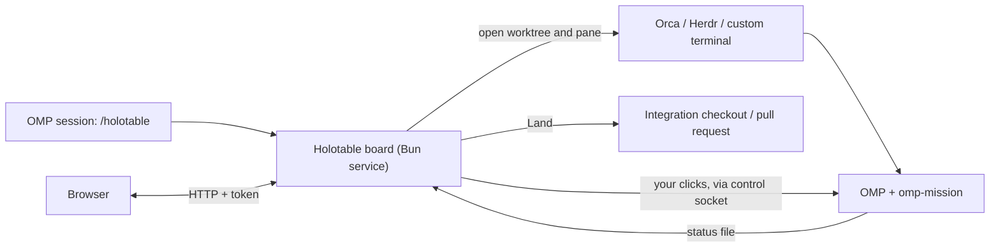

<div align="center">


<h1>Holotable</h1>

**Mission control for OMP.**

[](https://github.com/can1357/oh-my-pi)
[](https://bun.sh)
[](LICENSE)

[How it works](#how-it-works) • [Install](#install) • [Quick start](#quick-start) • [Concepts](#concepts)
<br>
[Safety](#safety-model) • [Documentation](#documentation) • [Credits](#credits)

</div>

Holotable is an [OMP](https://github.com/can1357/oh-my-pi) extension and a local web board for running many [omp-mission](https://github.com/Shadorain/omp-mission) missions as one campaign. You put tickets on a board, say which ones wait on which, and launch them. Each launched ticket becomes a mission in its own worktree and terminal pane. The board shows every mission's state, what needs you, and what is ready to land, and lets you approve, answer and land from one page. It launches and watches missions; it never runs them. Plan approval, Pause gates, resume hold and ownership locks stay inside each mission, and nothing is launched or landed unless you click or switch on auto mode for that operation.


## How it works



1. `/holotable` in OMP starts (or reuses) one board service and prints its URLs. The service keeps running when OMP closes.
2. **Launch** asks the operation's frontend (Orca, Herdr or a custom terminal) for a worktree and a terminal running `omp` with `/mission`. The mission plans and waits for you to approve its plan.
3. The board watches each mission's status file and control socket. It records every change as an append-only event and rebuilds the page from those events.
4. Your clicks (**Approve**, **Continue**, answers, **Switch model**) go to the mission's own control socket and run the same code as the slash command in the pane.
5. **Land** merges finished work on the operation's integration checkout or through its pull request, then unblocks whatever was waiting on it.

## Requirements

- **OMP 18.4.4 or later.** Approving a native plan from the board needs OMP 18.10.4 or later; answering tool approvals from the board needs 18.11.3 or later. Older versions show **Approve in pane** or **Answer in mission** instead.
- **[omp-mission](https://github.com/Shadorain/omp-mission)** installed as an OMP extension. Launched panes must load it.
- **[Bun](https://bun.sh/docs/installation)** on `PATH`, and a browser.
- **A terminal frontend to launch missions:** Orca (`orca` CLI), Herdr (`herdr` CLI), or your own shell templates. Without one, the board can still organize work.
- Optional, per project: `lin` for Linear tickets, `gh` for GitHub tickets and PR delivery, Git for local-merge delivery. See [Integrations](docs/guide.md#integrations).

## Install

Install omp-mission from its marketplace, inside OMP:

```text
/marketplace add Shadorain/omp-mission
/marketplace install mission@omp-mission
```

Install Holotable from a shell:

```bash
omp plugin install github:Shadorain/holotable
```

OMP's Git installer installs runtime dependencies automatically. **Restart OMP after installation.** No container, database, separate server command or Holotable-specific model key is needed.

<details>
<summary>Install from a checkout instead</summary>

```bash
git clone https://github.com/Shadorain/holotable.git
cd holotable
bun install --frozen-lockfile
omp plugin link .
```

Install `omp-mission` too and restart OMP. Then open a session in the repo you want to manage, not this tool's checkout, and run `/holotable`. To use the `holotable` shell command, see [Standalone CLI and service](docs/reference.md#standalone-cli-and-service).

</details>

## Quick start

1. **Open the board.** In an OMP session inside your repository, run `/holotable` and open one of the printed URLs. The full URL carries the access token; keep it private. A board with no operations opens on **Projects** with a **Getting started** card that checks OMP, omp-mission and the CLIs your integrations need, with a fix for anything missing.
2. **Add your project.** Projects → **New project**. Pick the session's repo. Holotable detects the base branch, tracker, frontend and delivery and explains each choice; adjust anything. To launch missions, choose Orca, Herdr or a custom terminal frontend.
3. **Create an operation.** Open the operation picker → **New operation** and choose the project. Then pick a starting point (drafting opens an OMP pane, so it needs the project's terminal frontend):
   - **From a Linear project or document:** paste its URL (or issue links) into **What** and click **Draft it**. An OMP pane reads the source with `lin` and the repository, and writes a draft: zones, contacts with short titles and full descriptions, dependencies, a brief and notes. Review it, then **Create**. Pasting a link without drafting imports nothing.
   - **From a markdown plan or a rough goal:** paste the plan, or describe the goal, constraints and what done looks like, in **What**, then **Draft it**. For work with no tickets, use a project with **Tracker → none** so the draft proposes local mission ids.
   - **From a seed file:** **Load a file** fills the form's seed JSON. In OMP, `/holotable new q3 --project <project-id> --from seed.json` does the same. The [seed file](docs/reference.md#seed-file) lists zones, contacts and dependencies.
   - **Blank:** name it and **Create**, then add zones and contacts on its Operation page (Plan → Operation).
4. **Launch.** On the Board, press **Launch** on a ready contact. Its mission opens in a new pane and writes a plan. Approve the plan from the card's **Plan** tab (or in the pane).
5. **Follow it through.** Approve Pause gates and answer questions from the card. When a contact is complete, press **Land**. Contacts that waited on it become ready.

On a small or heat-constrained machine, set **Settings → Agents** to 2 first. Auto mode is off by default; turn it on per operation only when you want it. Recovery (**Keep missions running**) is on by default in the New operation form; switch it off there or on the Operation page if you want to restart crashed panes yourself.

### Try it without a real repo

The playground serves the real board over simulated missions. Nothing touches Git, Orca or any CLI.

```bash
git clone https://github.com/Shadorain/holotable.git
cd holotable
bun install --frozen-lockfile
bun run demo
```

It prints the board URLs (port 4747 by default; `--port` changes it). Launch a contact, approve its plan and gate, and land it. See [Playground](docs/playground.md) for what each seeded operation demonstrates.

## Concepts

|Term|Meaning|
|---|---|
|**Project**|One repository and its defaults: base branch, integration checkout, tracker, frontend, delivery and worktree folder. Operations in a project inherit these unless they override them.|
|**Operation**|One campaign: a set of contacts, their dependencies, a brief and notes. It belongs to a project or stands alone. When it ends, it moves to the archive with a report.|
|**Zone**|A workstream inside an operation, such as "API" or "Cutover". Zones are the sectors of the radar and the columns of the Plan map.|
|**Contact**|One ticket on the board, with a short title and a full description. Kinds: `implement` (the default), `audit`, `decision`, `closer`, and `conflict` (opened by Land).|
|**Mission**|The omp-mission session that works one contact in its own worktree and terminal pane: plan, execute, verify, deliver, review, complete.|
|**Lane**|The worktree, branch and terminal recorded for a launched contact. A contact without a lane is queued.|
|**Blocker**|A contact another one waits for (`blockedBy`). A blocker counts as done only once it has **landed**, not when its mission completes.|
|**Landed**|Merged into the base branch, confirmed by the delivery (PR state or Git ancestry).|
|**Decision**|A contact that is a question, not code. It never launches; you (or an agent pane you start) pick an answer, and work that depends on it unblocks.|
|**Conflict mission**|A new local mission that resolves the merge conflicts Land found, so the original contact can land.|
|**Closer**|An operation's last contact. Once everything else has landed, it reviews the integrated result, fixes small problems and reports the rest as follow-ups.|
|**Pause gate**|A stop inside a mission that waits for your approval before it continues.|
|**Frontend, tracker, delivery, fleet**|The adapters an operation uses: where panes open (`orca`, `herdr`, `custom`), where tickets live (`linear`, `github`), how work merges (`github-pr`, `local-merge`), and what runs missions (`omp-mission`). Each can be `none`.|
|**Auto mode**|A per-operation switch that launches and lands for you. See [below](#what-you-do-and-what-auto-mode-does).|
|**Recovery**|A per-operation switch, **Keep missions running**, that reopens and continues missions whose pane crashed or closed. On by default for operations created in the New operation form.|

## The board

The page has four views. Switch with the header buttons or keys `1`–`4`.

- **Table** (`1`): a radar. Zones are sectors; rings are lifecycle stages from the outside in (queued, planning, active, complete). Contacts that need you pulse.
- **Board** (`2`): the contact list ordered by what needs you (**Needs you**, **In flight**, **Queue**, **Landed**), the selected contact's card with its actions and mission report, and the operation's progress, notes and wiring.
- **Plan** (`3`): the dependency map by zone, with history beside it. Its **Operation** sub-view is the operation as a document: brief, notes, auto mode, setup, zones, contacts, closer and **End the operation**.
- **Intel** (`4`): measurements from the recorded history: where time goes, what waited on you, spend, stalls, conflicts and ranked recommendations, for one operation or the whole fleet. See [Intel](docs/intel.md).

The [guide](docs/guide.md#the-board) has screenshots of each view and the full key list.

## Typical workflow

1. Create an operation from a plan, a Linear project or a goal, and review the draft.
2. Launch the contacts that are ready. Independent contacts run in parallel, up to the **Agents** cap (default 8 live `omp` sessions).
3. Review each mission's plan on its card and approve it.
4. Watch **Needs you**. It lists plans to approve, Pause gates, questions, tool approvals, decisions, quota holds and finished work to land.
5. Land finished work. If Land hits a merge conflict, it opens a conflict mission; land the original contact once that mission completes.
6. When everything has landed, the closer reviews the integrated result. Read its review, land or mark it done, then **Close** the operation. Its report stays in the archive.

### What you do and what auto mode does

|Step|Without auto mode|With auto mode on|
|---|---|---|
|Launch ready contacts|you click **Launch**|launched, the one that unblocks the most work first, up to `auto.maxLive` (default 4) and the global cap|
|Approve a mission's plan|you click **Approve plan**|only with `auto.plans` on|
|Approve a Pause gate|you click **Approve**|you click **Approve**|
|Answer a question or tool approval|you answer|you answer|
|Decide a decision contact|you click **Mark decided**|only with `auto.decide` on: the recommended option, or an agent pane|
|Land finished work|you click **Land**|landed once its checks allow; red CI gets at most two **Check PR** requests per base position|
|Merge past failing or unfinished CI|you click **Land anyway** or **Skip CI and land**|never|
|Reopen a crashed pane|you click **Relaunch**, then **Continue**|only with Recovery on|

A failed automatic step never switches auto mode off: it retries that contact after 5, 15 and 60 minutes, then leaves it for you. Details: [Auto mode and Recovery](docs/automation.md).

## Safety model

- **The board never runs a mission.** It opens panes and reads status files. It never attaches to a mission and never calls its `control()`. Every change to a mission is a request to that mission's own control socket, which runs the same code as the slash command.
- **Mission rules still apply.** Pause gates, resume hold, plan mode and the ownership lock are enforced inside the mission. The board never routes around them. Plan approval resolves OMP's native plan review through the mission socket, only on your click or with opt-in `auto.plans`. Recovery only reopens closed panes and sends **Continue**, only to sessions the board launched, never after failed verification or on a quota hold, and never approves a gate or a plan.
- **Only you, or auto mode you switched on, change the outside world.** The board merges a pull request or a branch only on your **Land** click or under auto mode you enabled for that operation. It reads trackers but never edits or closes an issue itself; a merged PR can still close linked issues through your tracker's own integration.
- **Landing is careful with your checkout.** Land merges on the integration checkout, never inside a mission's worktree. It refuses when that checkout is on the wrong branch or has uncommitted changes on the paths the merge would write, and never stashes, discards or commits your changes. A conflict becomes a new mission, not a second copy of the ticket.
- **Close keeps your work.** Closing an operation closes its mission panes and removes clean worktrees only. It keeps every worktree with uncommitted changes, and it does not touch Git branches, pull requests, tracker issues, the base branch or the integration checkout. **Abort** also deletes worktrees with uncommitted changes, after it lists them and you type the operation id.
- **Blocked work stays visible.** A contact with unmet blockers never launches and never disappears from the queue.
- **History is append-only.** Every action except **Focus**, by you, auto mode or Recovery, is an event that records who caused it. The board keeps no second copy of mission state.
- **Access needs the token.** Anyone with the full board URL can approve gates, so keep it private. The board answers on loopback and Tailscale by default (Settings → Server). Every API call needs the token from the URL fragment and passes Host and Origin checks. The connection is plain HTTP: use a trusted network, Tailscale or an SSH tunnel. API errors are typed by cause; see [HTTP API errors](docs/reference.md#http-api-errors).
- **Model tools only propose.** In an OMP session, `holotable_state` reads the board and `holotable_queue` adds or edits queued contacts. Neither can launch, land or approve.

## Documentation

|Doc|Covers|
|---|---|
|[Guide](docs/guide.md)|set up, create operations, the four views, the contact card, launching, plan review, questions, operator actions, decisions, closer review, ending an operation|
|[Landing and conflicts](docs/landing.md)|what Land checks, CI gates, conflict missions, cleanup after landing|
|[Auto mode and Recovery](docs/automation.md)|every auto-mode switch, quota pauses, Recovery rules and limits|
|[Reference](docs/reference.md)|`/holotable` and `holotable` commands, seed file, settings, models, frontends, watching, resource budgets, data layout|
|[Intel](docs/intel.md)|the Intel view, its measurements and recommendations, review-prompt export|
|[Playground](docs/playground.md)|the simulated board and what each seeded operation shows|
|[Architecture](docs/architecture.md)|layers, ports, lifecycle, events and safety invariants|
|[Mission contract](docs/contract.md)|status files, control sockets, mission and closer reports|
|[Plan approval API](docs/omp-plan-approval.md)|native plan review APIs, socket revision checks and runtime requirements|
|[Testing](docs/testing.md)|regression coverage and runtime smokes|

## Roadmap

[PLAN.md](PLAN.md) tracks work that is not built yet.

## Development

```bash
git clone https://github.com/Shadorain/holotable.git
cd holotable
bun install --frozen-lockfile
bun test
bun run typecheck
```

Tests use temp homes and never touch `~/.omp/agent`.

## Credits

Built for [oh-my-pi](https://github.com/can1357/oh-my-pi), with missions provided by [omp-mission](https://github.com/Shadorain/omp-mission) and the board runtime powered by [Bun](https://bun.sh).

## License

[MIT](LICENSE)
