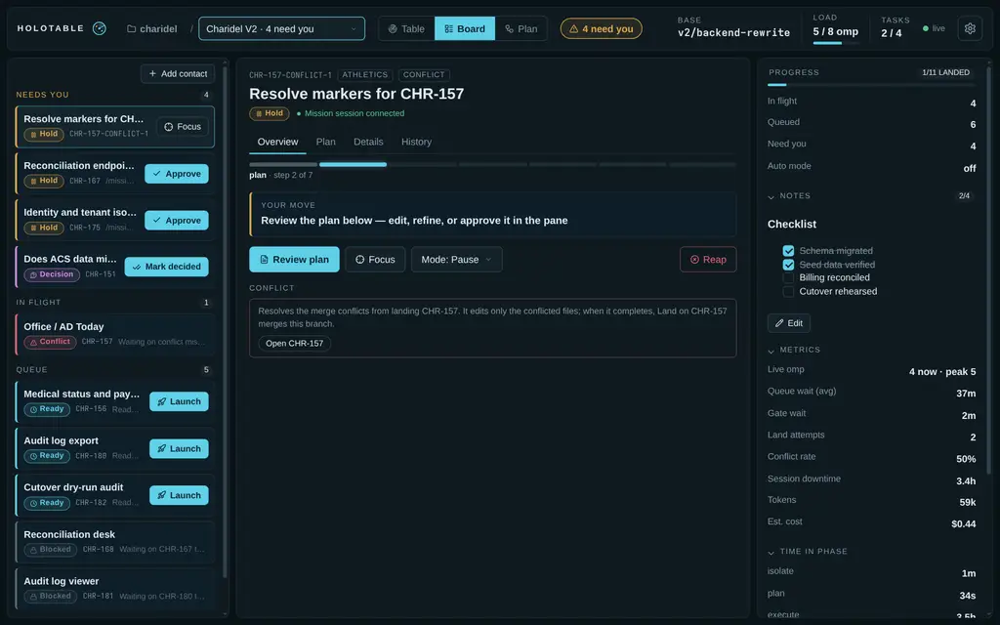
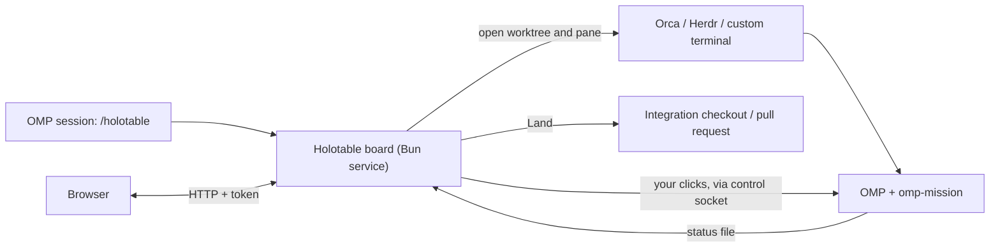
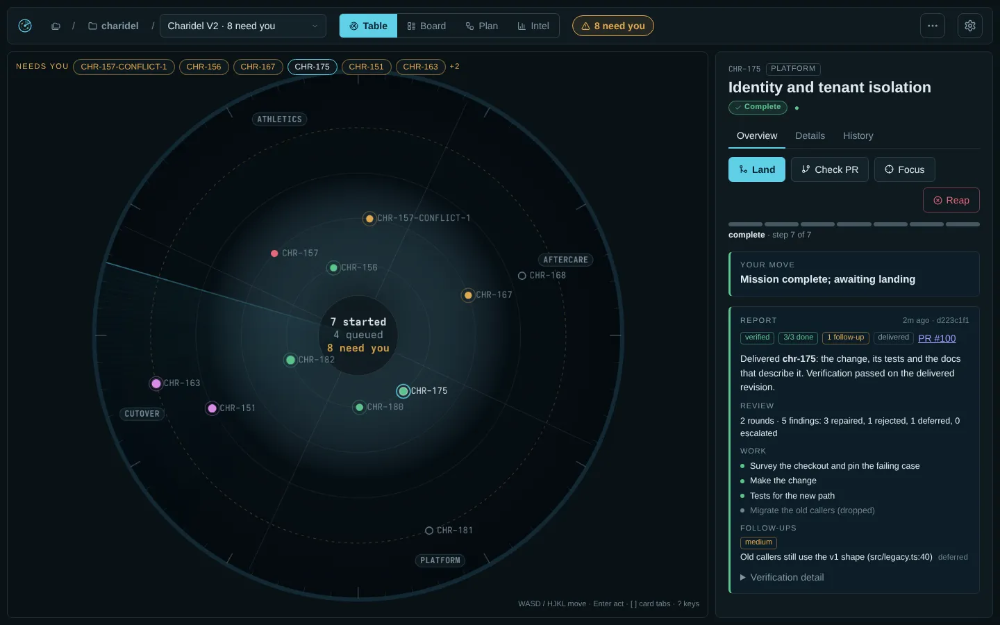
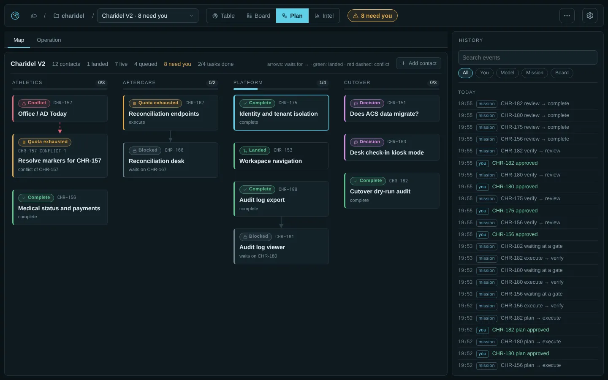
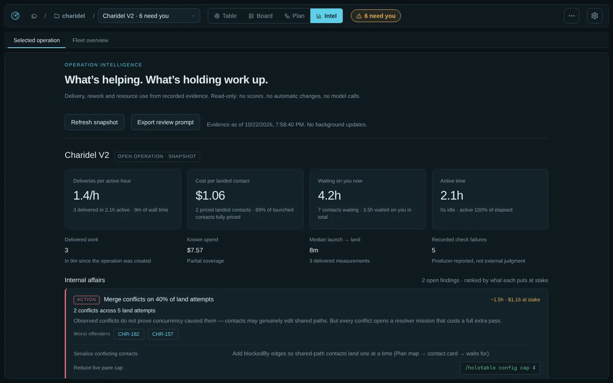
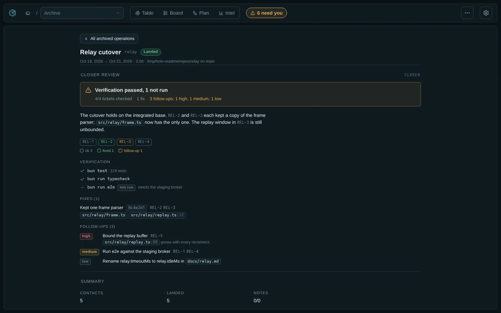

<div align="center">


<h1>Holotable</h1>

**Mission control for OMP and agent-managed work.**

[](https://github.com/can1357/oh-my-pi)
[](https://bun.sh)
[](LICENSE)

[How it works](#how-it-works) • [Install](#install) • [Quick start](#quick-start) • [Concepts](#concepts)
<br>
[Safety](#safety-model) • [Documentation](#documentation) • [Credits](#credits)

</div>

Holotable is an [OMP](https://github.com/can1357/oh-my-pi) extension and a local web board for coordinating operation contacts. Choose **Missions** to launch [omp-mission](https://github.com/Shadorain/omp-mission) sessions in separate worktrees, or **Agent-managed** when your main OMP session will orchestrate native task subagents. In agent-managed mode the board remains passive: it records only lifecycle updates the coordinator reports, and never launches or recovers workers.



## How it works

<details>
<summary>Architecture diagram</summary>



</details>

1. `/holotable` in OMP starts (or reuses) one board service and prints its URLs. The service keeps running when OMP closes.
2. **Launch** asks the operation's frontend (Orca, Herdr or a custom terminal) for a worktree and a terminal running `omp` with `/mission`. The mission plans and waits for you to approve its plan.
3. The board watches each mission's status file and control socket. It records every change as an append-only event and rebuilds the page from those events.
4. Your clicks (**Approve**, **Continue**, answers, **Switch model**) go to the mission's own control socket and run the same code as the slash command in the pane.
5. **Land** merges finished work on the operation's integration checkout or through its pull request, then unblocks whatever was waiting on it.

## Requirements

- **OMP 18.22.0 or later.** Mission panes and the board use the same current SDK, including native HTML-form questions and plan review.
- **[omp-mission](https://github.com/Shadorain/omp-mission)** installed as an OMP extension. Launched panes must load it.
- **[Bun](https://bun.sh/docs/installation)** on `PATH`, and a browser.
- **A launch frontend:** Orca terminal (`orca` CLI plus the `orca-cli-patch` extension that adds `orca worktree create --command`), Herdr (`herdr` CLI), or your own shell templates. Setup checks launch capabilities before workspace creation. Without a frontend, the board can still organize work.
- Optional, per project: `lin` for Linear tickets, `gh` for GitHub tickets and PR delivery, Git for local-merge delivery. See [Integrations](docs/guide.md#integrations).
- **Multiple Linear logins:** pin `mission.linearWorkspace` in each repository's local Git config to its `lin auth list` workspace name. Board ticket reads, search, drafting and mission panes use that login without changing the CLI default. See [Linear accounts](docs/guide.md#linear-accounts).

## Install

Install omp-mission from its marketplace, inside OMP:

```text
/marketplace add Shadorain/omp-mission
/marketplace install mission@omp-mission
```

Install Holotable from a shell:

```bash
omp plugin install github:Shadorain/holotable
```

OMP's Git installer installs runtime dependencies automatically. **Restart OMP after installation.** No container, database, separate server command or Holotable-specific model key is needed.

<details>
<summary>Install from a checkout instead</summary>

```bash
git clone https://github.com/Shadorain/holotable.git
cd holotable
bun install --frozen-lockfile
omp plugin link .
```

Install `omp-mission` too and restart OMP. Then open a session in the repo you want to manage, not this tool's checkout, and run `/holotable`. To use the `holotable` shell command, see [Standalone CLI and service](docs/reference.md#standalone-cli-and-service).

</details>

## Quick start

For agent-assisted setup, invoke `/skill:holotable <goal>` in OMP. The bundled skill points
OMP at the workflow and CLI docs; it is manual-only and never auto-invoked.

1. **Open the board.** In an OMP session inside your repository, run `/holotable` and open one of the printed URLs. The full URL carries the access token; keep it private. A board with no operations opens on **Projects** with a **Getting started** card that checks OMP, omp-mission and the CLIs your integrations need, with a fix for anything missing.
2. **Add your project.** Projects → **New project**. Pick the session's repo. Holotable detects the base branch, tracker, frontend and delivery and explains each choice; adjust anything. To launch missions, choose Orca, Herdr or a custom terminal frontend.
3. **Create an operation.** Open the operation picker → **New operation** and choose the project. Then pick a starting point (drafting opens an OMP pane, so it needs the project's terminal frontend):
   - **From a Linear project or document:** paste its URL (or issue links) into **What** and click **Draft it**. An OMP pane reads the source with `lin` and the repository, and writes a draft: zones, contacts with short titles and full descriptions, dependencies, a brief and notes. Review it, then **Create**. Pasting a link without drafting imports nothing.
   - **From a markdown plan or a rough goal:** paste the plan, or describe the goal, constraints and what done looks like, in **What**, then **Draft it**. For work with no tickets, use a project with **Tracker → none** so the draft proposes local mission ids.
   - **From a seed file:** **Load a file** fills the form's seed JSON. In OMP, `/holotable new q3 --project <project-id> --from seed.json` does the same. The [seed file](docs/reference.md#seed-file) lists zones, contacts and dependencies.
   - **Blank:** name it and **Create**, then add zones and contacts on its Operation page (Plan → Operation).
4. **Choose execution.** In New operation, choose **Missions** for board-launched mission panes or **Agent-managed** for native task subagents orchestrated by your main OMP session. Agent-managed operations hide mission Auto and Recovery settings.
5. **Work the contacts.** In Missions mode, click **Launch**, review the plan and **Land** finished work. In Agent-managed mode, claim the operation with `holotable_work`, launch task subagents from the main session, report every state change, verify and integrate each completion, then report it as integrated. The card distinguishes complete from landed/integrated.

Mission auto mode is off by default; Recovery (**Keep missions running**) is on by default only for Missions operations. Agent-managed operations have neither setting because the main OMP session, not the board, owns worker execution.

Subscription quotas and OMP's account-wide routing-policy counts are available under **Settings → AI & Models → Load subscription quotas**. The policy counts are diagnostics only; OMP remains responsible for routing each model.

### Try it without a real repo

The playground serves the real board over simulated missions. Nothing touches Git, Orca or any CLI.

```bash
git clone https://github.com/Shadorain/holotable.git
cd holotable
bun install --frozen-lockfile
bun run demo
```

It prints the board URLs (port 4747 by default; `--port` changes it). Launch a contact, approve its plan and gate, and land it. See [Playground](docs/playground.md) for what each seeded operation demonstrates.

## Concepts

|Term|Meaning|
|---|---|
|**Project**|One repository and its defaults: base branch, integration checkout, tracker, frontend, delivery and worktree folder. Operations in a project inherit these unless they override them; `/holotable set <field> inherit` or **use project value** on the Operation page drops an override.|
|**Operation**|One campaign: contacts, dependencies, a brief and notes. Its execution mode is `missions` (the default) or `agent` (main-session orchestration of native task subagents). When it ends, it moves to the archive with a report.|
|**Zone**|A workstream inside an operation, such as "API" or "Cutover". Zones are the sectors of the radar and the columns of the Plan map.|
|**Contact**|One ticket on the board, with a short title and full description. Kinds: `implement` (default), `audit`, `decision`, `closer`, and `conflict` (opened by Land).|
|**Mission**|An omp-mission session working one contact in its own worktree and terminal pane: plan, execute, verify, deliver, review, complete.|
|**Agent-managed**|Passive board tracking for work orchestrated by the main OMP session using native task subagents. The coordinator explicitly reports worker lifecycle; the board does not launch, infer, recover, retry or terminate those jobs.|
|**Coordinator**|The session owning an Agent-managed operation. On OMP, the adapter supplies the current session id; takeover requires explicit operator release.|
|**Worker complete**|A task worker reported completion. It is not integrated or landed and does not unblock dependencies; the coordinator verifies and integrates before reporting `integrated`.|
|**Lane**|The worktree, branch and terminal recorded for a launched mission contact. Agent-managed worker identity instead uses the native task-job id.|
|**Blocker**|A contact another one waits for (`blockedBy`). It counts as done only once landed/integrated, not when a mission or worker merely reports completion.|
|**Landed**|Merged into the base branch, confirmed by the delivery (PR state or Git ancestry).|
|**Decision**|A contact that is a question, not code. It never launches; an operator or coordinator chooses an offered answer, and work depending on it unblocks.|
|**Conflict mission**|A new local mission that resolves the merge conflicts Land found, so the original contact can land.|
|**Closer**|An operation's last contact. Once everything else has landed, it reviews the integrated result, fixes small problems and reports the rest as follow-ups.|
|**Pause gate**|A stop inside a mission that waits for your approval before it continues.|
|**Frontend, tracker, delivery, fleet**|The adapters an operation uses: where panes open (`orca`, `herdr`, `custom`), where tickets live (`linear`, `github`), how work merges (`github-pr`, `local-merge`), and what runs missions (`omp-mission`). Each can be `none`.|
|**Auto mode**|A Missions-only per-operation switch that launches and lands work for you. See [below](#what-you-do-and-what-auto-mode-does).|
|**Recovery**|A Missions-only switch, **Keep missions running**, that reopens and continues mission panes. Agent-managed workers are never automatically restarted.|

## The board

The page has four views. Switch with the header buttons or keys `1`–`4`.

- **Table** (`1`): a radar. Zones are sectors; rings are lifecycle stages from the outside in (queued, planning, active, complete). Contacts that need you pulse.
- **Board** (`2`): the contact list ordered by what needs you (**Needs you**, **In flight**, **Queue**, **Landed**), the selected contact's card with its actions and mission report, and the operation's progress, notes and wiring. Agent-managed boards instead show reported workers and worker details, with mission plan/control affordances omitted.
- **Plan** (`3`): the dependency map by zone, with history beside it. Its **Operation** sub-view is the operation as a document: brief, notes, setup, zones, contacts, closer and **End the operation**; mission automation settings appear only for Missions operations.
- **Intel** (`4`): measurements from the recorded history: where time goes, what waited on you, spend, stalls, conflicts and ranked recommendations, for one operation or the whole fleet. See [Intel](docs/intel.md).

|Table|Plan|
|---|---|
|||
|**Intel**|**Closer review**|
|||

The [guide](docs/guide.md#the-board) walks through each view and the full key list.

For **Agent-managed** work, the main OMP session claims the operation, maps contacts to native task-job ids, and explicitly reports worker state. `complete` awaits coordinator verification and integration; only verified `integrated` work lands and unblocks dependents. Decision contacts use `holotable_work`'s `decide` action. The board never infers worker status, relaunches jobs or terminates them. See the [Agent-managed workflow](docs/guide.md#agent-managed-operations).

## Typical workflow

1. Create an operation from a plan, a Linear project or a goal, and review the draft.
2. Launch the contacts that are ready. Independent contacts run in parallel, up to the **Agents** cap (default 8 live `omp` sessions).
3. Review each mission's plan on its card and approve it.
4. Watch **Needs you**. It lists plans to approve, Pause gates, questions, tool approvals, decisions, quota holds and finished work to land.
5. Land finished work. If Land hits a merge conflict, it opens a conflict mission; land the original contact once that mission completes.
6. When everything has landed, the closer reviews the integrated result. Read its review, land or mark it done, then **Close** the operation. Its report stays in the archive.

### What you do and what auto mode does

|Step|Without auto mode|With auto mode on|
|---|---|---|
|Launch ready contacts|you click **Launch**|launched, the one that unblocks the most work first, up to `auto.maxLive` (default 4) and the global cap|
|Approve a mission's plan|you click **Approve plan**|only with `auto.plans` on|
|Approve a Pause gate|you click **Approve**|you click **Approve**|
|Answer a question or tool approval|you answer|you answer|
|Decide a decision contact|you click **Mark decided**|only with `auto.decide` on: the recommended option, or an agent pane|
|Land finished work|you click **Land**|landed once its checks allow; red CI gets at most two **Check PR** requests per base position|
|Merge past failing or unfinished CI|you click **Land anyway** or **Skip CI and land**|never|
|Reopen a crashed pane|you click **Relaunch**, then **Continue**|only with Recovery on|

A failed automatic step never switches auto mode off: it retries that contact after 5, 15 and 60 minutes, then leaves it for you. Details: [Auto mode and Recovery](docs/automation.md).

## Safety model

- **The board never runs a mission or native task worker.** In Missions mode it opens panes and reads status files; it never attaches to a mission or calls its `control()`. In Agent-managed mode the main OMP session starts native subagents and explicitly reports progress; the board never infers their status or launches, recovers, retries or terminates them.
- **Mission rules still apply.** Pause gates, resume hold, plan mode and the ownership lock are enforced inside a mission. The board never routes around them. Plan approval resolves OMP's native plan review through the mission socket, only on your click or with opt-in `auto.plans`. Recovery only reopens mission panes and sends **Continue**, only to sessions the board launched, never after failed verification or on a quota hold, and never approves a gate or a plan.
- **Only you, or mission auto mode you switched on, change the outside world.** The board merges a pull request or branch only on your **Land** click or under Missions auto mode enabled for that operation. For Agent-managed work, the coordinator must verify and integrate changes before reporting `integrated`. It reads trackers but never edits or closes an issue itself; a merged PR can still close linked issues through your tracker's own integration.
- **Landing is careful with your checkout.** Missions Land merges on the integration checkout, never inside a mission's worktree. It refuses when that checkout is on the wrong branch or has uncommitted changes on the paths the merge would write, and never stashes, discards or commits your changes. A conflict becomes a new mission, not a second copy of the ticket.
- **Close keeps your work.** Closing an operation closes its mission panes and removes clean worktrees only. It keeps every worktree with uncommitted changes, and does not touch Git branches, pull requests, tracker issues, the base branch or the integration checkout. Closing or aborting cannot stop Agent-managed native task jobs; coordinate or stop every worker separately before handoff or archival. **Abort** also deletes worktrees with uncommitted changes, after it lists them and you type the operation id.
- **Blocked work stays visible.** A contact with unmet blockers never launches and never disappears from the queue. Agent-managed worker `complete` is not landed and does not unblock dependents.
- **History is append-only.** Every action except **Focus**, by you, mission auto mode, Recovery or the coordinator, is an event that records who caused it. The board keeps no second copy of mission or worker state.
- **Access needs the token.** Anyone with the full board URL can approve gates, so keep it private. The board answers on loopback and Tailscale by default (Settings → Server). Every API call needs the token from the URL fragment and passes Host and Origin checks. The connection is plain HTTP: use a trusted network, Tailscale or an SSH tunnel. API errors are typed by cause; see [HTTP API errors](docs/reference.md#http-api-errors).
- **Model tools have different authority.** In OMP, `holotable_state` reads and `holotable_queue` adds or edits queued contacts. `holotable_work` explicitly records Agent-managed ownership, worker updates and decisions; it does not launch or monitor subagents, and an `integrated` report must follow real coordinator verification and integration.

## Documentation

|Doc|Covers|
|---|---|
|[Guide](docs/guide.md)|set up, create operations, the four views, the contact card, launching, plan review, questions, operator actions, decisions, closer review, ending an operation|
|[Landing and conflicts](docs/landing.md)|what Land checks, CI gates, conflict missions, cleanup after landing|
|[Auto mode and Recovery](docs/automation.md)|every auto-mode switch, quota pauses, Recovery rules and limits|
|[Reference](docs/reference.md)|`/holotable` and `holotable` commands, seed file, settings, models, frontends, watching, resource budgets, data layout|
|[Intel](docs/intel.md)|the Intel view, its measurements and recommendations, review-prompt export|
|[Playground](docs/playground.md)|the simulated board and what each seeded operation shows|
|[Architecture](docs/architecture.md)|layers, ports, lifecycle, events and safety invariants|
|[Mission contract](docs/contract.md)|status files, control sockets, mission and closer reports|
|[Plan approval API](docs/omp-plan-approval.md)|native plan review APIs, socket revision checks and runtime requirements|
|[Testing](docs/testing.md)|regression coverage and runtime smokes|

## Roadmap

[PLAN.md](PLAN.md) tracks work that is not built yet.

## Development

```bash
git clone https://github.com/Shadorain/holotable.git
cd holotable
bun install --frozen-lockfile
bun test
bun run typecheck
```

Tests use temp homes and never touch `~/.omp/agent`.

## Credits

Built for [oh-my-pi](https://github.com/can1357/oh-my-pi), with missions provided by [omp-mission](https://github.com/Shadorain/omp-mission) and the board runtime powered by [Bun](https://bun.sh).

## License

[MIT](LICENSE)
