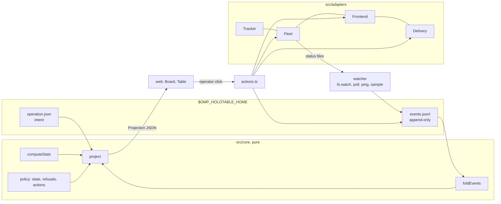

# Architecture

The board is a standalone Bun service (`bin/holotable.ts serve`, usually a systemd user unit) that owns campaign data (operations, contacts, zones, queue, events), the HTTP board and the watcher. The OMP host adapter runs explicit `/holotable` commands through the bundled CLI; its model tools, completions and passive status use the host-agnostic core (`src/plugin/`) in-process. The host reads the running service rather than owning it. Everything stack-specific sits behind four optional ports.

Automatic startup and the OMP CLI adapter resolve `bun` from `PATH`; they never treat OMP's `process.execPath` as a Bun interpreter (OMP may be a compiled executable). The adapter invokes the checkout's own `bin/holotable.ts`, avoiding a mismatched global CLI version. A missing Bun produces an installation error before any process or service is started. Detached spawn waits for spawn/error, unreferences the child and closes the parent's log descriptor.

The installed Linux unit bounds its cgroup (board plus CLI subprocesses): `CPUQuota=25%`, `MemoryHigh=256M`, `MemoryMax=512M`, `TasksMax=64`, `Nice=10`. Stop timeout is 15 s; failure restarts wait 10 s and are limited to three starts in 300 s. Orca/herdr mission panes run outside that cgroup. Direct/detached `serve` has no systemd resource ceiling.

## Layers

|Layer|Rule|
|---|---|
|`src/core/`|pure: no `node:*`, no `process.env`, no `Date.now()` (the clock is an argument), no I/O|
|`src/store/`|the only code that touches `$OMP_HOLOTABLE_HOME`|
|`src/adapters/`|the only code that spawns processes or opens sockets; spawns go through the injected `Run`|
|`src/runtime/`|watcher, launcher, actions, lander, auto mode (`auto.ts`), post-land cleanup (`cleanup.ts`), end-of-operation wind-down (`winddown.ts`, `end.ts`): orchestration over ports and store|
|`src/service.ts`|the standalone board owner: lock, server, watcher loop, token; used by `bin/holotable.ts` and the tests|
|`bin/holotable.ts`|the CLI: `start`, `stop`, `restart`, `status`, `url`, foreground `serve`, Linux default-home `install`/`uninstall`, and shared store commands; global `--home`, `--json`, `--current` precede the command|
|`src/plugin/`|host-agnostic core: command runner, generic tool definitions, structured live status, service health via `board.json`|
|`src/plugins/omp/`|the OMP adapter: explicit commands through `src/adapters/holotable-cli.ts`, generic core tools mapped into `ExtensionAPI`, themed status and completions. No server, no watcher|

The OMP adapter initially registers only `/holotable`. Its first explicit invocation imports the core and CLI adapter, registers and activates the model tools, and starts a session-owned 10-second refresh for completion data and live status. CLI calls carry the session's `--current` selection and never read or write the shell's selection. Inactive sessions do not read the store or query the board. Session start, switch, branch, shutdown and explicit stop clear status, cancel the refresh timer and disable the tools; session lifecycle events also clear selection, while stop keeps it. Late results from an old context cannot restore the row.

Each live-status refresh uses one operations request and no CLI subprocess, distinguishing an unreachable service from a running empty board. Counts belong to the selected operation (or the sole operation), otherwise they are board totals. OMP renders them with its current theme's symbols and colors, omits zero counts and hides the empty-board row.

## Service lifecycle

One authenticated board is shared per home. Default-home Linux starts use the installed systemd user unit when available; custom homes and other platforms use a detached Bun process. `stop` reads the live identity from `GET /api/service`, then posts its PID and ephemeral instance nonce to `POST /api/service/stop`, under the existing token, Host and Origin checks. A stale identity is rejected; the CLI never kills a PID from `board.json`.

The shutdown reply finishes before closing the listener. The service stops scheduling passes, drains tracked HTTP requests and the current watcher, auto and recovery work, then releases the ownership lock. Stop waits for that lock release; a replaced owner is not stopped. Startup failures close any acquired resources and release the lock. Restart uses this same stop path before starting, keeping campaign files and the URL token.

`new --auto` builds the enabled auto configuration into the initial operation write, then the CLI ensures the board is running. Its defaults enable launch and land, cap operation concurrency at four (also bounded by the global cap), and leave plan approval, decision automation and recovery off. Explicit seed auto fields are preserved; the flag overrides only `enabled`. Pause and project inheritance are unchanged.

Decision cards and confirmation dialogs use native radio groups with no implicit first or recommended selection. Card choices are tentative browser state keyed by operation and ticket; polls preserve them, successful saves clear them. Pick recommended only selects. Confirmation binds the captured operation id, so an archive or selection change cannot send the answer to a different operation. Save failures restore the controls and display the actual error; toast deduplication compares dataset strings rather than constructing selectors from error text.

`board.json` binds discovery to the home it was written in (realpath). A copied `board.json`/`token` pair cannot make another home's CLI manage this board; symlinked homes resolve to the same owner.

## AI preferences and review UI

`settings.ai` stores nullable `model`, `thinking`, `draft`, `decision` and `mission` preferences.
New draft and decision panes receive `--model` and `--thinking`; mission panes receive them
through `Fleet.launch`. A call's explicit model wins over its per-use default and global default;
explicit `null` bypasses both and omits `--model`. Omitted values inherit, ultimately leaving OMP
in charge. A lane stores only an explicit model override (`string | null`), preserving it across
replacement panes; inherited lanes use the current defaults. No existing session is reconfigured,
and `plan-refine` stays on its current socket owner/model.

`POST /api/drafts` accepts optional `model`; `launch` and `decide-agent` accept `args.model`.
The server rejects non-string, non-null overrides. Browser action picks are keyed by operation
and ticket and cleared after success, so identical ticket ids in different operations cannot
share an override.

`GET /api/models` runs `omp models --json --no-extensions` and
`omp usage --json --redact --no-extensions` through the injected `Run`, on demand. CLI startups
are serialized because they share the production board's CPU budget. Each command and wait is
bounded at 10 seconds (up to 20 seconds for both). `src/models.ts` coalesces concurrent requests
and caches results for 30 seconds; `?refresh=1` bypasses that cache without duplicating an
in-flight request. Opening a picker or requesting quotas triggers a read; mounting a form or
card does not. The browser also expires its cache after 30 seconds and renders at most 60
matching options, searching the whole catalog. There is no quota polling.

`core/subscription-capacity.ts` projects sanitized quota evidence into each model's optional
`capacity` and the catalog's `subscriptions`. Capacity contains `state` (`available`, `low`,
`exhausted`, `unknown`), remaining fraction, binding reset time, report timestamp and detail;
subscriptions add provider, pool label and window summaries. Accounts are not summed: each
account is constrained by its lowest remaining window, then the best reported account is used.
Unreported accounts prevent claiming universal exhaustion. Model-scoped limits do not block
unrelated models. Antigravity backend counters isolate Gemini from its shared Claude/GPT pool.
Grok subscription windows exclude product breakdowns and paid overage. Reports older than ten
minutes, or predating an elapsed reset, are unknown until refreshed. Raw report metadata,
account identifiers, endpoints and credentials are not exposed.

Settings shows the read-only subscription panel; existing pickers display capacity and reset
hints, rank known headroom ahead of near-limit/unknown choices, and disable exhausted options
without changing the selected value. Refresh updates closed settings pickers too. Low means
at most 10% remaining or a provider warning. Usage failures preserve a searchable model catalog
with unknown capacity and an explicit `usageError`. Capacity is advisory subscription evidence,
not a billing balance or model-access guarantee. No live sessions or OMP settings are changed;
fallback and subagent-role/account selection remain OMP-owned.

Contacts keep a short `title` and a separate optional `description` containing complete instructions.
Map and list cards show the title; the selected card displays the full markdown description
directly, without clamping or expand/collapse controls. A double click opens the task card;
double-click intent is handled on `click.detail` before selection replaces the map nodes.
Description-only changes participate in rendering signatures. The new-operation brief is full-width
with markdown preview and a wide focus editor; draft completion updates unedited preview/focus
views without replacing the operator's edits.

Blocked cards use dependency chips as their sole prerequisite list, omitting duplicate status
and launch-refusal lists. Connectivity dots keep accessible labels and themed live/offline colors.
The demand-driven Load tooltip renders measurements only.

Operation-table zone filters are browser state keyed by operation and cleared when a zone is
removed. Ticket navigation rejects PR URLs and resolves missing tracker URLs on demand through
`GET /api/tracker/issue?op=&ticket=`. Linear uses the authenticated workspace key from `lin me`
when an issue omits its URL. Tracker-only service wiring supplies valid unused port kinds;
queued contacts need not enter the watcher's sampling loop to obtain a link.

Recovery treats producer `hold: quota` as an operator hold, even when the pane is offline:
neither Continue nor Relaunch is automatic. Serialized relaunches recheck that hold when
their queued action begins, so a newly reported exhausted quota cannot trigger a retry storm.

`core/mission-problem.ts` reads structured producer problems and uses older panes' next-step text only for presentation. Failed reviews are Hold/Needs you even without a retry capability; scheduled retries are Waiting, never running or relaunchable live panes. Recovery capacity waits remain distinct. Projection exposes an operation-level `auto.capacityWait` for current quota/rate-limit problems: Auto suppresses new mission launches, native plan approvals and paid decision panes but continues landing and recommended decisions. No deadline inferred from text authorizes an action.

Mission launch and relaunch admission reads Linux `MemAvailable` without scanning the
process table. `core/policy.ts` requires 600 MiB per new/pending pane plus a 512 MiB
machine reserve. `runtime/launcher.ts` checks before frontend creation or old-pane
closure; refusal is `409 memory-pressure` and preserves the saved lane. Recovery checks
both before enqueueing and when a queued relaunch begins. A later admission refusal is
logged but excluded from its crash budget. Missing `/proc` skips memory admission;
the cross-operation cap still applies. Existing missions and their tools are not capped
by this check.

Capacity refusals are also excluded from the crash budget. Recovery reserves slots
and pane-memory budgets for queued launches, rechecks cancellation/ownership/resources
at dequeue, and refreshes the watcher after successful socket actions. Its transient
`deferred(op)` map feeds projection-only Waiting states; it stores no mission data and
emits no events just for waiting. Reasons clear when eligibility or operation intent changes.

## Ports

|Port|Adapters|Role|
|---|---|---|
|Tracker|`linear`, `github`, `none`|sample a ticket's state and URL; `search` feeds the Add contact ticket picker (`GET /api/tracker/search?op=<id>|project=<id>&q=<text>` → `{tracker, hits, error?}`, hits already on the operation flagged `taken`)|
|Fleet|`omp-mission`, `none`|read mission status, ping and control the owning session, build the launch command|
|Frontend|`orca`, `herdr`, `custom`, `none`|create worktrees, open/focus/close terminals|
|Delivery|`github-pr`, `local-merge`, `none`|probe delivery state, land on the integration checkout|

An operation names one adapter per port; all four can be `none`.

## Data flow

1. Operator commands and board clicks change `operation.json` (intent) and append events.
2. The watcher reads mission status files and pings sockets, then appends `phase`, `gate-armed`, `socket-up/down` and `sample` events only when something changed. `src/runtime/status-watch.ts` runs `fs.watch` over `<agentDir>/missions` and every `missions/<id>/status` directory; a status write wakes a pass within a debounce, while the `pollMs` loop stays the floor for owner pings, terminal lists and anything file events miss. Its in-memory view is seeded from the events, so a restart replays nothing. Frontend terminal lists are needed only for live recorded lane terminals or open decision panes. Orca/herdr listings are global and shared once per pass; custom listings remain operation-scoped. Vanished terminals and open counts update in the same pass.

File notifications use bounded 300 ms coalescing. Ordinary JSON writes do not rescan directories; topology events trigger a coalesced scan, and a periodic scan checks inode identity to rearm replaced directories and remove stale watches. Parent directory events are filtered to mission topology. The service cancels its existing fallback timer before each wakeup; wakeups during a pass retain only one pending rerun, and shutdown drains the active pass.

`GET /api/stream` is a header-authenticated Server-Sent Events channel consumed through streaming `fetch` (`web/live.js`); the token never enters a request URL. `appendEvent`, changed watcher extras, and successful HTTP mutations notify `core/notify.ts`. Each client coalesces pushes within 250 ms without resetting the deadline; backpressure retains one dirty flag until drain. Close and rebind destroy tracked streaming responses explicitly.

The operation directory also holds `brief.md` (free text the operator edits on the operation page; `GET`/`PUT /api/brief`), `notes.md` (the scratch pad; `GET /api/notes`, `PUT /api/notes {op, text, base}` answers 409 `stale` when `base` is not the current revision; the projection only counts its task lines as `notes {done, total}`) and `seed.json` (the raw `--from`/create-payload that seeded the operation).

Projects live in `projects/<id>/project.json` (`store/projects.ts`). An operation's `operation.json` stores `project` and only the overridable fields that differ (`repo`, `base`, `integration`, `pause`, the four ports, `worktreeRoot`); `core/validate-operation.ts` resolves the effective operation from the project and reports which fields were `inherited`. Attaching sets every overridable field to the project's value (refused with 409 when launched work would move to another repo); detaching writes the resolved values back so nothing changes in effect; the value `inherit` drops one override. `store/migrate.ts` runs once per home (marker `.v5-projects`, under the home lock): project-less operations are grouped by repo realpath into one project each, seeded from the oldest. Reading an operation that still has the legacy `workflow` array rewrites it to `notes.md` task lines (done state from its last `workflow` event) and drops the key. Routes: `GET /api/projects`, `GET`/`POST /api/project-config`, `POST /api/projects`, `POST /api/projects/remove` (409 while an open operation uses it), `POST /api/project-graph` (`op` `install`|`restart`).

The bead graph (`src/adapters/beads-dolt.ts`) is read per project, not per operation: `projectConfig` answers a `graph` field with the unit name (`beads-dolt-<project>`), the port from `.beads/dolt/config.yaml` or `dolt-server-config.yaml`, `unitState` from `systemctl --user`, a TCP reachability probe, and whether `bd`'s `dolt.auto-start` is off. `install` renders the unit (the same shape `beads-dolt-charidel.service` was written in by hand: `dolt sql-server --config`, `Restart=always`), writes the pinned port, sets `dolt.auto-start: false`, then `systemctl --user daemon-reload` and `enable --now`; a second install keeps the existing port so a live graph is never moved under missions. `restart` runs `systemctl --user restart`. Both go through the injected `Run`; the page refreshes the pill on its poll so it shows live health rather than stored config.

New projects take explicit `pause`, otherwise `settings.defaults.pause` (default false/Auto).
Operations take explicit `pause`, then their project's saved value, then that global default.
Saved projects and operations are not migrated. Board auto launch/land remains independent.

Reach (`src/access.ts`, `settings.access`): `local` binds `127.0.0.1`, `tailscale` (default) binds `0.0.0.0` but accepts only loopback and Tailscale peers (`100.64.0.0/10`, `fd7a:115c:a1e0::/48`) by remote address, `network` binds `0.0.0.0` and accepts any. The API token and the Host/Origin checks apply in every mode. `settings.port` defaults to 4848; a taken port falls back up to 4858 (`0` = any free port). The service publishes its reachable `urls` in `board.json` (loopback always, plus Tailscale IPs and the MagicDNS name from `tailscale status --json`, plus LAN addresses in `network`). `PUT /api/settings` for `access` or `port` rebinds in-process — close listener, reopen, republish `board.json` — and answers the new `urls`.

Repo detection (`src/adapters/detector.ts`, all through the injected `Run`): `GET /api/repos` merges project repos, `orca repo list --json`, and `recent-repos.json` (up to five git top-levels recorded by the plugin when `/holotable` runs), deduplicated by realpath, cached ~30 s. `POST /api/projects/detect {repo}` answers `{fields, reasons}`: base from Orca's `worktreeBaseRef`, else remote `origin/HEAD`, else the current branch, else `main`; name from Orca's `displayName` else the folder; frontend `orca`/`herdr`/`none`; tracker `linear` (`lin me`) or `github` (GitHub origin + `gh auth`) or `none`; delivery `github-pr` or `local-merge`; fleet `omp-mission`, integration = the git top-level (non-git paths are a 400). The HTTP response reflects `settings.defaults.pause`; repository detection does not choose mission mode. `POST /api/projects` accepts `{repo}` alone and detects unspecified repository fields.

Agent drafts (`store/drafts.ts`, `drafts/<id>/`): `POST /api/drafts {text, project?|repo?}` opens a terminal through the frontend running `omp` with a prompt to read the text or link and write `seed.json` there; `GET /api/drafts?id=` reports `running`, `ready` (with the validated seed), `invalid` (with the error) or `missing`; `POST /api/drafts/close` closes the pane and deletes the directory. Refused with 409 when the effective frontend is `none`. The board never runs a model itself; the form only fills fields from the seed.

Draft instructions support both source import and idea development. Linear document URLs resolve
through `lin docs get <trailing-id> --json`, followed by issue/relationship reads. The draft pane
inspects the selected repository read-only, preserves explicit dependencies and independent lanes,
and records scope, acceptance checks and ownership boundaries in the brief. Each contact has a
concise title and a self-contained description with its task scope and acceptance criteria. For
tracker `none`, it generates local slugs; the fleet launches `/mission -- <description>` (using
the title only when no description was supplied). Tracked launches keep the real ticket and pass
the description as additional mission instructions. The campaign brief is not injected into
implementation missions. Drafting never creates or updates external tickets; an idea that needs
new unticketed work must use a local project or receive real tickets first. Drafts remain
proposals: the operator reviews the seed before creating an operation, and mission plan approval
is a separate step in the launched pane.
Saved contact order governs auto-launch priority among currently eligible contacts. Zones,
map positions and narrative ordering do not introduce dependencies; `blockedBy` and decision
contacts carry hard constraints.

Decision panes (`store/decisions.ts`, inside the operation directory — unlike drafts, which live under the home): `decide-agent` opens a lane-less `omp` terminal in the operation's `integration` checkout with a prompt that lists the question, `options` and `recommended` (free text when there are none) and asks it to write `decisions/<ticket>.json` (`{choice, rationale?}`) under that operation directory, then stop. The open pane is recorded in `decision-panes/<ticket>.json` (`terminal: null` until `openTerminal` returns). The watcher lists terminals per pass: a listed pane with no answer file yet is still working; a readable answer records `decided {choice, rationale?, by: "agent"}`, lands the contact (`via: "manual"`), deletes the record and closes the pane (`terminal-missing` when it already exited); a listed pane whose answer is invalid records one `operator {op: "decide-agent", ok: false}` and is left open for the operator to fix or close; a gone pane with no answer records the same failure once (`pane closed before deciding`) and deletes the record. The same shape covers crashes and restarts: a pane written on disk but absent from `listTerminals` fails on the next pass.

First-run setup (`GET /api/setup`): checks prerequisites (OMP CLI, OMP Mission extension, and CLIs for the frontends/trackers in use) by running them in parallel through `ports.ts::Run` with a 5s timeout. Cached for 30s. Failures return `ok: false` with a `fix` message instead of 500s. Also returns store counts (projects, operations, contacts, launched contacts).

Load tooltip (`GET /api/usage?op=<id>`): `src/machine.ts` samples `/proc` (machine CPU jiffies from `stat`, `MemTotal`/`MemAvailable` from `meminfo`, the process table's cwd/ppid/jiffies/RSS) and `src/usage.ts` diffs two samples — the previous one it kept, or a pair 300 ms apart when it has none or it is over 10 s old. A single in-flight refresh and ~1 s snapshot cache are shared across all viewers and operation ids; each refresh resolves lane roots once, then derives per-operation reports from that same baseline. `core/usage.ts` does the math: a process belongs to an operation when its cwd is inside a lane worktree (realpath compare) or it descends from one that is; CPU% is ticks delta over `elapsed * CLK_TCK * cpuCount` (share of the whole machine), memory is summed RSS against `usableMemoryBytes()`. `op` is null when `op=` is absent, and every figure degrades to null when /proc cannot be read. The web (`usage.js`) fetches only while the stat is hovered or focused and the document is visible.

Browser lifecycle: streaming `fetch` on `/api/stream` refetches when the board pushes a change. The safety poll runs every 30 s while connected, 3 s while disconnected. A change during an active refresh requests one catch-up refresh; reconnect also refreshes immediately. Hidden pages abort their stream and stop board, draft and load-tooltip refreshes; visibility restoration reconnects and refreshes. Tooltips dismiss on hiding. Radar draws remain gated by view and visibility; header and sidebar signatures avoid rebuilding unchanged DOM.

3. `project()` folds the events, joins live status, and returns one `Projection` that both views render. Contact state, the refusal text of a disabled button and the legal actions all come from `core/policy.ts`; the web never recomputes legality. Decision contacts carry `options`, `recommended` and `decision` (the folded latest `decided`, with its `by`), and the watcher's `decisionPanes` set marks `decisionPane` on the contact whose agent pane is still open.
4. A click posts `{op, contact, action, args?}`. `plan-approve` carries the displayed plan's `revision` and resolves OMP's native review with `compact`; `auto.plans` uses the same socket operation when opted in. The server recomputes legality from a fresh projection; the mission rechecks revision and native review availability. No review is approved by the board model or Recovery.
5. After every watcher pass, `runtime/auto.ts` looks at each open operation with `auto.enabled`: it lands contacts that are `complete` (when `auto.land`), resolves undecided decisions — `by: "recommended"` when a recommended option exists, otherwise a `decide-agent` pane that counts as one live lane — until `auto.maxLive` or the operation cap is hit (when `auto.decide`), then launches queued `implement`/`audit` contacts in queue order under the same two limits (when `auto.launch`). Actions it takes are recorded as `operator` events with `by: "auto"`. Landing preflight reuses the delivery adapter's overlap/base-branch guard (`assertIntegrationReady`, fed the same resolved `sourceBranch` the lander will merge). `integration-dirty` and `integration-wrong-branch`, including a readiness change between preflight and merge, defer landing without disabling Auto; a transient per-operation reason is exposed as `operation.auto.landWait` and shown on the Operation card. While blocked, preflight is paced at 30 seconds with no merge attempts or repeated failure events; queue/decision automation remains independent. The wait clears after readiness returns, Land/Auto is disabled, the target disappears, or the operation is archived. Other failures pause Auto and record why. The Operation page loads its document even when restored directly after refresh, coalesces concurrent reads, and ignores responses for a different selection. Plans at `plan-approval` and unmet blockers are left for the operator unless their specific automation is enabled and supported.
6. `runtime/cleanup.ts` runs after a clean land (and `done`), when `settings.cleanup` is on: it closes the terminal (`reaped` event; a terminal that is already gone counts as reaped) and removes the worktree only when `git status --porcelain` is empty (`removed` event). Any failure — a dirty worktree included — appends an `operator {op: "cleanup", ok: false}` event and never fails the land. The watcher stops reading and pinging landed+reaped contacts, so a landed mission stops counting against the live cap.
7. Ending an operation (page `close`/`abort`, `/holotable close`, `POST /api/close|abort`) runs `runtime/end.ts::endOperation`: auto mode off, `winddown.ts` closes every recorded terminal (`reaped`; `terminal-missing` counts) and removes every non-external worktree (`removed`; abort deletes dirty worktrees), failures are `operator` events that never stop it, then `closed` is appended, `store/archive.ts::writeReport` writes `report.json` next to the operation's files and `archiveOperation` moves the directory under `archive/`. Abort's `GET /api/abort-preview` lists the terminals and worktrees (each `git status --porcelain`-checked) before the confirm. `core/report.ts::buildReport` is pure: an archive without `report.json` gets one rebuilt on read, never written back. Archive routes: `GET /api/archive` (newest first) and `GET /api/archive/report?key=`; the key must name a real archive entry, so traversal cannot leave `archive/`.
8. After every watcher pass, `runtime/recover.ts` looks at each open operation with `recover: true` (default off, never inherited from a project). It never acts for an operation with the switch off. Per contact: (a) a session at `hold: "resume"` whose owner is live, with `status.ctl !== null`, `verify !== "failed"` and `continue` among `status.actions`, gets a `continue` through the normal action runner with `by: "recover"`; attempts for one contact are at least 30 s apart, derived from the events so a board restart keeps the pacing (the ownership lock of a crashed session stays stale ~30 s). (b) A contact that is `offline`, has a lane terminal, is not `complete`, has no `reaped` event after its latest `launched` (an operator Reap means "leave it"), and either lost its terminal from a frontend that lists terminals (`vanished`) or has had `socket-down` for 60 s or more with the terminal still listed, gets a `relaunch` with `by: "recover"`. Relaunches run fire-and-forget and one at a time across contacts (the service cgroup caps threads, and the frontend CLI fails with EAGAIN when several start together; a queued contact is not queued twice), so the watcher loop never waits on the 90 s socket poll so the watcher loop never waits on the 90 s socket poll; none is attempted while the relaunch action is disabled (cap full), so a refusal never costs crash-loop budget. At most 3 `by: "recover"` relaunches per contact in 30 min; the next candidate records one `operator {op: "relaunch", ok: false, by: "recover", error: "gave up: 3 relaunches in 30 min"}` and stops until an operator Relaunch (any `relaunch` event without `by`) resets the count. `runtime/launcher.ts::relaunchContact` is the relaunch: close the recorded terminal if the frontend still lists it, open a new one in `lane.worktree` with the same fleet launch command and environment, record it on the lane and as a fresh `launched` (which clears `reaped`), then wait for the control socket. The new child attaches the worktree's saved mission under resume hold (`OMP_MISSION_AUTOSTART` is ignored when a mission exists), so (a) or the operator's Continue finishes the job. Recovery never approves a gate or plan, never continues on failed verification, never touches a session without a control socket, never relaunches a reaped contact and never exceeds the cap.

Each watcher pass also runs `git status --porcelain` on a local-merge operation's integration checkout; the uncommitted path count rides the projection as `operation.integrationDirty` and drives the header's `integration dirty · n` warning pill. The probe is advisory only: readiness is rechecked inside `assertIntegrationReady` at land time.

## Invariants

- Events are append-only and every stat is derived from them; there is no second copy of mission JSON and the board never parses it.
- One board per home (`proper-lockfile` on `board.lock`); a second session is told where the first one lives.
- Mutations of a mission only happen from board clicks, through the owning session's control socket. This process never attaches a mission and never calls `control()`.
- Launch is resumable: each step's result is written to `contact.lane` immediately, so a crash never orphans a worktree or a terminal.
- A blocker counts only when it has a `landed` event.
- Land happens on the integration checkout, only when it is on the base branch and no uncommitted path overlaps the files the merge would write (`git merge-tree --write-tree` names them; an `integration-dirty` refusal lists the overlap). Unrelated uncommitted paths are preserved. A conflict aborts the merge and opens a conflict mission.
- The live-`omp` cap (default 8, maximum 64) counts panes whose session can still be running, across all open operations. A pane whose owner is offline (session exited, died or hung) or whose terminal vanished holds no slot, so Relaunch and Recovery can replace it.

## Events

`$OMP_HOLOTABLE_HOME/operations/<id>/events.jsonl`: append only, one JSON object per line, written with a single `appendFile` of `JSON.stringify(e) + "\n"`. Never rewritten. Every event has `v: 1` and `at` (ISO-8601). Contact events add `contact` (ticket). Kinds and extra fields, exact:

| kind | extra fields |
|---|---|
| `queued` | `source?: "operator" \| "model" \| "seed" \| "conflict"` (who put it on the board) |
| `edited` | `source`, `fields: string[]` (a queued contact changed) |
| `blocked` | `by: string[]` |
| `unblocked` | |
| `adopted` | `worktree: string`, `source?` |
| `launched` | `worktree`, `frontend`, `terminal: {handle, incarnationId}` |
| `launch-failed` | `step: "repo" \| "workspace" \| "terminal" \| "socket"`, `error: string` |
| `socket-up` | `generation: number` |
| `socket-down` | |
| `phase` | `from: string \| null`, `to: string` |
| `gate-armed` | `gate: string` |
| `operator` | `op: string`, `ok: boolean`, `error?: string`, `by?: "auto" \| "recover"` (auto mode or recovery ran it). `op` is a policy action id (`launch`, `relaunch`, `continue`, `reap`, ...) |
| `land-attempt` | `outcome: "clean" \| "conflict"`, `paths?: string[]` |
| `conflict-opened` | `conflictContact: string` |
| `landed` | `via: "merge" \| "pr" \| "manual"` |
| `decided` | `choice: string`, `rationale?: string`, `by: "operator" \| "agent" \| "recommended"` (latest one wins for fold; lands the contact) |
| `reaped` | |
| `removed` | `worktree: string` (lane worktree removed: cleanup after landing, or the operation's wind-down) |
| `sample` | `tracker?: {state, url}`, `delivery?: {url, state, mergeable, checks}`, `workers?: number`, `omp?: number`, `usage?: {tokens: {input, output, cacheRead, cacheWrite}, costUsd: number \| null}` (the mission's cumulative total; stats add each contact's latest) |
| `workflow` | legacy, read only to migrate a checklist into `notes.md`; no longer written |
| `auto` | no `contact`; `enabled: boolean`, `reason?: string`, `by: "operator" \| "board"` (auto mode flipped) |
| `recover` | no `contact`; `enabled: boolean`, `by: "operator" \| "board"` (recovery flipped; `/holotable set recover`, `POST /api/operation-config`) |
| `closed` | no `contact`; `outcome: "landed" \| "abandoned" \| "decision" \| "failed"` |

A `sample` carries ids, states, URLs and counts, never ticket text. The watcher appends one only when a watched field differs from the last sample for that contact.

## Contact state and policy

Contact state, first match wins:

| condition | state |
|---|---|
| landed event | `landed` |
| lane null, kind decision | `decision` |
| lane null, unmet blockers | `blocked` |
| lane null | `ready` |
| a contact with `conflictOf` = this exists and is not yet `complete` or `landed` | `conflict` |
| status null, no `socket-up` event yet, lane has a terminal | `planning` |
| status null, or unfinished mission with owner `offline` | `offline` |
| `status.hold !== "none"` on a live owner | `hold` |
| `status.complete` | `complete` |
| live unfinished mission advertises `resend` (stopped worker) | `hold` |
| `status.phase === "verify"` | `verify` |
| `status.phase === "review"` | `review` |
| otherwise | `running` |

A finished mission (`status.complete`) stays `complete` when its owner is gone or its terminal was reaped, because landing needs no live owner. An unfinished quota-held mission with an offline owner is `offline` and explicitly relaunchable; its quota reason remains visible and Recovery still skips it. A live quota-held owner exposes the producer's Continue for an operator retry, even with Recovery enabled.

Eligible offline missions with Recovery's explicit capacity/memory deferral render as
`waiting`; they do not need operator attention. Reaped and quota-held missions never
inherit this state. A Review needs attention only when the producer advertises `review`.
Every fleet control, including Mode, is producer-advertised; Review/Resend/Release use the
same operator socket path. Closed frontend handles cannot be focused. Automatic Continue
re-reads producer status before sending and refuses new quota or failed-verification holds.

Group: `queue` if lane is null and the contact has no `landed` event, else `live`.

`launchRefusal` returns the first matching reason (strings exact), else null:

1. `operation closed`
2. `decision tickets do not launch`
3. `already launched` (lane has a terminal)
4. `blocked by <T1, T2>` (unmet blockers, ticket list comma-space joined)
5. `cap <open>/<cap> omp` when `load.open >= cap`
6. `no frontend: set one with /holotable set frontend orca` when frontend `none`
7. `no fleet configured` when fleet `none`

`actionsFor` returns `ActionView = { id, label, primary: boolean, enabled: boolean, reason: string | null }[]`:

| state | actions |
|---|---|
| ready | `launch` (Launch, primary, enabled iff `launchRefusal` null, else reason) |
| blocked | `launch` disabled with its reason |
| decision | `done` (Mark decided, primary; `{choice?, rationale?}` — the choice must be one of `options` when set, free text otherwise, blank counts as `decided`); `decide-agent` (Ask an agent: opens the decision pane; enabled iff the operation is open and under `cap`, reason `operation closed`/`cap <open>/<cap> omp`/`no frontend`, disabled while `decisionPane` is set with reason `decision agent running`) |
| planning, running, verify, hold, offline | `focus` (Focus, enabled iff terminal recorded and frontend not `none`/`external`); for owner live and hold/running/verify: one button per op in `status.actions ∩ {approve, continue, review, dispatch}` (labels Approve, Continue, Review, Dispatch; `approve` and `continue` primary) plus `mode` (Mode); owner not live: those buttons disabled with reason `owner-offline`; `ctl === null` disabled with reason `no control socket (not launched by holotable)`; `reap` (Reap, enabled iff terminal recorded) |
| complete | `land` (Land, primary; enabled iff delivery is not `none`, kind is `implement`, the probe is not `closed`, and no conflict contact for it is unresolved; reason otherwise: `no delivery configured`, `conflict mission <ticket> open`, `pull request closed`); `done` (Mark done) when Land does not apply (kind `audit`, kind `conflict`, or delivery `none`); `focus`; `reap` |
| conflict | `land` disabled with reason `conflict mission <ticket> open`; `focus`; `reap`. The conflict contact has its own card in `planning`/`running`/... states. When every conflict contact for this contact is `complete`, this contact falls through to its own state (`complete`) and Land uses the newest conflict contact's branch |
| landed | `reap` (enabled iff terminal recorded and not reaped); `redecide` (Change decision, `{choice, rationale?}`, same choice rules as `done`) when `kind: "decision"` |

Fleet buttons require `status.ctl !== null`. Holotable never computes mission legality itself; it renders `status.actions`.

`relaunch` (Relaunch, primary) is offered in state `offline` only, when the lane has a terminal, the frontend is neither `none` nor `external`, and the mission is not complete (a complete mission is `complete`, not `offline`). A reaped contact is `offline` and therefore relaunchable by the operator; that is the only way back after Reap. It is enabled unless the operation is closed or `load.open >= cap`, with the reason `operation closed` or `cap <open>/<cap> omp`. A lane with no terminal (a launch that stopped early) offers `launch` instead.

## Provenance
Every history entry has an actor: `operator` (your commands and board clicks, and `--from` seeds), `model` (the `holotable_queue` tool), `mission` (phase, gate and session changes the watcher reads from the mission's status), or `board` (blocking and unblocking, conflict contacts the lander opens, auto mode, and recovery). `operator` events fired by auto mode carry `by: "auto"`, those fired by recovery `by: "recover"`; a `decided` event's `by` is `operator`, `agent` (the decision pane answered) or `recommended` (auto mode took the recommended option). `ContactView.origin` is the contact's first `queued`/`adopted` event. `GET /api/history?op=<id>` returns the full history, newest first; the projection carries only the last 50.
