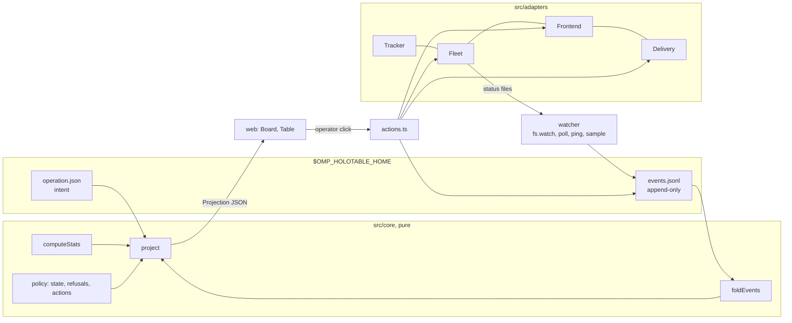

# Architecture

The board is a standalone Bun service (`bin/holotable.ts serve`, usually a systemd user unit) that owns campaign data (operations, contacts, zones, queue, events), the HTTP board and the watcher. The OMP host adapter runs explicit `/holotable` commands through the bundled CLI; its model tools, completions and passive status use the host-agnostic core (`src/plugin/`) in-process. The host reads the running service rather than owning it. Everything stack-specific sits behind four optional ports.

Automatic startup and the OMP CLI adapter resolve `bun` from `PATH`; they never treat OMP's `process.execPath` as a Bun interpreter (OMP may be a compiled executable). The adapter invokes the checkout's own `bin/holotable.ts`, avoiding a mismatched global CLI version. A missing Bun produces an installation error before any process or service is started. Detached spawn waits for spawn/error, unreferences the child and closes the parent's log descriptor.

The installed Linux unit bounds its cgroup (board plus CLI subprocesses): `CPUQuota=25%`, `MemoryHigh=256M`, `MemoryMax=512M`, `TasksMax=64`, `Nice=10`. Stop timeout is 15 s; failure restarts wait 10 s and are limited to three starts in 300 s. Orca/herdr mission panes run outside that cgroup. Direct/detached `serve` has no systemd resource ceiling.

## Layers

|Layer|Rule|
|---|---|
|`src/core/`|pure: no `node:*`, no `process.env`, no `Date.now()` (the clock is an argument), no I/O|
|`src/store/`|the only code that touches `$OMP_HOLOTABLE_HOME`|
|`src/adapters/`|the only code that spawns processes or opens sockets; spawns go through the injected `Run`|
|`src/runtime/`|watcher, launcher, actions, lander, auto mode (`auto.ts`), post-land cleanup (`cleanup.ts`), end-of-operation wind-down (`winddown.ts`, `end.ts`): orchestration over ports and store|
|`src/service.ts`|the standalone board owner: lock, server, watcher loop, token; used by `bin/holotable.ts` and the tests|
|`bin/holotable.ts`|the CLI: `start`, `stop`, `restart`, `status`, `url`, foreground `serve`, Linux default-home `install`/`uninstall`, and shared store commands; global `--home`, `--json`, `--current` precede the command|
|`src/plugin/`|host-agnostic core: command runner, generic tool definitions, structured live status, service health via `board.json`|
|`src/plugins/omp/`|the OMP adapter: explicit commands through `src/adapters/holotable-cli.ts`, generic core tools mapped into `ExtensionAPI`, themed status and completions. No server, no watcher|

The OMP adapter initially registers only `/holotable`. Its first explicit invocation imports the core and CLI adapter, registers and activates the model tools, and starts a session-owned 10-second refresh for completion data and live status. CLI calls carry the session's `--current` selection and never read or write the shell's selection. Inactive sessions do not read the store or query the board. Session start, switch, branch, shutdown and explicit stop clear status, cancel the refresh timer and disable the tools; session lifecycle events also clear selection, while stop keeps it. Late results from an old context cannot restore the row.

Each live-status refresh uses one operations request and no CLI subprocess, distinguishing an unreachable service from a running empty board. Counts belong to the selected operation (or the sole operation), otherwise they are board totals. OMP renders them with its current theme's symbols and colors, omits zero counts and hides the empty-board row.

## Service lifecycle

One authenticated board is shared per home. Default-home Linux starts use the installed systemd user unit when available; custom homes and other platforms use a detached Bun process. `stop` reads the live identity from `GET /api/service`, then posts its PID and ephemeral instance nonce to `POST /api/service/stop`, under the existing token, Host and Origin checks. A stale identity is rejected; the CLI never kills a PID from `board.json`.

The shutdown reply finishes before closing the listener. The service stops scheduling passes, drains tracked HTTP requests and the current watcher, auto and recovery work, then releases the ownership lock. Stop waits for that lock release; a replaced owner is not stopped. Startup failures close any acquired resources and release the lock. Restart uses this same stop path before starting, keeping campaign files and the URL token. Once that drain is done, `holotable serve` exits within 3 seconds even if some handle is still open.

`new --auto` builds the enabled auto configuration into the initial operation write, then the CLI ensures the board is running. Its defaults enable launch and land, cap operation concurrency at four (also bounded by the global cap), and leave plan approval, decision automation and recovery off. Explicit seed auto fields are preserved; the flag overrides only `enabled`. Pause and project inheritance are unchanged.

Decision cards and confirmation dialogs use native radio groups with no implicit first or recommended selection. Card choices are tentative browser state keyed by operation and ticket; polls preserve them, successful saves clear them. Pick recommended only selects. Confirmation binds the captured operation id, so an archive or selection change cannot send the answer to a different operation. Save failures restore the controls and display the actual error; toast deduplication compares dataset strings rather than constructing selectors from error text.

Browser mission requests are locked by operation and contact, not just action id. `runAction`
sets the lock synchronously, includes it in list/card/operation render signatures, and keeps it
through the acknowledgement and a subsequent projection read. A concurrent poll is awaited
before that read; all exit paths release the lock and repaint. Mode and Plan controls share
the contact lock, and opening another recovery dialog cannot evade it. Recovery has one modal
at a time and disables its submit/model/targets while awaiting requests. Shared settings rows
disable inputs and buttons until their save callback resolves, restoring the committed value
on rejection. Brief/zone pending state is operation-keyed so navigation cannot re-enable a
submission in flight; creation forms disable before asynchronous prerequisite reads.

`board.json` binds discovery to the home it was written in (realpath). A copied `board.json`/`token` pair cannot make another home's CLI manage this board; symlinked homes resolve to the same owner.

## AI preferences and review UI

`settings.ai` stores nullable `model`, `thinking`, `draft`, `decision` and `mission` preferences.
New draft and decision panes receive `--model` and `--thinking`; mission panes receive them
through `Fleet.launch`. A call's explicit model wins over its per-use default and global default;
explicit `null` bypasses both and omits `--model`. Omitted values inherit, ultimately leaving OMP
in charge. A lane stores only an explicit model override (`string | null`), preserving it across
replacement panes; inherited lanes use the current defaults. No existing session is reconfigured,
and `plan-refine` stays on its current socket owner/model.

Terminal inventory is not mission ownership: a successful control-socket ping stays live even
when the recorded terminal handle/incarnation is absent. Missing identities disable Focus but
do not free that session's capacity or trigger Recovery. Relaunch reads and pings the current
mission before closing or opening panes, refusing a live socket even if the watcher queued stale work.

An absent control socket does not imply an absent process: manual OMP resumes can lose the
launch environment while continuing to publish status. Watcher owner `observed` separates this
passive activity evidence from `live` socket authority. A socket-free snapshot is current for
90 seconds, or through an active review's producer deadline. It retains the reported phase and
capacity even when the recorded terminal incarnation is stale, but never enables fleet commands
or Recovery. A stale queued relaunch rechecks the same activity evidence before touching panes.
Expired snapshots revert to offline; this is bounded observation, not a claim of process liveness.
A socket-free owner is not permanent: reading a tracked status file backfills the `<run-id>.ctl`
marker beside it, and an owning pane retries socket open on its polling passes once eligible —
a pane revived without `OMP_HOLOTABLE_CHILD` comes back under board control without a relaunch.

Automatic relaunch additionally requires a fresh, non-null terminal inventory with no session
rows in the lane's canonical worktree and no row for its recorded handle. A row the frontend
marks `session: false` is not an agent session and is ignored, except for the recorded handle.
Orca marks its idle default shell (title null, empty or a shell name such as `zsh`) and the
"Setup" tab that runs the worktree's setup hook; an OMP pane (`π …`) or any other title stays a
session, and an unmarked row from any frontend counts as one. This check runs in
the launcher after queueing: a manually resumed pane with a different incarnation still
blocks it, even after all status activity windows expire. Socket failure never proves a
listed pane is dead. Only manual Relaunch may close a listed pane or proceed without
inventory. Both automatic Continue and Relaunch re-read the operation's Recovery switch.

`POST /api/drafts` accepts optional `model`; `launch` and `decide-agent` accept `args.model`.
The server rejects non-string, non-null overrides. Browser action picks are keyed by operation
and ticket and cleared after success, so identical ticket ids in different operations cannot
share an override.

`GET /api/models` runs `omp models --json --no-extensions` through the injected `Run` and
returns model choices without waiting for subscription providers. `?usage=1` separately runs
`omp usage --json --redact --no-extensions` and returns the catalog enriched with capacity.
Initial usage loading starts after the catalog; independent in-flight caches let catalog
requests finish even while a usage refresh is pending. Each CLI request is bounded at 10 seconds.
Both snapshots cache for 30 seconds; `?refresh=1` bypasses the requested snapshot's cache without
duplicating its in-flight request. A catalog refresh preserves recent capacity evidence.
Pickers populate first, then update capacity; recovery can select a model while quotas load,
with unknown capacity explicitly marked. Opening a picker or requesting quotas triggers reads;
mounting a form or card does not. The browser renders at most 60 matching options, searching
the whole catalog. There is no quota polling.

`core/subscription-capacity.ts` projects sanitized quota evidence into each model's optional
`capacity` and the catalog's `subscriptions`. Capacity contains `state` (`available`, `low`,
`exhausted`, `unknown`), remaining fraction, binding reset time, report timestamp and detail;
subscriptions add provider, pool label and window summaries. Accounts are not summed: each
account is constrained by its lowest remaining window, then the best reported account is used.
Unreported accounts prevent claiming universal exhaustion. Model-scoped limits do not block
unrelated models. Antigravity backend counters isolate Gemini from its shared Claude/GPT pool.
Grok subscription windows exclude product breakdowns and paid overage. Reports older than ten
minutes, or predating an elapsed reset, are unknown until refreshed. Raw report metadata,
account identifiers, endpoints and credentials are not exposed.

Settings shows the read-only subscription panel; existing pickers display capacity and reset
hints, rank known headroom ahead of near-limit/unknown choices, and disable exhausted options
without changing the selected value. Refresh updates closed settings pickers too. Low means
at most 10% remaining or a provider warning. Usage failures preserve a searchable model catalog
with unknown capacity and an explicit `usageError`. Capacity is advisory subscription evidence,
not a billing balance or model-access guarantee. No live sessions or OMP settings are changed;
fallback and subagent-role/account selection remain OMP-owned.

Contacts keep a short `title` and a separate optional `description` containing complete instructions.
Map and list cards show the title; the selected card displays the full markdown description
directly, without clamping or expand/collapse controls. A double click opens the task card;
double-click intent is handled on `click.detail` before selection replaces the map nodes.
Description-only changes participate in rendering signatures. The new-operation brief is full-width
with markdown preview and a wide focus editor; draft completion updates unedited preview/focus
views without replacing the operator's edits.

Blocked cards use dependency chips as their sole prerequisite list, omitting duplicate status
and launch-refusal lists. Connectivity dots keep accessible labels and themed live/offline colors.
The watcher stops pinging a landed or reaped contact, so its last owner is frozen; the projection's
`sessionOwner` reports `none` for a landed, reaped or closed contact, and the card shows no dot there.
The demand-driven Load tooltip renders measurements only.

Operation-table zone filters are browser state keyed by operation and cleared when a zone is
removed. Ticket navigation rejects PR URLs and resolves missing tracker URLs on demand through
`GET /api/tracker/issue?op=&ticket=`. Linear uses the authenticated workspace key from `lin me`
when an issue omits its URL. Tracker-only service wiring supplies valid unused port kinds;
queued contacts need not enter the watcher's sampling loop to obtain a link.

Recovery treats producer `hold: quota` as an operator hold, even when the pane is offline:
neither Continue nor Relaunch is automatic. Serialized relaunches recheck that hold when
their queued action begins, so a newly reported exhausted quota cannot trigger a retry storm.

Producer `hold: question` is also an operator hold. Projection shows the question under Needs you, suppressing plan approval and Continue even if stale actions are advertised. Recovery never continues or relaunches that hold, including queued relaunches and offline panes. When the status carries `ask` (the open `ask` call's id and each question's options), `ContactView.ask` exposes it and policy offers a primary **Answer** action when the status also lists `answer` in `actions` (the pane can take a board answer), on any frontend. Otherwise the primary action is Focus, labeled **Answer in mission**.

`answer {id, answers: [{option}|{options}|{text}]}` is operator-only. The runner re-reads the status through `FleetPort.read` and refuses `stale` unless `hold` is still `question`, `actions` still lists `answer` and `ask.id` is unchanged. Pure `core/ask.ts` `askAnswers` checks the answers against the questions (count, option ranges, multi-select), then the runner sends `answer` over the control socket. omp-mission resolves the pane's ask dialog with the equivalent submit result (its `ask-bridge.ts`). No keystrokes are typed into panes.

When the status carries `approval` (the pane's open tool-approval prompt), `ContactView.approval` exposes it while hold is `question`, and policy offers a primary `permit` action, **Answer approval**, when `actions` also lists `permit`. Focus stays primary only when the pane advertises neither `answer` nor `permit`. `permit {id, answer}` is refused for any `by` (auto mode, Recovery) before it reaches the in-flight lock. Otherwise the runner re-reads the status, refuses `stale` unless `hold` is still `question`, `actions` still lists `permit` and `approval.id` is unchanged, and refuses `bad-request` when `answer` is not one of `approval.options`. Then it sends `permit` over the control socket. omp-mission settles the pane's `ui.approve` prompt with the matching answer (its `approval-bridge.ts`). The card renders one button per option, with the last option (Deny) styled as danger. The full prompt sits under a disclosure.

`ContactView.hold` preserves the producer's explicit hold subtype (`null` without a status). Shared UI labels distinguish **Question** (`question`), **Plan** (`plan-approval`), and **Verify** (a verification-phase hold) while retaining lifecycle state `hold` and Needs you placement. Question presentation takes precedence over an earlier verification failure; quota/rate-limit labels still override other phase labels. Running mission processes must load question publication support themselves; restarting the board cannot upgrade their extensions or infer pending dialogs from old verification status.

`core/mission-problem.ts` reads structured producer problems and uses older panes' next-step text only for presentation. Failed reviews are Hold/Needs you even without a retry capability; scheduled retries are Waiting, never running or relaunchable live panes. Recovery capacity waits remain distinct. Projection exposes an operation-level `auto.capacityWait` for current quota/rate-limit problems of live or observed, non-offline contacts (a reaped or dead pane's stale status is not current evidence): Auto suppresses new mission launches, native plan approvals, automatic PR checks and paid decision panes but continues landing and recommended decisions. No deadline inferred from text authorizes an action. While auto mode is enabled, each auto pass appends `capacity-wait {waiting}` only when that wait starts or ends (auto switched off ends it); the last recorded state is read from the history once per operation, so a restart never repeats a transition.

Mission launch and relaunch admission reads Linux `MemAvailable` without scanning the
process table. `core/policy.ts` requires 600 MiB per new/pending pane plus a 512 MiB
machine reserve. `runtime/launcher.ts` checks before frontend creation or old-pane
closure; refusal is `409 memory-pressure` and preserves the saved lane. Recovery checks
both before enqueueing and when a queued relaunch begins. A later admission refusal is
logged but excluded from its crash budget. Missing `/proc` skips memory admission;
the cross-operation cap still applies. Existing missions and their tools are not capped
by this check.

Capacity refusals are also excluded from the crash budget. Recovery reserves slots
and pane-memory budgets for queued launches, rechecks cancellation/ownership/resources
at dequeue, and refreshes the watcher after successful socket actions. Its transient
`deferred(op)` map feeds projection-only Waiting states and stores no mission data.
Reasons clear when eligibility or operation intent changes. After each pass it appends
`recovery-wait {wait}` for a contact only when its deferral starts, changes reason
(`capacity`, `memory`, `refused`) or ends (`null`), seeded once per operation from the
history like auto's capacity wait. A restart that is queued or in flight (`Restart queued`,
kind `queued`) is not a deferral and records nothing.

## Ports

|Port|Adapters|Role|
|---|---|---|
|Tracker|`linear`, `github`, `none`|sample a ticket's state and URL; `search` feeds the Add contact ticket picker (`GET /api/tracker/search?op=<id>|project=<id>&q=<text>` → `{tracker, hits, error?}`, hits already on the operation flagged `taken`)|
|Fleet|`omp-mission`, `none`|read mission status, ping and control the owning session, build the launch command|
|Frontend|`orca`, `herdr`, `custom`, `none`|create worktrees, open/focus/close terminals|
|Delivery|`github-pr`, `local-merge`, `none`|probe delivery state, land on the integration checkout|

Orca supports the frontend's optional `createWorkspaceWithTerminal` capability. New lanes pass the fleet command and environment to `orca worktree create --command`, which uses the runtime's existing `startupCommand` field and returns the first terminal's handle. The adapter resolves that handle to a connected incarnation in the exact new checkout; it never chooses a terminal by title. The launcher records the workspace and returned mission terminal before waiting for its socket and does not open a second terminal. Existing lanes and relaunches still use `openTerminal`. The new checkout is supplied to the fleet as `.`; the child resolves it from its own working directory, preserving reuse-only mission binding.

Startup is a short `sh <script>` command: a private mode-0700 temporary script contains the shell-quoted environment and argv, removes itself and its directory, then execs the child. This avoids terminal line limits when Orca wraps a long mission command to wait for setup. A script that never starts is retained in the host temp directory. Orca still owns setup ordering and failure behavior; no setup skip, gate approval, tab reaping or runtime restart is added. The execution host's CLI must expose `worktree create --command`; this is not the stock `--agent` launch path, which cannot carry the mission's complete environment.

The operation and project pages show where Orca will put the next lane from `orca repo show --repo path:<repo>` (`adapters/workspace-info.ts`). The board reuses that answer per frontend and repo for 60 seconds, because the CLI takes seconds under the service's CPU quota; any operation, project or settings write through the board drops it, so a changed setting shows on the next read. A change made in Orca itself shows within the minute.

An operation names one adapter per port; all four can be `none`.

## Data flow

1. Operator commands and board clicks change `operation.json` (intent) and append events.
2. The watcher reads mission status files and pings sockets, then appends `phase`, `gate-armed`, `socket-up/down` and `sample` events only when something changed. `src/runtime/status-watch.ts` runs `fs.watch` over `<agentDir>/missions` and every `missions/<id>/status` directory; a status write wakes a pass within a debounce, while the `pollMs` loop stays the floor for owner pings, terminal lists and anything file events miss. Its in-memory view is seeded from the events, so a restart replays nothing. Frontend terminal lists are needed only for live recorded lane terminals or open decision panes. Orca/herdr listings are global and shared once per pass; custom listings remain operation-scoped. Vanished terminals and open counts update in the same pass.

File notifications use bounded 300 ms coalescing. Ordinary JSON writes do not rescan directories; topology events trigger a coalesced scan, and a periodic scan checks inode identity to rearm replaced directories and remove stale watches. Parent directory events are filtered to mission topology. The service cancels its existing fallback timer before each wakeup; wakeups during a pass retain only one pending rerun, and shutdown drains the active pass.

`GET /api/stream` is a header-authenticated Server-Sent Events channel consumed through streaming `fetch` (`web/live.js`); the token never enters a request URL. `appendEvent`, changed watcher extras, and successful HTTP mutations notify `core/notify.ts`. Each client coalesces pushes within 250 ms without resetting the deadline; backpressure retains one dirty flag until drain. A stream's heartbeat, push timer and change listener stop when its request closes: under Bun the response emits no `close` when the client leaves, so a closed tab would otherwise leave a 25 s heartbeat running and keep a stopped board's process alive. Close and rebind end tracked streaming responses explicitly (a clean end of body, not a reset); close then waits for in-flight responses before it cuts the remaining connections.

The operation directory also holds `brief.md` (free text the operator edits on the operation page; `GET`/`PUT /api/brief`), `notes.md` (the scratch pad; `GET /api/notes`, `PUT /api/notes {op, text, base}` answers 409 `stale` when `base` is not the current revision; the projection only counts its task lines as `notes {done, total}`) and `seed.json` (the raw `--from`/create-payload that seeded the operation).

Mission reports (`store/reports.ts`, `reports/<ticket>.json`): each watcher pass, and the final capture before land or reap, saves a contact's status `report` (`docs/contract.md`) when it differs from what the pass last saved; the file holds the newest report, written atomically. It is the bounded summary the producer publishes, not mission JSON. The watcher stops reading landed and reaped contacts, so this file is what the card shows afterwards. An empty `work` list keeps the saved list of the same `revision` (a beads pane publishes none briefly after a restart). `GET /api/report?op=&contact=` answers `{ticket, report}`: the saved report, else the live status's, else null (404 for an unknown contact). The projection carries only `reportAt` (the live report's `at`), so the card refetches when it moves or the contact's state changes; it shows the report for complete and landed contacts, and for a running one marked in progress.

Projects live in `projects/<id>/project.json` (`store/projects.ts`). An operation's `operation.json` stores `project` and only the overridable fields that differ (`repo`, `base`, `integration`, `pause`, the four ports, `worktreeRoot`, `ignoreChecks`); `core/validate-operation.ts` resolves the effective operation from the project and reports which fields were `inherited`. A project or operation written before `ignoreChecks` existed reads it as `false` (Land waits for green checks). Attaching sets every overridable field to the project's value (refused with 409 when launched work would move to another repo); detaching writes the resolved values back so nothing changes in effect; the value `inherit` drops one override. `store/migrate.ts` runs once per home (marker `.v5-projects`, under the home lock): project-less operations are grouped by repo realpath into one project each, seeded from the oldest. Reading an operation that still has the legacy `workflow` array rewrites it to `notes.md` task lines (done state from its last `workflow` event) and drops the key. Routes: `GET /api/projects`, `GET`/`POST /api/project-config`, `POST /api/projects`, `POST /api/projects/remove` (409 while an open operation uses it), `POST /api/project-graph` (`op` `install`|`restart`).

The bead graph (`src/adapters/beads-dolt.ts`) is read per project, not per operation: `projectConfig` answers a `graph` field with the unit name (`beads-dolt-<project>.service`), the port from `.beads/dolt/config.yaml` or `dolt-server-config.yaml`, `unitState` from `systemctl --user`, a TCP reachability probe, and whether `bd`'s `dolt.auto-start` is off. `install` writes `beads-dolt-<project>.service` into the user unit directory (`$XDG_CONFIG_HOME/systemd/user`, the same one `holotable install` uses) running `dolt sql-server --config .beads/dolt/config.yaml` in the foreground with `Restart=always`, writes the pinned port, sets `dolt.auto-start: false`, then `systemctl --user daemon-reload` and `enable --now`; a second install keeps the existing port so a live graph is never moved under missions. `restart` runs `systemctl --user restart`. Both go through the injected `Run`; the page refreshes the pill on its poll so it shows live health rather than stored config.

New projects take explicit `pause`, otherwise `settings.defaults.pause` (default false/Auto).
Operations take explicit `pause`, then their project's saved value, then that global default.
Saved projects and operations are not migrated. Board auto launch/land remains independent.

Reach (`src/access.ts`, `settings.access`): `local` binds `127.0.0.1`, `tailscale` (default) binds `0.0.0.0` but accepts only loopback and Tailscale peers (`100.64.0.0/10`, `fd7a:115c:a1e0::/48`) by remote address, `network` binds `0.0.0.0` and accepts any. The API token and the Host/Origin checks apply in every mode. `settings.port` defaults to 4848; a taken port falls back up to 4858 (`0` = any free port). The service publishes its reachable `urls` in `board.json` (loopback always, plus Tailscale IPs and the MagicDNS name from `tailscale status --json`, plus LAN addresses in `network`). `PUT /api/settings` for `access` or `port` rebinds in-process — close listener, reopen, republish `board.json` — and answers the new `urls`. When no new port binds, the board listens on its previous port again; once the new socket is bound it stays the board's, even if republishing fails.

Repo detection (`src/adapters/detector.ts`, all through the injected `Run`): `GET /api/repos` merges project repos, `orca repo list --json`, and `recent-repos.json` (up to five git top-levels recorded by the plugin when `/holotable` runs), deduplicated by realpath, cached ~30 s. `POST /api/projects/detect {repo}` answers `{fields, reasons}`: base from Orca's `worktreeBaseRef`, else remote `origin/HEAD`, else the current branch, else `main`; name from Orca's `displayName` else the folder; frontend `orca`/`herdr`/`none`; tracker `linear` (`lin me`) or `github` (GitHub origin + `gh auth`) or `none`; delivery `github-pr` or `local-merge`; fleet `omp-mission`, integration = the git top-level (non-git paths are a 400). The HTTP response reflects `settings.defaults.pause`; repository detection does not choose mission mode. `POST /api/projects` accepts `{repo}` alone and detects unspecified repository fields.

Agent drafts (`store/drafts.ts`, `drafts/<id>/`): `POST /api/drafts {text, project?|repo?}` opens a terminal through the frontend running `omp` with a prompt to read the text or link and write `seed.json` there; `GET /api/drafts?id=` reports `running`, `ready` (with the validated seed), `invalid` (with the error) or `missing`; `POST /api/drafts/close` closes the pane and deletes the directory. Refused with 409 when the effective frontend is `none`. The board never runs a model itself; the form only fills fields from the seed.

Draft instructions support both source import and idea development. Linear document URLs resolve
through `lin docs get <trailing-id> --json`, followed by issue/relationship reads. The draft pane
inspects the selected repository read-only, preserves explicit dependencies and independent lanes,
and records scope, acceptance checks and ownership boundaries in the brief. Each contact has a
concise title and a self-contained description with its task scope and acceptance criteria. For
tracker `none`, it generates local slugs; the fleet launches `/mission -- <description>` (using
the title only when no description was supplied). Tracked launches keep the real ticket and pass
the description as additional mission instructions. The campaign brief is not injected into
implementation missions. Drafting never creates or updates external tickets; an idea that needs
new unticketed work must use a local project or receive real tickets first. Drafts remain
proposals: the operator reviews the seed before creating an operation, and mission plan approval
is a separate step in the launched pane.
Auto launch picks the ready contact that unblocks the most unlanded work; saved contact
order breaks ties and remains the order among equally unblocking contacts. Zones,
map positions and narrative ordering do not introduce dependencies; `blockedBy` and decision
contacts carry hard constraints.

Decision panes (`store/decisions.ts`, inside the operation directory — unlike drafts, which live under the home): `decide-agent` opens a lane-less `omp` terminal in the operation's `integration` checkout with a prompt that lists the question, `options` and `recommended` (free text when there are none) and asks it to write `decisions/<ticket>.json` (`{choice, rationale?}`) under that operation directory, then stop. The open pane is recorded in `decision-panes/<ticket>.json` (`terminal: null` until `openTerminal` returns). The watcher lists terminals per pass: a listed pane with no answer file yet is still working; a readable answer records `decided {choice, rationale?, by: "agent"}`, lands the contact (`via: "manual"`), deletes the record and closes the pane (`terminal-missing` when it already exited); a listed pane whose answer is invalid records one `operator {op: "decide-agent", ok: false}` and is left open for the operator to fix or close; a gone pane with no answer records the same failure once (`pane closed before deciding`) and deletes the record. The same shape covers crashes and restarts: a pane written on disk but absent from `listTerminals` fails on the next pass.

First-run setup (`GET /api/setup`): checks prerequisites (OMP CLI, OMP Mission extension, and CLIs for the frontends/trackers in use) by running them in parallel through `ports.ts::Run` with a 5s timeout. Cached for 30s. Failures return `ok: false` with a `fix` message instead of 500s. Also returns store counts (projects, operations, contacts, launched contacts).

Load tooltip (`GET /api/usage?op=<id>`): `src/machine.ts` samples `/proc` (machine CPU jiffies from `stat`, `MemTotal`/`MemAvailable` from `meminfo`, the process table's cwd/ppid/jiffies/RSS) and `src/usage.ts` diffs two samples — the previous one it kept, or a pair 300 ms apart when it has none or it is over 10 s old. A single in-flight refresh and ~1 s snapshot cache are shared across all viewers and operation ids; each refresh resolves lane roots once, then derives per-operation reports from that same baseline. `core/usage.ts` does the math: a process belongs to an operation when its cwd is inside a lane worktree (realpath compare) or it descends from one that is; CPU% is ticks delta over `elapsed * CLK_TCK * cpuCount` (share of the whole machine), memory is summed RSS against `usableMemoryBytes()`. `op` is null when `op=` is absent, and every figure degrades to null when /proc cannot be read. The web (`usage.js`) fetches only while the stat is hovered or focused and the document is visible.

Browser lifecycle: streaming `fetch` on `/api/stream` refetches when the board pushes a change. The safety poll runs every 30 s while connected, 3 s while disconnected. A change during an active refresh requests one catch-up refresh; reconnect also refreshes immediately. Hidden pages abort their stream and stop board, draft and load-tooltip refreshes; visibility restoration reconnects and refreshes. Tooltips dismiss on hiding. Radar draws remain gated by view and visibility; header and sidebar signatures avoid rebuilding unchanged DOM.

3. `project()` folds the events, joins live status, and returns one `Projection` that both views render. Contact state, the refusal text of a disabled button and the legal actions all come from `core/policy.ts`; the web never recomputes legality. Decision contacts carry `options`, `recommended` and `decision` (the folded latest `decided`, with its `by`), and the watcher's `decisionPanes` set marks `decisionPane` on the contact whose agent pane is still open.
4. A click posts `{op, contact, action, args?}`. `plan-approve` carries the displayed plan's `revision` and resolves OMP's native review with `compact`; `auto.plans` uses the same socket operation when opted in. The server recomputes legality from a fresh projection; the mission rechecks revision and native review availability. No review is approved by the board model or Recovery.
5. After every watcher pass, `runtime/auto.ts` looks at each open operation with `auto.enabled`: it sends bounded Check PR requests to finished contacts with failing checks, lands contacts that are `complete` (when `auto.land`; a finished audit or closer with nothing to land is marked done instead), resolves undecided decisions — `by: "recommended"` when a recommended option exists, otherwise a `decide-agent` pane that counts as one working lane — until `auto.maxLive` or the operation cap is hit (when `auto.decide`), then launches the queued `implement`/`audit`/`closer` contact whose unlanded `blockedBy` dependents are most numerous, falling back to queue order on ties, under the same two limits (when `auto.launch`); a closer is ready only once every other contact landed. `auto.maxLive` is checked against `header.working`: the operation's open panes (`header.live`, from the watcher's slot count) minus contacts in state `complete` whose pane holds a slot (`fold.ts::holdsSlot`), whatever their kind. A finished mission waiting on CI or landing wakes only for a bounded Check PR or a conflict, so it does not keep ready work queued; it still counts in `header.open`, so the cap and the memory guard are unchanged. Actions it takes are recorded as `operator` events with `by: "auto"`. `autoCheckDue` allows at most `MAX_AUTO_CHECKS` (2) automatic `check` events per contact, only while `land-anyway` is offered (failing checks, `ignoreChecks` off), the owner is live and the mission advertises `check`; a second waits 10 minutes and for a `status.check` newer than the first (or 45 minutes of silence), and none follows a reported `checks` state. The action runner rechecks the auto-land intent and the bound at send time. Landing preflight reuses the delivery adapter's overlap/base-branch guard (`assertIntegrationReady`, fed the same resolved `sourceBranch` the lander will merge). `integration-dirty` and `integration-wrong-branch`, including a readiness change between preflight and merge, defer landing without disabling Auto; a transient per-operation reason is exposed as `operation.auto.landWait` and shown on the Operation card. While blocked, preflight is paced at 30 seconds with no merge attempts or repeated failure events; queue/decision automation remains independent. The wait clears after readiness returns, Land/Auto is disabled, the target disappears, or the operation is archived. A `not-merged` refusal after a merge or done attempt is also a wait: the ticket goes on a ten-minute per-ticket cooldown and is skipped for target selection until then, so one unmerged ticket never stalls the queue. Any other failed automatic action backs off only that contact and action: `autoRetryAllowed` counts consecutive failed `by: "auto"` `operator` events (land waits excluded, reset by a success) and allows a retry after 5, 15, then 60 minutes, then stops; other preflight errors wait 5 minutes. Auto switches itself off only when every contact landed or the operation's own store fails. The Operation page loads its document even when restored directly after refresh, coalesces concurrent reads, and ignores responses for a different selection. Plans at `plan-approval` and unmet blockers are left for the operator unless their specific automation is enabled and supported.
6. `runtime/cleanup.ts` runs after a clean land (and `done`), when `settings.cleanup` is on: it closes the terminal (`reaped` event; a terminal that is already gone counts as reaped) and removes the worktree only when `git status --porcelain` is empty (`removed` event). Any failure — a dirty worktree included — appends an `operator {op: "cleanup", ok: false}` event and never fails the land. The watcher stops reading and pinging landed+reaped contacts, so a landed mission stops counting against the live cap. Reap of a conflict contact whose projected state is neither `complete` nor `landed` abandons it, so no land will clean it up: after `reaped`, `cleanupAbandonedConflict` removes its non-external worktree (`removed`) under the same setting, without the dirty check, because its uncommitted merge is what the next Land replays; the branch stays, and policy stops offering Relaunch on a `removed` lane. A completed conflict contact keeps its worktree (its branch is the pending resolution), as does every other kind.
7. Ending an operation (page `close`/`abort`, `/holotable close`, `POST /api/close|abort`) runs `runtime/end.ts::endOperation`: auto mode off, `winddown.ts` closes every recorded terminal (`reaped`; `terminal-missing` counts) and removes every non-external worktree (`removed`; abort deletes dirty worktrees), failures are `operator` events that never stop it, then `closed` is appended, `store/archive.ts::writeReport` writes `report.json` next to the operation's files and `archiveOperation` moves the directory (with `closer/` and `reports/`) under `archive/`. Abort's `GET /api/abort-preview` lists the terminals and worktrees (each `git status --porcelain`-checked) before the confirm. `core/report.ts::buildReport` is pure: an archive without `report.json` gets one rebuilt on read, never written back. Archive routes: `GET /api/archive` (newest first) and `GET /api/archive/report?key=` (report, history and `closer`: the closer's review with coverage, its Markdown report, or null without a closer); the key must name a real archive entry, so traversal cannot leave `archive/`. A Close from the page opens that archive report.
8. After every watcher pass, `runtime/recover.ts` checks open operations with `recover: true` (default off, never inherited). A live socket owner at `hold: "resume"` with `verify !== "failed"` and advertised `continue` gets Continue through the action runner, credited to Recovery and paced at least 30 seconds apart across board restarts. An offline, unfinished, unreaped contact whose recorded pane vanished can queue Relaunch after the one-minute startup grace. Relaunches are serialized across contacts, respect capacity and memory admission, and do not block the watcher on the socket poll. The launcher rechecks the Recovery switch, current socket/activity and fresh terminal inventory; any session pane in the worktree (idle shells and the setup tab excluded), or unavailable inventory, refuses automatic replacement without closing or opening anything. Only manual Relaunch may close a listed pane. A successful replacement records the new terminal and waits for its control socket; the child attaches the saved mission at resume hold, then Continue resumes it. At most three automatic relaunch attempts per contact in 30 minutes; a give-up event stops attempts until an operator Relaunch resets the count. Recovery never approves gates/plans or continues failed verification, and skips quota/question holds and reaped contacts.

Each watcher pass also runs `git status --porcelain` on a local-merge operation's integration checkout; the uncommitted path count rides the projection as `operation.integrationDirty` and drives the header's `integration dirty · n` warning pill. The probe is advisory only: readiness is rechecked inside `assertIntegrationReady` at land time.

Opt-in `auto.repairs` sends `review` with `args.repairBudgetOnly: true` once per contact, after a native `problem.source: repair-budget` hold. Selection requires a live owner, passed verification, non-Pause mode and an enabled Review action; capacity waits suppress it. The action runner rechecks operation opt-in, prior `operator` events and freshly read native status. Any prior auto Review attempt carrying that flag, successful or failed, consumes the allowance across restarts. The producer independently rejects the scoped request outside a confirmed budget hold or in Pause. Explicit triage escalations remain manual.

Auto mode settles the watcher after each launch or decision pane it opens, so the next pass reads the new pane's load. Without that, consecutive passes counted against stale load and opened one pane past the cap.

Opt-in `auto.reviews` sends `mode` with `args.mode: "force"` once per contact. The target is a live mission whose status reports `mode: "auto"`, is not complete, and advertises `mode`; the producer advertises `mode` only outside native plan review. Capacity waits suppress the request. In omp-mission, Force is Auto plus `reviewRequested`. Without that flag, a delivered Auto mission holds at "Result is ready" until someone runs `/mission review`. The action runner refuses any other automatic mode change. It rechecks operation opt-in, the prior successful `by: "auto"` Force event and a freshly read status. A failure backs off through `autoRetryAllowed` like other automatic ops. A mission the operator later sets back to Auto stays in Auto.

Auto launch and auto decision panes count `recover.ts::relaunchesPending` against `auto.maxLive` and the cap. That function lists the dead panes Recovery will relaunch: offline, pane vanished or process gone, not reaped, not complete, not parked on quota or a question, under the relaunch limit, Relaunch enabled. Without this, the slot a crash frees went to new work during Recovery's one-minute startup grace, and the crashed mission then waited behind it.

Completed non-conflict contacts require attention even when their primary landing action is disabled; their detail names the refusal or awaiting-landing state. GitHub delivery probe, land and `verifyMerged` prefer the producer's delivered PR URL, falling back to branch lookup only when no URL is known. Reused branches cannot substitute a historical PR for the delivered one.

The GitHub delivery probe (`DeliveryProbe`) reads `gh pr view --json state,mergeable,url,headRefOid,statusCheckRollup` and keeps only the newest run of each workflow job. The rollup omits a queued workflow run until a job starts, so when an open PR's checks are `pending`, `none`, or `fail` only from `CANCELLED` check runs, the probe also reads `gh run list --commit <headRefOid> --json status,workflowName,createdAt` (best effort; no answer leaves the rollup's verdict). A cancelled check run whose workflow has an unfinished run is superseded: it counts as pending and is left out of `failing`. Land applies the same rule before its checks gate. `STARTUP_FAILURE` stays red, because it is a broken workflow, not a replaced one. When the checks are `pending` or `none` and every unfinished run is `queued`, `waiting`, `pending` or `requested`, the probe sets `queuedSince` to the earliest such run's `createdAt`. The watcher records it in `sample.delivery`. `core/policy.ts::ciQueuedSince` flags an open, non-conflicting PR of a `complete` contact once CI has been queued for 30 minutes (`CI_QUEUED_ALERT_MS`), unless the operation ignores checks. Land is then disabled with that wait as its reason, and `handsOff` returns null even under `auto.land`, so the contact needs attention.

## HTTP API status codes

Every `/api/` failure answers `{error}` with a status chosen by its cause, from typed errors only (`src/server.ts`, never message text):

| status | cause | typed as |
|---|---|---|
| 400 | the caller's input: malformed body or parameter, validation, unknown field or value, a project named in a body that does not exist | `HttpError(400)`, `InputError` (`core/errors.ts`) |
| 404 | the operation, contact, project, archive or draft the request addresses does not exist; a route or runtime the board lacks | `HttpError(404)` |
| 409 | a conflict with current state: stale notes revision, an id already taken, an unavailable action, launched work moving repo, a project still in use | `HttpError(409)`, `ConflictError` |
| 500 | store, I/O or unexpected failure (including a read after a successful write), with the error message | anything else |

Actions keep their own `ActionError` status. Stores mark the input phase themselves: `mutateOperation`, `mutateProject`, `mutateSettings`, `createOperation` and `createProject` run the caller's edit and validate the new document inside `asInput`, so a plain validator rejection there is an `InputError` while reading, locking and writing stay 500s; typed errors thrown by the edit (an `HttpError(409)`) pass through.

## Invariants

- Events are append-only and every stat is derived from them; there is no second copy of mission JSON and the board never parses it.
- One board per home (`proper-lockfile` on `board.lock`); a second session is told where the first one lives.
- Mutations of a mission only happen from board clicks, through the owning session's control socket. This process never attaches a mission and never calls `control()`.
- Launch is resumable: each step's result is written to `contact.lane` immediately, so a crash never orphans a worktree or a terminal.
- A blocker counts only when it has a `landed` event.
- Land happens on the integration checkout, only when it is on the base branch and no uncommitted path overlaps the files the merge would write (`git merge-tree --write-tree` names them; an `integration-dirty` refusal lists the overlap). Unrelated uncommitted paths are preserved. A conflict aborts the merge and opens a conflict mission.
- `landed` is written only after the delivery's `verifyMerged` confirms the work reached the base branch. `github-pr` asks `gh` for the PR state first (a `MERGED` verdict counts; an open or closed PR never does) and falls back to `git merge-base --is-ancestor` + `git cherry` when `gh` yields no PR — that git check also answers for `local-merge` and `none`, against the local base or `origin/<base>` when no `gh` answer exists. A merge that leaves the branch outside the base refuses with `not-merged`, and no cleanup runs. Land and Mark done share the guard; decision contacts skip it. The same `check` socket op (`OPERATOR_OPS`; auto mode only within its bound, never Recovery) sends a finished mission to inspect its delivered PR; its outcome rides the status file's `check` field onto the card's Delivery section.
- The live-`omp` cap (default 8, maximum 64) counts live and observed owners across open operations. Offline owners do not reserve a slot, but this is not permission to replace an existing pane: automatic Relaunch separately requires a worktree inventory with no session rows.

## Events

`$OMP_HOLOTABLE_HOME/operations/<id>/events.jsonl`: append only, one JSON object per line, written with a single `appendFile` of `JSON.stringify(e) + "\n"`. Never rewritten. Every event has `v: 1` and `at` (ISO-8601). Contact events add `contact` (ticket). Kinds and extra fields, exact:

| kind | extra fields |
|---|---|
| `queued` | `source?: "operator" \| "model" \| "seed" \| "conflict"` (who put it on the board) |
| `edited` | `source`, `fields: string[]` (a queued contact changed) |
| `blocked` | `by: string[]` |
| `unblocked` | |
| `adopted` | `worktree: string`, `source?` |
| `launched` | `worktree`, `frontend`, `terminal: {handle, incarnationId}` |
| `launch-failed` | `step: "repo" \| "workspace" \| "terminal" \| "socket"`, `error: string` |
| `socket-up` | `generation: number` |
| `socket-down` | |
| `phase` | `from: string \| null`, `to: string` |
| `gate-armed` | `gate: string` |
| `operator` | `op: string`, `ok: boolean`, `error?: string`, `by?: "auto" \| "recover"` (auto mode or recovery ran it). `op` is a policy action id (`launch`, `relaunch`, `continue`, `reap`, ...) |
| `land-attempt` | `outcome: "clean" \| "conflict"`, `paths?: string[]` |
| `conflict-opened` | `conflictContact: string` |
| `landed` | `via: "merge" \| "pr" \| "manual"` |
| `decided` | `choice: string`, `rationale?: string`, `by: "operator" \| "agent" \| "recommended"` (latest one wins for fold; lands the contact) |
| `reaped` | |
| `removed` | `worktree: string` (lane worktree removed: cleanup after landing, or the operation's wind-down) |
| `sample` | `tracker?: {state, url}`, `delivery?: {url, state, mergeable, checks, queuedSince?}` (`queuedSince`: when the PR's CI started waiting for a runner, see the delivery probe), `workers?: number`, `omp?: number`, `usage?: {tokens: {input, output, cacheRead, cacheWrite}, costUsd: number \| null}` (the mission's cumulative total; stats add each contact's latest), `mission?: {id, hold, verify, complete, problem?: {kind: "quota" \| "rate-limit" \| "timeout" \| "error", source, retryAt: string \| null} \| null}` (`problem` is the status problem without its text, `null` once cleared or the mission is complete, absent when the producer reports none or the sample predates it), `measurements?`, `usageEvidence?` |
| `workflow` | legacy, read only to migrate a checklist into `notes.md`; no longer written |
| `auto` | no `contact`; `enabled: boolean`, `reason?: string`, `by: "operator" \| "board"` (auto mode flipped) |
| `recover` | no `contact`; `enabled: boolean`, `by: "operator" \| "board"` (recovery flipped; `/holotable set recover`, `POST /api/operation-config`) |
| `capacity-wait` | no `contact`; `waiting: boolean` (auto mode started or stopped waiting for provider capacity, `auto.capacityWait`) |
| `recovery-wait` | `wait: "capacity" \| "memory" \| "refused" \| null` (Recovery started, changed or, with `null`, stopped deferring this contact's relaunch) |
| `closed` | no `contact`; `outcome: "landed" \| "abandoned" \| "decision" \| "failed"` |
| `pane-usage` | `pane: string` (`pane:N` dedupe id), `tokens: {input, output, cacheRead, cacheWrite}`, `costUsd: number \| null`, `sessions: number`, `malformedLines?: number`, `truncated?: boolean` — spend **delta** from the operation's decision-pane session dirs since the last record for that contact; emitted only on growth, folded into the contact's `decision` phase and `usage.pane` |

A `sample` carries ids, states, URLs and counts, never ticket text. The watcher appends one only when a watched field differs from the last sample for that contact. Each group's key is canonical JSON (sorted object keys) of the group as the event log records it, so a field added to a recorded group is compared without code changes, and a live field the log does not keep never reads as a change. Two parts are left out on purpose: `usageEvidence.measuredAt`, which moves on every producer read, and the order of `usageEvidence.sources`.

Decision panes run `omp --session-dir decisions/<ticket>.sessions`. Each existing watcher pass reads complete JSONL records only, with actual I/O and allocation bounded to 8 MiB / 4 MiB per file / 32 files (`truncated` on overflow). The signature cache advances only after a successful event append or a confirmed zero delta. Transient unreadable files retry; half-written final records wait for completion. Removed contacts retain pane spend in evaluation without adding timing or delivery observations. Monotonic `pane:N` high-water marks dedupe old replayed deltas beyond the bounded legacy-id ring.

Draft panes use `drafts/<id>/sessions`. Store-owned `recordDraftUsage` appends only aggregate counters to `drafts/usage.jsonl` before transcript removal; persistence failures preserve the directory. A leading newline isolates crash-torn records. The streaming reader validates counters, deduplicates per-draft component high-water marks, and marks corrupt/truncated evidence partial. Rollup `totals.panes` is the combined draft/decision subtotal; `totals.drafts` identifies board-wide spend excluded from operation spend and its delivery denominator.

## Contact state and policy

Contact state, first match wins:

| condition | state |
|---|---|
| landed event | `landed` |
| lane null, kind decision | `decision` |
| lane null, unmet blockers, or no frontend/fleet configured | `blocked` |
| lane null | `ready` |
| a contact with `conflictOf` = this exists and is not yet `complete` or `landed` | `conflict` |
| status null, no `socket-up` event yet, lane has a terminal | `planning` |
| status null, or unfinished mission with owner `offline` | `offline` |
| `status.hold !== "none"` on a live owner | `hold` |
| `status.complete` | `complete` |
| live unfinished mission advertises `resend` (stopped worker) | `hold` |
| `status.phase === "verify"` | `verify` |
| `status.phase === "review"` | `review` |
| otherwise | `running` |

A finished mission (`status.complete`) stays `complete` when its owner is gone or its terminal was reaped, because landing needs no live owner. An unfinished quota-held mission with an offline owner is `offline` and explicitly relaunchable; its quota reason remains visible and Recovery still skips it. A live quota-held owner exposes the producer's Continue for an operator retry, even with Recovery enabled.

Eligible offline missions with Recovery's explicit capacity/memory deferral render as
`waiting`; they do not need operator attention. Reaped and quota-held missions never
inherit this state. A Review needs attention only when the producer advertises `review`.
Every fleet control, including Mode, is producer-advertised; Review/Resend/Release use the
same operator socket path. Closed frontend handles cannot be focused. Automatic Continue
re-reads producer status before sending and refuses new quota or failed-verification holds.

A `running`, `verify` or `review` contact whose producer reports `coordinator.state: "idle"` for at least
3 minutes (`IDLE_ALERT_MS`, measured against the projection's `now`), with no live workers, no live
review and `verify` not `active`, needs attention: `handsOff` is null, the detail names the idle time,
and Focus is primary unless the producer advertises its own primary step. Holds, questions, plan
approval, completion and scheduled retries are other states and keep their own detail.

Group: `queue` if lane is null and the contact has no `landed` event, else `live`.

`launchRefusal` returns the first matching reason (strings exact), else null:

1. `operation closed`
2. `decision tickets do not launch`
3. `already launched` (lane has a terminal)
4. `blocked by <T1, T2>` (unmet blockers, ticket list comma-space joined); a closer says `Waits for the rest of the operation to land (<n> left)` instead
5. `cap <open>/<cap> omp` when `load.open >= cap`
6. `no frontend: choose Panes in Project settings` when frontend `none`
7. `no fleet configured` when fleet `none`

`actionsFor` returns `ActionView = { id, label, primary: boolean, enabled: boolean, reason: string | null }[]`:

| state | actions |
|---|---|
| ready | `launch` (Launch, primary, enabled iff `launchRefusal` null, else reason) |
| blocked | `launch` disabled with its reason |
| decision | `done` (Mark decided, primary; `{choice?, rationale?}` — the choice must be one of `options` when set, free text otherwise, blank counts as `decided`); `decide-agent` (Ask an agent: opens the decision pane; enabled iff the operation is open and under `cap`, reason `operation closed`/`cap <open>/<cap> omp`/`no frontend`, disabled while `decisionPane` is set with reason `decision agent running`) |
| planning, running, verify, hold, offline | `focus` (Focus, enabled iff terminal recorded and frontend not `none`/`external`); for owner live and hold/running/verify: one button per op in `status.actions ∩ {approve, continue, review, dispatch}` (labels Approve, Continue, Review, Dispatch; `approve` and `continue` primary) plus `mode` (Mode); owner not live: those buttons disabled with reason `owner-offline`; `ctl === null` disabled with reason `no control socket (not launched by holotable)`; `reap` (Reap, enabled iff terminal recorded) |
| complete | `land` (Land, primary; enabled iff delivery is not `none`, kind is `implement` or an `audit`/`closer` that carried code — probe non-null —, the probe is not `closed` or `merged`, no conflict contact for it is unresolved, and, unless the PR conflicts or the operation's `ignoreChecks` is on, the probe reports no failed or running check and its CI has not waited 30 minutes for a runner; reason otherwise: `no delivery configured`, `conflict mission <ticket> open`, `pull request closed`, `failing check: <names>`, `CI queued since <HH:MM> UTC with no runner picking it up`, `checks still running`); `land-anyway` (operator-only, two-click confirm) only when CI is the sole reason Land is off — labelled Land anyway for failing checks, Skip CI and land for pending, queued or unregistered checks; it lands with `ignoreChecks` for that one call, and its `operator` event carries `args.ci: "pending"` when it went past unfinished CI (history: `landed without waiting for CI`; without it, `landed past failing checks`); `done` (Mark done, or Mark merged when the probe reports the PR merged outside the board, primary in that case) when Land does not apply; `relaunch` when the owner is offline, the contact carries code, its PR is not merged and the lane is relaunchable (same conditions as `offline`); `check` (Check PR, operator-only) when `status.actions` advertises it; `focus`; `reap` |
| conflict | `land` disabled with reason `conflict mission <ticket> open`; `focus`; `reap`. The conflict contact has its own card in `planning`/`running`/... states. When every conflict contact for this contact is `complete`, this contact falls through to its own state (`complete`) and Land uses the newest conflict contact's branch |
| landed | `reap` only while its terminal is still recorded and not reaped (never disabled); `redecide` (Change decision, `{choice, rationale?}`, same choice rules as `done`) when `kind: "decision"` |

Fleet buttons require `status.ctl !== null`. Holotable never computes mission legality itself; it renders `status.actions`.

An idle coordinator makes `focus` primary only when Focus can open its pane; otherwise the detail names why and says to reply in the omp session that runs it. Producer step text (`status.next`) loses its `/mission <op>` commands in the detail: a leading command is dropped and one inside a sentence becomes its button label. A `conflict` contact whose open conflict mission needs the operator drops its hands-off note and says so in its detail.

`relaunch` (Relaunch, primary) is offered in state `offline`, and in state `complete` when the finished pane is offline and its code has not merged (Recovery skips complete contacts), when the lane has a terminal and the frontend is neither `none` nor `external`. A reaped contact is `offline` and therefore relaunchable by the operator; that is the only way back after Reap. It is enabled unless the operation is closed or `load.open >= cap`, with the reason `operation closed` or `cap <open>/<cap> omp`. A lane with no terminal (a launch that stopped early) offers `launch` instead.

## Closer

A `closer` contact (`KINDS`) is an operation's last contact: a mission that reviews the integrated result once everything else has landed. `core/validate-operation.ts` allows at most one per operation; it lists no `blockedBy` and no contact may list it. Its ticket may be any short id (default `CLOSER`, `core/closer.ts`) even under a tracker; the watcher samples the tracker for it only when the ticket is a real tracker id.

**Implicit blocking.** `core/graph.ts::unmetBlockers` returns, for a closer, every other non-conflict contact without a `landed` event, computed on each projection, so contacts added later block it too. Decided decisions are landed; a conflict mission is part of its target's landing, so the target stands for it and an abandoned (reaped) one never holds the closer. The projection keeps the closer's `blockedBy` empty: its blocked detail and launch refusal are one line, `Waits for the rest of the operation to land (<n> left)`, and the Plan map draws it in its own last column with no arrows. `contacts.ts::queueEvents` appends a fresh `blocked` for a waiting closer when a new contact joins its blockers; the watcher's `unblocked` fires as for any contact.

**Brief.** `core/closer.ts::closerBrief` is pure. From the operation, its events, `brief.md`, the notes' task lines (`core/notes.ts::taskLines`) and Intel's ranked recommendations it writes: the instructions (fetch the base and run the repo's full verification; review the combined change set for cross-contact problems — duplicated helpers, inconsistent APIs or naming, leftover TODO/FIXME/debug code, dead code from superseded approaches, docs that disagree with code, missing tests at seams; check the brief's acceptance criteria and every checklist item; fix small problems on its branch; report larger ones as follow-ups; never rewrite or revert landed history; deliver nothing, with evidence, when nothing needs fixing), the delivery-specific way out, the JSON report format, every landed implement/audit contact (title, kind, delivered PR URL from the last `sample` or the lane branch, landed time), the tickets it must give a verdict for, decisions with choice and rationale, conflict missions with their paths and fate, the checklist, the top three recommendations, the closer's own description, and the brief. Lists cap at 40/20/20/40 rows with `… and N more`; the ticket list (`core/closer.ts::closerTickets`, ids only, oldest landing first) is never capped, since a ticket missing from it would read as unreported; the brief is cut at 6000 characters. `runtime/closer.ts::closerBriefFor` gathers the inputs (`evaluateOperation` for recommendations); `GET /api/closer?op=` answers `runtime/closer.ts::closerView` — `{ticket, brief, report, review, reviewError, coverage}` (404 without a closer) — so the card shows the brief before launch.

**Launch.** The launcher builds the brief at launch and relaunch, creates `operations/<id>/closer/` and names the worktree `closer-<token>` (several operations on one repo can each have a closer, and a freeform mission refuses a branch that looks like a tracker ticket); it never passes the closer's ticket as a Linear issue. `fleet-omp-mission` starts `/mission [--pause] -- Closer review of operation <name>` and passes the brief through `--append-system-prompt`. Graph `beads`; delivery `local` on every operation: omp-mission's `pr` delivery requires an actual PR URL in `record_delivery` and asserts the PR base before review, which a closer that finds nothing to fix cannot provide (`gh` opens no PR without commits).

**Report and landing.** The brief tells the closer to write its report as JSON to `operations/<id>/closer/<ticket>.json` (`docs/contract.md`, Closer report), the same in-operation-directory pattern as decision answers, and allows a Markdown copy at `<ticket>.md`. `store/closer.ts::readCloserFilesAt` reads both from an operation directory, open or archived, capped at 64 KiB; `core/pr-body.ts::prBody` builds the description of the PR Mark done opens for an audit or closer from that review (its `prNotes` verbatim) or the saved mission report; `core/closer.ts::parseCloserReview` is lenient (a file that is not an object with `v: 1` and a `summary` is `reviewError`; bad entries drop) and `closerCoverage` lines every landed ticket up against the review's verdicts, a ticket the review leaves out being `not-reported`. `runtime/closer.ts` builds the same report view for the card (`GET /api/closer`, `closerView`) and for a closed operation (`archivedCloserView` over `store/archive.ts::readArchive`, whose entry carries the archived `operation.json` and closer files; archiving renames the whole directory, so `closer/` and `reports/` travel with it). `web/closer.js` renders it in three places: the closer card's Overview, the Operation page once the closer has landed, and the archive report, where it leads. A JSON review opens with a headline banner from `web/closer-format.js::closerHeadline` (tone `bad` when a command failed or a ticket went unreported, `warn` when one was not run or not checked or a high follow-up is open; facts: `checked/total tickets checked`, checked meaning any verdict but `not-checked`, fixes, follow-ups by severity), then one chip per ticket coloured by verdict, the verification checklist, fixes (path chips, short commit, ticket chips) and follow-ups grouped high first. The Markdown renders only when there is no JSON (older closers), through the closer formatter: `closerBlocks` splits it into recognised sections (Checked/Verified/Verification/Gates, Fixed/Fixes, Follow-ups, Findings, Summary, numbered or not) shown as panels, tables, and fenced output folded past 12 lines; `closerTokens`/`classifyCode` mark status words (`PASS`, `FAILED`, `NOT RUN`, `OK`, `[x]`, the check/cross/warning emoji, drawn as worded badges), severities (capitalised, bracketed, `High:`, `P0`–`P3`), `path/file.ext:line` and backticked paths, 7–40 hex commit shas and the operation's tickets. Everything lands through `textContent`. On an open operation a ticket chip opens that contact's card; an archive's are inert. Completion follows the audit path: with a delivery probe (a PR, or a local-merge branch) it carries code and lands through the usual gates; without one **Mark done** verifies the branch is in the base and records `landed`, or, when it has commits and no PR, opens one (`pr-opened`) for Land to take over. Auto mode launches it when it turns ready and marks it done like an audit, so "every contact landed" (auto finishing, the done banner, Close) waits for it.

New operations get a closer when `settings.defaults.closer` (default `true`) or the create spec's `closer` says so (`--closer`/`--no-closer`, the New operation form's switch, `closer` in `POST /api/operations`); it goes in the last zone, or a new `closer` zone when there is none. Saved operations are not migrated. `/holotable add closer [ticket]`, `POST /api/contacts {op, kind: "closer"}` (ticket and zone optional) and the Operation page's **Add closer** add one later.

## Provenance
Every history entry has an actor: `operator` (your commands and board clicks, and `--from` seeds), `model` (the `holotable_queue` tool), `mission` (phase, gate and session changes the watcher reads from the mission's status), or `board` (blocking and unblocking, conflict contacts the lander opens, auto mode, and recovery). `operator` events fired by auto mode carry `by: "auto"`, those fired by recovery `by: "recover"`; a `decided` event's `by` is `operator`, `agent` (the decision pane answered) or `recommended` (auto mode took the recommended option). `ContactView.origin` is the contact's first `queued`/`adopted` event. `GET /api/history?op=<id>` returns the full history, newest first; the projection carries only the last 50.

## Deterministic evaluation

`core/evaluation.ts` accumulates numerical evidence inside the existing event fold, without another history read or replay; its header maps each metric family to the function in `core/evaluation/` (fold, metrics, contacts, trends, recommend, parse, shared) that computes it. Evaluation uses a nondecreasing observation clock and scalar open intervals; terminal events stop occupancy, and operation close freezes queue ages and reports. Finished queue latency is separate from unfinished queue age. Delivery counts exclude decisions and conflict-helper contacts; delivery and self-verification are proxies, not externally verified correctness.

Normal projections do not calculate or carry evaluation/recommendations. Evidence accumulation remains inside the existing fold and watcher cadence, and new closed reports retain `evaluation.v: 1`. Intel is a view of the board app: `web/app.js` imports `web/intel.js` on the first visit and mounts it into `#intelPage`, beside the Projects and Archive pages; `web/intel.css` holds its styles. `/intel` serves the same `index.html`, which records the Intel view (and any old `op`, `archive` or `view=fleet` query) in the board's storage keys and rewrites the address to `/`. The board owns what Intel shows: the sub-tabs pick the scope, the header picker the source (it lists archives from `/api/intel/sources` only while Intel is shown). The module fetches only when that pair changes, on **Refresh snapshot**, or on re-entering the view; while Intel is shown the board's own stream and polling still keep the header current. Fleet overview and selected-operation scope issue independent on-demand requests; deep links prioritize the selected snapshot without loading a fleet rollup. Scope changes abort obsolete requests and guard responses by generation. No Intel timer, stream, animation loop or background refresh. `web/intel-brief.js` synthesizes the **Internal affairs** docket from the same evaluation/rollup payloads: one case per fired rule (plus derived cases for rework dominance and queue starvation), each carrying its measured stat, its `impact` (derived cases put their own review/repair time or queue age at stake), up to three culprit contacts and concrete fixes — copyable `/holotable` commands, board links (the board switches operation and view in place) or manual checks. Operation cases sort by `impact.scoreMs` when the evaluation carries impacts; older archives and the fleet docket sort critical → warning → watch → coverage. Culprit ordering ranks by the offending magnitude (launches, blocked ms, ready→land ms), not alphabetical order. Archives render culprit chips as text and drop board-link fixes. Headline cards, Where time goes, Trends, Contacts, Spend, Stalls and Conflicts each render from one optional evaluation field (`activity`, `operatorWait`, `series`, `contacts`, `usage.spend`, `stalls`, `conflicts`) and are omitted, with a note, when an archive predates it; headline slots fall back to the older delivered/spend/median/check-failure cards. Charts are inline SVG and CSS bars coloured by theme variables; the contacts table sorts client-side (`sortContacts`, unknown values last) and below 640 px hides secondary columns behind each row's Details. The phase ledger and collapsed evidence drawer replace per-facet tabs; fleet rankings and cohorts render only on drawer expansion.
Early vs recent renders from `launchCohorts` the same way: omitted when an archive predates the field, an empty note while it is null, otherwise one table (inside the shared horizontal scroller) of both cohorts and the direction of change, every measure reading lower as better.

Authenticated `GET /api/intel/sources` returns operation/archive names and keys without projecting live operations or reading stored archive histories. `GET /api/intel?op=<id>` evaluates just the selected history from its cached fold (see Event reads below), without watcher refreshes or port calls. The exclusive `?archive=<key>` selector reads the frozen report; missing/invalid optional evaluations remain unknown. Archive listings and snapshot reads skip event payloads when a stored report exists; legacy report reconstruction retains the existing read-only fallback. Base archive report responses omit evaluation while preserving it on disk for Intel and offline comparisons.

`GET /api/intel/rollup` aggregates every evaluated source in one pass: `core/rollup.ts` ranks failure classes by count (with denominators), wait classes and phase totals by milliseconds, per-phase attributed usage cost by dollars, and configuration cohorts by `measurements.config`. Archives reuse stored evaluations; open operations are evaluated from their cached fold. Sources without an evaluation count as missing evidence, never zero. `totals.activity`, `totals.operatorWait` and `totals.spend` sum their evaluation families over the sources that report them, each with `operations` counting those sources, and are null when none does: `activity.deliveriesPerActiveHour` divides those sources' delivered work by their summed active time (concurrent operations add their overlap), `operatorWait` sums every total and `byKind`, and `spend` sums each known USD part, re-divides `perLandedUsd`, weights `knownShare` by launched contacts and re-derives `pricedShare` from message counts.

Event ratios include observed zero-numerator operations in their denominators; unknown denominators suppress ratios rather than imply coverage. Time/phase-cost shares use the total recorded categories across all evaluated sources, including operations where a particular category is absent. Wait categories can overlap and must not be interpreted as elapsed-time partitions. Draft-only evidence remains visible even without evaluated operations.

Fleet review and repair aggregates remain `null` until at least one evaluated source reports quality instrumentation; recorded zero rounds are distinct from missing evidence. Draft-only views omit operation/quality headlines rather than inventing zero outcomes.

On-demand evaluation checks nine rules — `usage-coverage`, `repeat-verification`, `review-retries`, `integration-conflicts`, `relaunch-churn`, `approval-wait`, `delivery-wait`, `dependency-wait`, `phase-cost` — and emits at most six `recommendations`, ranked by `impact.scoreMs`: the larger of the time a rule puts at stake (`impact.ms`) and its known spend at stake (`impact.usd`) converted to time at the operation's own spend per active hour (`usage.knownCostUsd / activity.activeMs`). Ties keep that rule order, so accounting advice (`usage-coverage` has no stake) and churn without measured downtime rank below operator, delivery and dependency waits instead of crowding them out. Stakes: `repeat-verification` the worst run's contact live time and spend; `review-retries` that contact's review-phase time; `integration-conflicts` conflict-helper live time and spend; `relaunch-churn` the offline time of relaunched contacts; `approval-wait` the summed gate hold; `delivery-wait` the summed ready-to-land time; `dependency-wait` pre-launch blocked time; `phase-cost` the review phase's known spend. Each is a plain threshold check over the fold's scalars — no model call, action or scheduling — carrying its numerator, denominator, observed time where relevant, up to three contact tickets, and bounded source event indexes. Cited evidence is the latest: the three newest conflicting land attempts, a run's three newest measurement samples and the newest usage samples (preferring contacts with incomplete accounting), each newest first. The `delivery-wait` message points at enabling `auto.land` when the operation's auto mode does not land. `dependency-wait` compares pre-launch blocked time with launched lifetime; `phase-cost` flags the review phase holding at least 40% of at least 100M attributed tokens. Small or missing samples suppress rules except informational usage coverage. Caveats state what the evidence cannot prove; rules never claim correctness, root cause or causality. Contact-history drilldown is fetched only on a click and renders at most 30 matching actions; numerical samples remain referenced by their stored event numbers.

`repeat-verification`, `review-retries` and `relaunch-churn` are `ruleVersion` 2; the other rules stay at 1. When `launchCohorts` is not null they judge only the recent window — every declared contact first launched at or after `launchCohorts.recent.firstLaunchAt`, open, abandoned and conflict-helper contacts included — so their worst run, launches and relaunches (numerator, denominator, cited contacts and stake) come from that window and their caveat says so. Without cohorts they judge the whole history, as in version 1. History the operation has moved past stays visible in `launchCohorts` instead of firing.

Scoped phase attribution uses the same global `(role,id)` high-water marks as operation totals. Each increase is attributed once to its first observing contact's phase; the first observed cumulative baseline is unassigned. Decreases flag uncertainty without charging recovered counters below their prior high-water marks. Legacy usage retains its separate per-contact baseline and stops attributing after scoped evidence arrives. A mission replacement resets only the legacy baseline, never accumulated phase totals. Frozen archive evaluations are not rewritten.

**Per-contact, wait, trend and spend fields** were added after `evaluation.v: 1` shipped. They are absent on evaluations archived before them; `parseEvaluation` validates each one when present. Times are epoch ms, durations ms, spend USD.

- `contacts[]` — one row per declared contact, in declaration order: `kind`; `state` at the clock (`unqueued`, `queued`, `blocked`, `running`, `hold`, `offline`, `complete`, `landed`, `reaped`, `removed`, `closed`); `outcome` (`landed`; `abandoned` = ended unlanded by Reap, worktree removal or close; `open`); last `phase` and mission `hold`; `queuedAt`, `launchedAt`, `landedAt` (first of each) and `endedAt`; `leadMs` (queued → landed); `activeMs` (launched and live); `blockedMs.beforeLaunch` (its share of `dependencyWaitMs`), `blockedMs.afterLaunch` (blocks that began after launch) and `blockedMs.by` (time per ticket named in `blocked.by`, overlapping when several block at once); `phaseMs`; `offlineMs`; `waitMs` (its `operatorWait` split); `review` (null without producer measurements, else summed `completedRounds`, `findingOccurrences` and `reviewFailures` over its runs, plus `perRound`: the latest 10 observed increases in completed rounds with the findings added since the previous sample and the producer's latest actionable/rejected counts; a sample that skipped rounds reports `rounds` > 1); `relaunches` (`total` = launches − 1, split by the successful launch/relaunch action recorded after each `launched` into `operator`, `recovery` and `auto`, with `other` for launches no action claims, such as the lander's or older histories); `launchFailures`; `conflicts` (`count`, `landAttempts`, and the latest 10 distinct conflicting `paths`, newest first); `spend` (`tokens` and `costUsd` of the usage sources it first observed, its legacy totals while unscoped, and its board panes; `complete` when that evidence is scoped, priced, not partial and nothing is missing).
- `operatorWait` — how long ready or gated work waited on someone, `byKind`: `launch` (queued, unblocked, unlaunched work), `decision` (the same for decision contacts), `plan-approval`, `gate` (Pause gate hold or an armed gate), `question` (answer and tool-approval prompts), `resume` (Continue) and `land` (complete, unlanded). A contact is in at most one kind at a time (question, plan-approval, resume, gate, then land). A closed wait is credited by the successful action that ends its kind — `launch`; `plan-approve`; `approve`; `answer`/`permit`; `continue`; `land`/`land-anyway`/`done`; or a `decided` event — to `automationMs` when that action carries `by: auto|recover` or the decision was `agent`/`recommended`, otherwise to `operatorMs`. Land and Launch actions appended up to a minute after the wait closed still settle it; a wait no action claims (the operator acted in the pane, or the operation closed) is operator time. `pendingMs` is the wait still open at the clock; `waits` counts intervals. `missionMs` is launched live time outside any wait — time the mission itself owned the work, quota and offline stalls included. Summed over contacts, `activeMs` equals `missionMs` plus every wait other than `launch` and `decision`.
- `activity` — `activeMs` is the union of time any declared contact was queued (blocked included) or live; `idleMs` the rest of the operation's age; `deliveriesPerActiveHour` delivered work per active hour. `throughputPerHour` keeps dividing by the whole age.
- `series` — dense buckets from operation creation to the clock, aligned to UTC epoch multiples of `bucketMs`: the narrowest of an hour, a day or a week that keeps at most 168 buckets; past 168 weeks the oldest drop and `truncated` is set. Each bucket counts `launches` (every `launched`, relaunches and conflict helpers included), `deliveries` (first landing of implement/audit/closer contacts), `landAttempts`, `conflicts` and `reviewFailures` (increases of each run's producer counter at sample time; a run's first sample contributes its whole count). Per-bucket `conflicts / landAttempts` is the conflict rate over time.
- `stalls` — each mission stall class has `ms` (time in it while the contact is active) and `episodes` (entries into it): `quota` (`sample.mission.problem.kind` `quota`, or mission hold `quota` when the sample carries no problem), `rateLimit` (`rate-limit`) and `otherProblem` (`timeout`, `error`); a new mission run starts unclassified. `offline` (`ms` socket-down, `episodes`); `capacityWait` (open `capacity-wait` intervals, an open one counted to the clock or close); `recoveryDeferral` (`recovery-wait` intervals, `byKind` splitting `ms` into `capacity`, `memory`, `refused`; a reason change is not a new episode); `launchRefusals` (failed launch/relaunch actions by recorded error: `memory` for `memory-pressure:`, `sessionCap` for `refused: cap`, `refused` for other refusals, `gaveUp` for Recovery's crash-loop give-up); `reviewFailures` (the producer counter, kept apart) and a `caveat` naming what is still unknown: samples without `problem` (older logs and producers) count rate limits held under `quota` as quota; waits are timed only from when they were recorded and include board downtime inside an open one; refusals exist only when an attempted action failed; these classes can overlap. `rateLimit`, `otherProblem`, `capacityWait` and `recoveryDeferral` are absent on evaluations archived before them.
- `conflicts` — `rate` (`attempts.conflicts / attempts.landAttempts`), the top 10 `paths` by conflicting land attempts (each with up to three latest contacts), the top 5 `contacts` by conflicts, `unpathed` conflicts that recorded no paths, and `truncated` once more than 500 distinct paths conflicted.
- `launchCohorts` — null until there are at least nine landed implement/audit/closer contacts with a launch; otherwise those contacts sorted by first launch (declaration order breaks ties), with `early` the first third and `recent` the last third (`floor(n / 3)` each, at least three). Each cohort carries `n`, `firstLaunchAt` and `lastLaunchAt` (its first-launch range), `medianUsd` over the `priced` contacts whose `spend.costUsd` is known (null with none), `medianActiveMs`, `medianDeliveryMs` (first launch → landed), `relaunchesPerContact` and `launchFailuresPerContact` (over `n`), `reviewRoundsPerContact` (completed rounds over the `reviewed` contacts with producer measurements; null with none) and `conflictsPerLandAttempt` (summed conflicts over summed land attempts; null without attempts).
- `usage.spend` — known spend split by what it bought, summing to `knownCostUsd` up to float rounding (all USD null when no cost is known): `landedUsd` (landed implement/audit/closer contacts), `landedPriced` (those with a known cost) and `perLandedUsd` (`landedUsd / landedPriced`); `supportUsd` (landed conflict helpers and decisions); `openUsd` (unlanded contacts still open); `abandonedUsd` (unlanded contacts that ended, plus sources first seen by contacts no longer declared); `paneUsd` (board decision panes); `wastedUsd` (`abandonedUsd + paneUsd`). `knownShare` is the share of launched contacts whose `spend.complete` holds; `pricedShare` is priced / all messages (null when legacy usage leaves counts unknown). `partial` keeps its meaning.
- `recommendations[].impact` — see the ranking above.

`web/intel-review.js` builds a manual, tool-free interpretation prompt only when **Export review prompt** is clicked. It whitelists aggregate fields from the last successfully rendered operation/archive or fleet snapshot, retains null/partial coverage, bounds lists and strings with omission metadata, and rejects a prompt over 32 KiB. It includes recommendation numerators/denominators and impacts, activity, operator wait by kind, the spend split, stall episodes and refusals, top conflicting paths and contacts, the eight longest-active contacts' summary rows (fleet: the rollup's activity, wait and spend totals), bounded stored event references and the same `internalAffairs` docket the page renders, never raw transcripts or authentication data. Loading a new scope clears export eligibility immediately; failures and unevaluated archives cannot export stale evidence. Downloading is entirely local: no new route, background task, model call or operation event. The operator inspects the file and explicitly invokes a chosen model in a separate OMP process; its advisory output and charges are not merged into deterministic evaluation.
The operation export also carries both `launchCohorts` rows' scalar fields.

Event appends serialize repair plus append per file. Clean history inspection reads its final byte only; torn tails scan backward in 64 KiB chunks. Complete history is never rewritten, and interior invalid records still fail validation.

Event reads (`store/events.ts`) keep one parsed snapshot per open operation's file, shared by the watcher, auto mode, Recovery and every board request: `readEvents` returns its frozen array and `readFolded` adds its `foldEvents` result, computed once per change (`project()` and `closerBrief()` take it instead of folding again). A read stats the file; an unchanged inode, size and mtime reuses the snapshot. Otherwise only the bytes past the last newline-terminated line are parsed, after checking that the 4 KiB before it are unchanged; a different inode, a shrink below that line or a changed edge reparses the whole file. Within two seconds of the file's mtime a read re-checks those bytes even when the stat matches, because file times move in coarse ticks. A torn final line is re-read until its newline arrives, so it is never committed half-written. Reads of one file queue behind each other, so concurrent callers share one parse; archiving drops the snapshot. Auto mode and Recovery read `operation.json` first and skip the projection while switched off.

