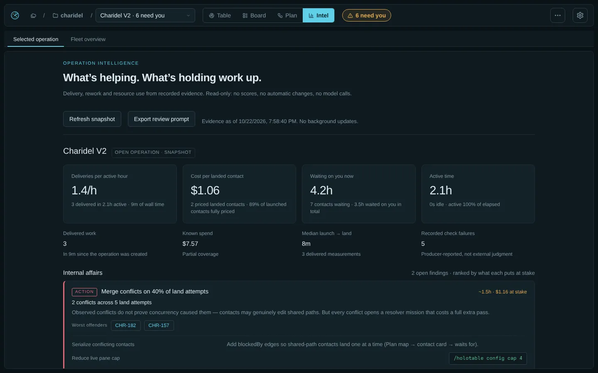
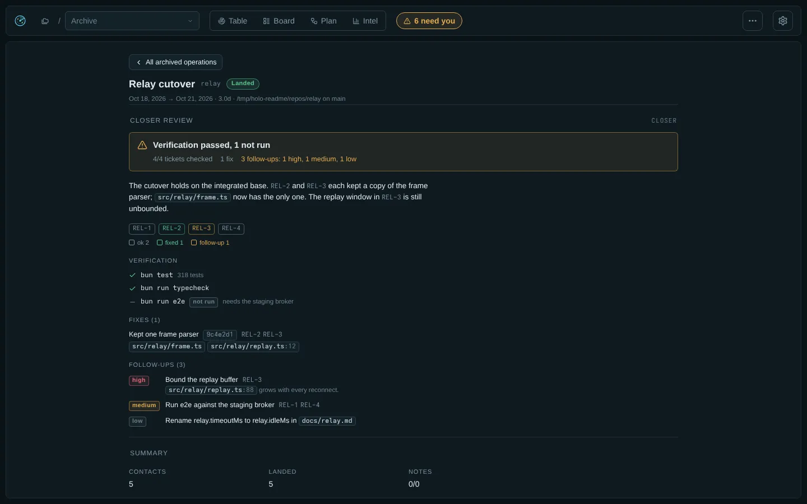

# Holotable guide

How to set up Holotable, create operations and run missions from the board. Commands and settings are in [reference.md](reference.md), landing rules in [landing.md](landing.md), and auto mode and Recovery in [automation.md](automation.md).

- [Set up](#set-up)
- [Create an operation](#create-an-operation)
- [The board](#the-board)
- [Run missions](#run-missions)
- [Decisions](#decisions)
- [Closer review](#closer-review)
- [End an operation](#end-an-operation)

## Set up

### Integrations

Install only what your projects use. The board can display and organize work with `none` adapters; launching missions requires a terminal frontend and `omp-mission` loaded in the child OMP sessions.

|Integration|Setup|
|---|---|
|Orca terminals and worktrees|Install Orca and its `orca` CLI. Set the repo's worktree folder in Orca's project settings.|
|Herdr terminals|Install and configure Herdr and its `herdr` CLI.|
|Custom terminals|Set the command templates in Settings → Custom frontend.|
|GitHub tickets or PR delivery|Install `gh` and run `gh auth login`.|
|Linear tickets|Install and authenticate `lin`; `lin me` should succeed.|
|Local-merge delivery|Git and a clean integration worktree; no hosting-service credentials needed.|
|Bead graph (server-mode beads)|The project page shows the repo's Dolt graph server and can put it under a supervised `beads-dolt-<project>` systemd user unit (pinned port, `Restart=always`, `dolt.auto-start: false` so no mission pane starts a copy the Orca reaper would kill).|

### Open the board from another machine

Default access is **Tailscale**, on port **4848** (or the next available port). Local URLs work without Tailscale. Settings → Server can restrict access to **This machine** or allow the **Network**. The full URL contains the API token: keep it private. HTTP is unencrypted; use a trusted network, Tailscale or an SSH tunnel.

### Getting started and the tour

A board with no operations opens on Projects with a **Getting started** card: checks of this machine (`GET /api/setup`: omp, the omp-mission extension, and the CLIs for the frontends and trackers in use, each with a fix to copy) and the first campaign as four steps (project, operation, contacts, launch) ticked off from real counts. **Hide** puts it away; Settings → Help → Getting started brings it back. The first visit also runs a short tour of the header (Esc skips, arrows step); Settings → Help → Take the tour replays it.

### Projects

**Projects** (the first breadcrumb in the header) is the top of the board: every project with its repo, base and operations (with what needs you), the standalone operations, and **New project**. The picker offers your existing projects' repos, every repo Orca knows, and repos where `/holotable` recently ran (`GET /api/repos`, deduplicated); pick or paste a repo and detection fills every field — name, base, integration, tracker, frontend, delivery, worktree folder — each with a one-line reason, all adjustable (`POST /api/projects/detect`; `POST /api/projects` with just `{repo}` does the same at create time). The second breadcrumb opens one project: its operations, its settings (changing one changes it for every operation that has not overridden it), the bead-graph server status when the repo is server-mode beads (Install puts it under the systemd unit; Restart bounces it), and Remove (only once no open operation uses it; the repo is never touched). An operation's own page only picks its project; the per-operation overrides are folded behind a one-line summary ("all from the project", or which fields differ). Boards from before projects existed are migrated once: operations are grouped by repo into one project each, seeded from the oldest operation, and keep only the fields that differ.

## Create an operation

### New operation

Picker → New operation. Choose the project, paste a source or rough goal into **What**, then **Draft it**. The drafting toolbar has a per-run model picker and a separate progress message. Review the generated name, brief, zones, contacts and notes before **Create**; drafting needs a terminal frontend and creates no operation by itself. **Finish with a closer review** (on by default, from `defaults.closer`) adds a [closer](#closer-review) as the last contact. **Keep missions running** (on by default) switches on [Recovery](automation.md#recovery) for the new operation. **Load a file** fills the seed JSON from a file instead of a draft. With no seed, **Create** makes an empty operation; add zones and contacts on its Operation page.

The brief has a full-width editor, markdown **Preview**, and **Review in focus** for a wide review
window with edit/preview and Save/Cancel. Draft completion fills both review views and preserves
brief text you have edited yourself.

Dependencies control eligibility, not map columns or prose numbering. Auto launch takes the first
ready contact in the saved queue; independent missions may run together, while hard prerequisites
and undecided decisions keep dependent contacts blocked.

### Draft from a plan or an idea

**Existing execution plan:** select the matching project, paste the document URL into **What**
and click **Draft it**. Linear documents are read with `lin docs get`; referenced issues and
relations supply live status and blockers. The agent is instructed to preserve parallel lanes,
explicit prerequisites, decisions, ownership boundaries and acceptance gates, not turn every
suggested ordering into a dependency. Review zones, contacts, `blockedBy` and the brief before
**Create**. Pasting a link without drafting does not import it.

**No tickets yet:** use a project with **Tracker → none** (for a new repo, open **Adjust**).
You can make a separate local project for the same repository rather than change a tracked
project's existing operations. Describe the goal, constraints and what success looks like in
**What**, then **Draft it**. The agent inspects the repo and proposes local mission ids, workstreams,
dependencies, acceptance checks and decision contacts for unresolved choices. No external tickets
are needed or created. Contacts have short titles and self-contained descriptions that carry
scope and acceptance checks; the brief records the campaign plan for review.

Drafting does not execute work or approve mission plans. After **Create**, each launched mission
develops its own detailed plan; approve it on the card's Plan tab or in its OMP pane.

With a ticket tracker, drafts use real fetched tickets only: the agent never invents ticket ids or
creates tracker issues. New unticketed work needs a local project or tickets you create first.
Check the draft: agent-generated dependencies and scope still need operator review.

### From the command line

`/holotable new` creates an operation from flags and an optional seed file (`--from file.json`, `--brief file.md`). See [Commands](reference.md#commands) and [Seed file](reference.md#seed-file).

## The board

The page has four views: three over one projection, and Intel. Each shows only what it is for; detail sits one tab or key away instead of on screen.

- **Table** (`1`): the radar and the selected contact's card. Zones are sectors; rings are lifecycle stages from the outside in (queued, planning, active, complete), so distance from the centre is progress. Contacts that need you pulse and are listed as chips across the top; selecting one draws its dependency chain. Move between orbs with **WASD**, **HJKL** or the arrow keys: each press goes to the nearest contact in that direction. One canvas: static when idle, about 30 fps with live missions or attention. Animation stops on other views, in a hidden tab, or with reduced motion.
- **Board** (`2`): the contact list, the card, and the operation panel (progress, notes and wiring). The list is ordered by what needs you: **Needs you**, **In flight**, **Queue**, and a collapsed **Landed**; each row is one line of title and one line of state, with the same next action the card leads with (Review plan, Approve, Switch model, Land, Launch, Mark decided, or Focus). An operation with no frontend or fleet shows its queue as **Blocked**, with the setting to change.
- **Plan** (`3`): compact dependency cards with state, ticket, a short title and a blocker cue, arranged by zone. Arrows show what waits on what (green once landed, red dashed for conflicts). Click to trace a chain and filter its history; double-click to open the full card. Its description is shown directly below the title, with no expand/collapse control.
- **Intel** (`4`): on-demand evidence for the operation in the picker (or an archived one), or the whole fleet; see [Holotable Intel](intel.md). Its code loads on the first visit, and it fetches evidence only when opened, switched or refreshed. Evidence continues to be collected whether Intel is open or not; the execution views stay focused on running work.

The Board view is shown in the [README](../README.md).

### Header, views and keys

The header has the project breadcrumb (opens the project page), the operation picker (grouped by project; below the list, New operation and a link to the Archive), the four view buttons, the needs-you and auto-mode pills (the auto pill opens the Operation page), base branch, load, note tasks done (hidden when the notes have no task lines), the connection dot and, rightmost, the settings gear. Hovering or focusing any control shows a tooltip saying what it does, and for a disabled one why it is off. On touch screens, tapping a pill, dot, chip or label toggles its tooltip and a long press on a button shows its tooltip without pressing it; tapping elsewhere or scrolling hides it. Hovering or focusing the Load stat instead shows live CPU and memory for the operation and the machine (plus all open operations when more than one is open) ; clicking Load pins a small CPU · MEM chip for the selected operation next to it, and clicking again hides it (`GET /api/usage`: /proc sampling, processes attributed by lane worktree; over 80% is tinted, over 95% marked bad). Simulated missions in the playground have no real processes, so attributed usage there reads zero while the machine line stays real.

Toggle views with the header buttons or `1 2 3 4` / `t b p i`. The Plan view has two sub-views (Map | Operation); `Shift+P` flips between them. Intel has two (Selected operation | Fleet overview). The view, its sub-view and the operation survive a reload; `/intel` (with the old `?op=`, `?archive=` or `?view=fleet`) opens the board on Intel.

- **Table**: radar with live pins inside the well and queued pins on the outer ring. Click a pin or use WASD/HJKL to select; Enter focuses its primary action.
- **Board**: what needs you, in flight and queued on the left (Add contact, at the foot of the Queue, queues a new ticket mid-flight; when the operation has a tracker, the Ticket field searches it, fills the title and marks tickets already on the board; Waits for picks from the operation's contacts); the selected contact's card in the middle; on the right the operation's progress, notes and wiring. When every contact has landed, Board and Table show a Close prompt.
- **Plan**: the dependency map with history beside it. Selecting a node focuses its chain and dims the rest; clicking it again or Esc undoes that.
- **Intel**: Selected operation reads the picker's operation; while Intel is shown the picker also lists archived operations. Fleet overview spans every source.

Keys (`?` or Settings → Help shows them): WASD/HJKL/arrows move, Enter moves focus to the card's main action and a second Enter presses it, `[` `]` cycle card tabs (Overview, Plan when one waits, Details, History), `1 2 3 4 t b p i` switch views, `Shift+P` toggles the Plan sub-view, `,` opens settings, Esc clears notices and focus. On Intel and the other pages, arrows scroll the page instead. Cmd/Ctrl+click on any ticket opens it at its tracker (or its pull request) in a new tab.

### The contact card

The card has three tabs (`[` and `]` switch): **Overview** (actions first, directly under the tabs, then progress, what happens next, the mission or closer report, what it waits for and unblocks, conflict links), **Details** (origin, kind, tracker, delivery, workers, branch, worktree, terminal) and **History** (every event for this contact, with who caused it). Land, Approve and the rest never sink below a long report.

### Mission reports

**Mission reports.** Once a mission has delivery or verification evidence its status carries a `report` ([contract](contract.md#mission-report-v1)): the delivery summary, verification outcome, work items done and open, review numbers (rounds, findings, repaired, rejected, deferred, escalated), follow-ups and the PR link. The card's **Overview** shows it, below the actions, as **Report** for complete and landed contacts of every kind, and as **Report · in progress** while a mission that already has one runs. Each pass saves a changed report to `reports/<ticket>.json`, so a landed contact whose pane was reaped still shows it.

### Feedback and controls

Destructive actions (Reap) need a second click. Disabled actions explain other refusals under the buttons; blocked contacts list prerequisites once, as navigable chips. Mission connectivity is a colored dot beside the card's state, with its status available on hover; only a contact still in play has one, so a landed or reaped contact, or any contact of a closed operation, shows none. Load shows measurements without instructional text. Results and failures appear as toasts; failures stay about 8 s and also go to the error inbox, a bell left of the settings gear (hidden while empty) whose badge counts unread errors. Opening it marks them read and lists them newest first with their time; Clear empties it, Esc closes it. The inbox lives only as long as the page. Keys are listed under [Views and keys](#header-views-and-keys). Below about 1440 px, base, load, tasks, the connection, Auto, the integration warning and the Intel button (which switches to the Intel view) fold behind a More button, which shows a warning dot while the connection is down or the integration checkout is dirty, so the header stays one row on laptops. Below about 760 px the header fits in two rows and the view toggle shows icons only. The Board then shows one panel at a time under List, Card and Progress tabs that stay at the top while the page scrolls: it opens on the List, tapping a contact opens its Card, and the List tab goes back to where the list was scrolled.

The gear at the right of the header opens a settings drawer for board-wide settings; settings for one operation live on its Operation page. Every control saves on change or blur and shows a brief "Saved" mark beside its title (the same on the project and Operation pages); a rejected value shows the server's message inline. Selects, switches and checkboxes use the page's controls; decision choices use native radio buttons. Dropdowns support arrows, Home/End and type-ahead, and a poll never closes an open one.

Submitting a mission action grays out that mission's controls across the list, card, Plan tab,
and mode picker until the response and a fresh board read arrive. Other missions remain usable.
Recovery dialogs show **Requesting…** and lock their model and targets while submitting.
Settings fields, project/operation creation, brief saves, and zone adds also disable their
submitting controls while waiting; rejected requests restore them. Request completion means
the command was acknowledged, not that the mission's background work has finished.

### Operation page

The operation as a document: once its closer has landed, the [closer review](#closer-review) heads the page; then brief (edit in place), notes, the auto-mode card (launch, land, max live, and the opt-in decide and approve-plans switches), setup (project and name; for a project's operation the rest folds behind a summary of overrides, each inherited field tagged "from project" and each override offering "use project value"; a standalone operation shows them all), zones (just a name; the id is derived) and contacts (Add contact, here or on the Board and the Plan map), the closer (its state, or **Add closer** when the operation has none), the seed it was created from (formatted, downloadable), and at the bottom **End the operation**: Close (once everything has landed) or Abort. Close opens the operation's archive report. Abort opens a dialog listing the panes it will close, the worktrees it will delete (dirty ones called out with their paths), then asks you to type the operation id.

On the Operation page, zone pills filter the contacts table; click again or **All** to clear.
Filters survive polls per operation, and contact kinds use themed colored pills.
Ticket clicks there (or Cmd/Ctrl+click elsewhere) open the tracker issue, never a delivery PR.
PR links remain under the card's Delivery details; local contacts have no tracker link.

### Notes

A markdown scratch pad per operation (`notes.md`), on the Operation page and in the Board sidebar. Task lines (`- [ ]` / `- [x]`) can be ticked in place and are counted in the header; nothing else reads them, so they never start or block missions. Saves carry the revision you loaded; if someone else saved first, the save is refused and your text stays in the editor to copy. Operations created before notes existed have their old checklist converted once.

### Archive

Picker → Archive. Closed and aborted operations, kept out of the picker: a list with outcome, close date and landed count, and a read-only report per operation led by its [closer review](#closer-review) when it had a closer, then summary counts, brief, every contact's result with issue and PR links, and the full history. Closing an operation from the page lands you on its report.

### Settings drawer

Board-wide only: Appearance (theme), Agents (cap), AI & Models (default model, reasoning effort and per-use defaults), Polling (seconds or milliseconds; stored in ms), Server (access, port and current URLs; changes rebind the board), After landing (cleanup), Defaults for new operations, Custom frontend templates (when used), and Help.

## Run missions

### Launch

Launch is a click on a ready contact. The board refuses first (decision tickets, blockers, `cap`, no frontend, no fleet), then runs: ensure the repo with the frontend, create a worktree on the operation's base, open a terminal running `omp` with `OMP_MISSION_AUTOSTART=/mission …` and a plan-mode overlay, then wait up to 90 s for the child's control socket. The child opens a pending plan and waits: its native plan review can be approved from the card's Plan tab or in the pane. Every step is written to the lane as it happens, so a failed launch resumes at the failed step instead of recreating anything. A contact whose socket never answered shows `offline`, with Focus and Reap.

Frontend commands, `cap` and **Reap** are described under [Frontends](reference.md#frontends).

### Review the plan

A contact with a pending plan shows a "Plan" tab (primary action "Review plan"). Edit and Save update the plan file with revision checks; Refine sends feedback through OMP's native plan review. **Approve plan** resolves that review with compacted context through the mission socket when advertised. Otherwise **Approve in pane** opens the mission; use `/plan-review`, or update and relaunch older OMP sessions. Native approval requires OMP 18.10.4 or newer.

### Answer questions and tool approvals

A question a mission asks appears under **Needs you** as **Question**. When the pane can take answers from the board, the card shows the full question and its options with the recommended one picked (checkboxes for multi-select), plus an **Other…** field for your own words. **Send answer** goes over the mission's control socket: omp-mission settles the pane's ask dialog exactly as if you had answered there, and the pane's copy closes. The board first re-reads the status and refuses (`stale`) if that question is gone or a different one is open. Panes started before this support show the question with **Answer in mission**, which brings the pane forward. Only an operator answers; auto mode and Recovery never do, and the board never resumes past a question. Plan approval is labeled **Plan**; verification holds are labeled **Verify**. All three stay in Needs you. Planning provider failures show their blocker instead of a misleading plan-approval prompt. Mission extensions load once per OMP process: panes started before question reporting was installed must be restarted to publish Ask dialogs; restarting only the board cannot update them.

A tool approval works the same way. When a mission pane stops on OMP's Approve/Deny prompt before running a tool (approval mode or a `tools.approval` policy asks), the contact shows **Question** under **Needs you**, and the card shows the tool, the command or summary, the full prompt, and one button for each of the pane's choices: **Approve**, any remembered grants or the for-this-session choice the prompt offers, and **Deny**. A click goes over the control socket, and omp-mission answers the pane's prompt exactly as that choice would. The board first re-reads the status and refuses (`stale`) if that approval is gone or a different one is open. Panes without this support (older omp-mission, or OMP before 18.11.3) show **Answer in mission**. Only an operator answers an approval. Auto mode and Recovery never do. Pause gates and plan approval are unchanged.

### Operator actions

The contact card shows the fleet buttons the mission itself offers (`Approve`, `Continue`, `Review`, `Dispatch`, `Resend`, `Release`, and a `Mode` select: auto, pause, force) and `Focus`. `Continue` appears only when the mission is actually stuck: a resume hold, quota park, or failed verification; with Recovery on, a plain resume hold is left to the board. Each button is one request to the owning session's control socket, sent as an operator action; the board never computes whether a transition is legal, so resume hold, plan mode and Pause gates apply exactly as when typing the slash command in the pane. `Approve` carries the id of the gate it was rendered for, and a gate that moved on fails as `stale`. A gone owner fails as `owner-offline` and changes nothing. Every action except `Focus` is recorded as an `operator` event, success or failure. A model turn in the board's own session can only read and queue: it has no tool that approves, continues or launches.

`Relaunch` appears on a contact whose session is `offline` while its lane still has a terminal (a pane that closed, a session that exited or died, or one that hung inside its pane). It closes the old pane if the frontend still lists it, opens a new one in the same worktree with the same launch command, and waits for the control socket. A mission that is already past its plan reopens **outside plan mode** (a resumed mission cannot continue while the session is in plan mode); one still waiting on a plan reopens in it and plans again. The new session re-attaches the saved mission under resume hold, so the card then shows `Continue`; nothing resumes until you press it (or [recovery](automation.md#recovery) does). A dead session holds no slot against the cap, so Relaunch replaces its own pane; it is disabled with the reason `cap <open>/<cap> omp` only when other live sessions fill the cap, and is not offered for a finished mission, a lane with no terminal, an `external` lane, or a `none` frontend. After **Reap**, Relaunch is the only way back.

Quota exhaustion is explicit: live panes show **Quota exhausted**, dead panes remain **Offline** with the last failure. On a mission parked on an exhausted quota, **Switch model** is the card's first action, because the producer-advertised retry (**Continue** for a coordinator park, **Review** for a failed review, or **Resend** for a stopped worker) only works once quota is back. When at least one mission can take a new model, a strip above the Board list names the stopped missions and opens the same dialog for all of them. The dialog shows each mission's model and what failed. When the same model is offered on another subscription with reported quota left (`anthropic/claude-sonnet-5-5` → `google-antigravity/claude-sonnet-5-5`), it presets the picker to the one with the most quota and says so. Otherwise it presets nothing: a different model is your call, and unknown capacity is no promise. Picking a model moves focus to **Switch & retry**, so the keyboard flow is Enter, type, Enter, Enter, and the dialog closes once every checked mission accepted the switch. Each checked mission gets the model for its coordinator, future workers and reviews, and only its failed work is retried. Running workers, finished review targets, bead claims and edits are kept; gates, resume holds and failed verification are not cleared, and missions not advertising `retry-model` stay unchecked with the reason. Recovery and auto mode never send it. Reload/relaunch older mission panes to load updated producer code; no mission/status-file edits are needed.

The board loads the model catalog (`omp models`) when it starts and answers pickers from memory afterwards. A refresh runs in the background, and a failed refresh keeps the last good list. Under the service's CPU quota, one `omp models` run takes several seconds.

A live mission advertising `resend` has a stopped worker and shows **Hold**, not
**Running**. Its **Resend** button asks the producer to retry; **Release** appears
only when the producer offers it. Recovery never sends either action automatically.

Active independent reviews show **Review**. Failed reviews requiring an operator show **Failed**, **Rate limited**, or **Quota exhausted** in Needs you; automatic cooldowns show under **Waiting**, not In flight, with their retry time and retained-review counts. The card exposes full provider error details when the producer supplies them. Older running panes' next-step text still identifies failures and scheduled waits, but their full structured evidence requires updated producer code.

### Blocked queue

A contact with unmet blockers stays in the queue, visible and unlaunchable (`blocked by <ticket>`), and never disappears. A blocker counts only when it has a `landed` event: a mission reaching `complete` does not unblock its dependents. `landed` is written by Land (or by **Mark done**, for decision contacts and code work the delivery verifies is already merged). When a contact's last blocker lands the watcher records `unblocked` once.

An audit mission delivers no PR. When an audit finishes with commits that are not in the base and no PR exists, **Mark done** (and auto mode) opens one from its branch through the delivery (`gh pr create`) and reports `pr-opened`, instead of refusing forever. The PR description carries the mission's saved report (summary, follow-ups); for a closer, its review's summary, fixes and follow-ups, plus its `prNotes` verbatim: lines the repo's own policy requires in a PR description (a `Guardrail-change:` marker, say), which the closer is told to look up in the repo's contribution rules and CI workflows. From then on, Land handles it like any other PR: checks, the up-to-date gate and the merge.

**Hands off.** The selected contact's status box shows **Hands off · <reason>** when nothing there is yours to do. That covers a mission working on its own, a plan it is still writing, a contact waiting on its own conflict mission, and an automation switched on for the next step: auto mode landing it, waiting for CI before it lands, approving its plan, the mission fixing its PR, a scheduled review retry, or Recovery restarting or continuing it. Such contacts drop out of **Needs you**. The banner never appears for a mission's question, a Pause gate, a decision auto mode does not make, red CI with no fix under way, or a step whose automation is off.

**Idle in its pane.** A mission whose coordinator ended its turn and has sat idle for 3 minutes, with no workers, review, verification or scheduled retry running for it, is not working on its own: it most likely stopped to ask you something in plain text. It moves to **Needs you** with the time it went idle, and **Focus** takes you to its pane. Normal waits (workers running, a review in progress, a retry scheduled) never flag. Needs `omp-mission` with coordinator reporting; older panes never flag.

## Decisions

A `decision` contact never launches: it sits in the queue until someone chooses. **Mark decided** records a `decided` event (`choice`, optional `rationale`, `by: "operator"`) and lands the contact; on a landed one, **Change decision** (`redecide`) records a new `decided` that replaces the old choice while dependents stay unblocked. Options come from `options` (2–8 short strings) plus an optional `recommended`, set when the contact is added — `/holotable add <ticket> --kind decision --option "Migrate ACS data" --option "Start fresh" --recommended "Migrate ACS data"`, `POST /api/contacts`, `holotable_queue`, or the seed — and shown on the card. With options the choice must be one of them; without, it is free text (blank counts as `decided`).

The card and confirmation dialog show native radio options with keyboard arrow navigation. New decisions have **no implicit selection**. **Pick recommended** is the top-level shortcut: it selects an option but records nothing until **Mark decided** confirms it, with optional reasoning. Card selection survives a poll. **Change decision** keeps the existing choice and reasoning until edited. A dialog stays bound to its original operation even if another operator archives it; a failed save stays open with the server error and enabled controls.

**Ask an agent** (`decide-agent`) opens a lane-less `omp` pane in the operation's integration checkout — read-only, briefed with the question, options, brief, notes and earlier decisions — that writes `decisions/<ticket>.json` under the operation directory and stops. The watcher lands the contact with `by: "agent"` and closes the pane; an unreadable answer is recorded once and left for you to fix or close, and a pane that exits without answering fails as `pane closed before deciding`. The pane counts toward `cap` like a live mission. With `auto.decide` on, auto mode lands each ready decision on its `recommended` option (`by: "recommended"`); without one it opens the agent pane itself, still respecting `auto.maxLive` and `cap`.

## Closer review

A `closer` is an operation's last contact: once every other contact has landed, a mission checks the integrated work as a whole, fixes small integration problems through the normal delivery and reports anything bigger as follow-ups. An operation has at most one. New operations get one by default (`defaults.closer`, the New operation switch, `new --closer`/`--no-closer`); add one later with `/holotable add closer [ticket]`, **Add contact** (kind **Closer**, disabled once the operation has one) or **Add closer** on the Operation page, which also shows whether the operation has a closer.

**It waits for everything.** A closer lists no `blockedBy` and nothing may wait on it. It stays blocked until every other contact has a `landed` event (decided decisions count; a conflict mission is part of its target's landing, so an abandoned one never holds it back), including contacts added after it. Its detail reads `Waits for the rest of the operation to land (N left)`, and the Plan map draws it in its own column after every zone, without an arrow from each contact.

**What it is told.** At launch the board builds a review brief from what it knows: the operation's name and brief, the notes checklist (done and open items), every landed contact with its PR or branch and landing time, decisions with their choice and rationale, conflict missions and their paths, the base branch, and Intel's top three open recommendations. Lists are capped with the number left out. The brief asks the mission to fetch the base and run the repo's full verification on the integrated result; review the combined change set for duplicated helpers, inconsistent APIs or naming, leftover TODO/FIXME/debug code, dead code from superseded approaches, docs that disagree with code and missing tests at the seams between contacts; check the brief's acceptance criteria and every checklist item; fix small problems on its own branch; report larger ones as follow-ups without building them; never rewrite or revert landed history; and, when nothing needs fixing, deliver no changes and say so with evidence. Before launch the card's **Details** tab shows the brief as it would be built now.

**How it runs.** A freeform `/mission -- Closer review of operation <name>` with the brief as additional instructions, in a `closer-<token>` worktree on the bead graph. Its delivery is always local: omp-mission's PR delivery needs a real PR URL, which a closer with nothing to fix cannot have. The brief lists every landed ticket and asks for a JSON report at `closer/<ticket>.json` in the operation's directory ([format](contract.md#closer-report-v1)): a summary, the verification commands it ran with their outcomes, one verdict per ticket (`ok`, `fixed`, `follow-up` or `not-checked`, each with an optional note), its fixes and its follow-ups. A Markdown copy at `closer/<ticket>.md` is optional.

**What the card shows.** Once it has run, the closer's **Overview** (below its actions) leads with a headline banner: the verification result (`All verification passed (3)`, `Verification passed, 1 not run`, `2 verification commands failed`), coverage (`42/45 tickets checked`, with how many the report left out), fixes and follow-ups by severity; red when a command failed or a ticket went unreported, amber when something was not run, not checked or a high follow-up is open. The banner is the review's only box and the only place its outcome colour fills. Then, one column with even spacing: the summary, one chip per landed ticket by verdict (`ok` stays neutral, `fixed` green, `follow-up` amber, `not checked` dashed grey, `not reported` dashed red; click a chip for its note and a link to its card), verification as a checklist, fixes (title, files as path chips, short commit, tickets) and follow-ups, high first, each with its severity in a column of its own so the titles line up. Ticket chips open that contact's card. A report that is not valid JSON or not v1 says so on the card. An older closer's Markdown report still shows when there is no JSON, formatted by convention: Checked/Verification/Gates, Fixed, Follow-ups, Findings and Summary sections (numbered or not) as sections split by a rule (no nested boxes); `PASS`, `FAILED`, `NOT RUN`, `OK`, checkboxes and check/cross/warning marks as coloured badges; `critical`/`high`/`medium`/`low` labels (`[high]`, `High:`, capitals) and `P0`–`P3` as severity badges; `path/to/file.rs:123` and backticked paths as code chips; commit shas as short chips; the operation's tickets as links; tables styled, commands kept whole and results wrapping between words; fenced output past 12 lines folded. Prose keeps a readable line length. The same review heads the Operation page once the closer lands and the [archive](#archive) report once the operation is closed.

**Finishing.** Like an audit: with no changes, **Mark done** checks its branch is already in the base and records it landed; with commits and no PR, Mark done opens one (`pr-opened`) and Land takes it through the usual checks and conflict handling; on `local-merge` its branch lands like any other. Auto mode launches it when it turns ready and lands or marks it done like other work, under every existing gate. The operation is finished (auto mode switching itself off, the done banner, **Close**) only once the closer has landed too.

## End an operation

Two ways, one path. **Close** (the End card on the Operation page, the done banner, or `/holotable close`) is for a finished operation; outcome `landed` is refused while any contact is unlanded. Its dialog lists, from the same preview Abort uses, what Close does: the mission panes it closes (count and tickets), how many clean worktrees it removes, the worktrees it keeps because they have uncommitted changes (by ticket and path), that auto mode and Recovery go off, and that the operation moves to the archive with its report and closer review, leaving the picker with no reopen. It also says what Close does not touch: git branches, PRs, Linear issues, the base branch and the integration checkout. **Abort** shows its own preview — the terminals it will close and the worktrees it will delete, each flagged dirty when `git status --porcelain` is non-empty — and then requires you to type the operation id. Both run the same wind-down: auto mode and Recovery are switched off first, then every contact's recorded terminal is closed (a terminal already gone counts as reaped) and every non-external worktree is removed. Close keeps a worktree that is dirty or that git cannot read and records the skip; abort removes it even with uncommitted changes. A failure is recorded as an `operator` event and never stops the wind-down.

The archive keeps everything the operation had — `operation.json`, `events.jsonl`, `brief.md`, `seed.json`, the closer's `closer/` files and the saved `reports/` — plus `report.json`: outcome, per-contact final states (`landed`, `aborted`, `not-launched`) with where each landing went (`landedVia`, tracker and PR URLs), counts (contacts, landed, conflicts, launches, land attempts), the full stats, the note task tally and the notes, and the first 2000 characters of the brief. Archives are browsable from the picker's Archive link; an archive written before reports existed still shows one, rebuilt on read.
